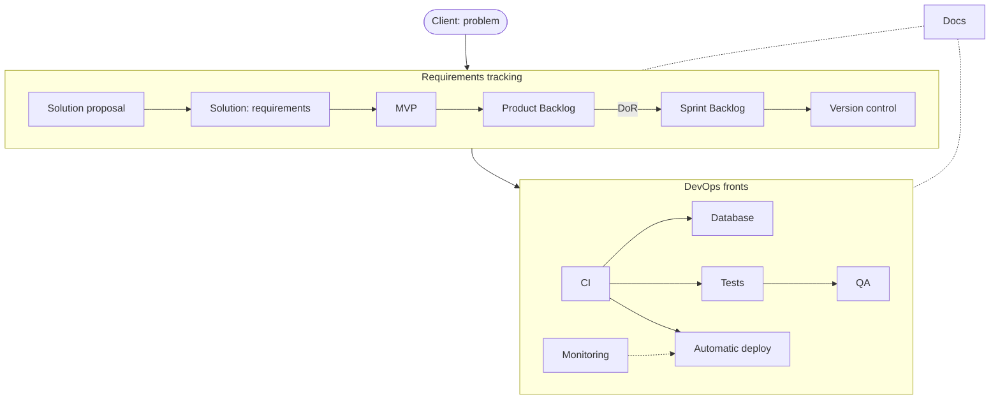

# DevOps

This documentation records Ratio's DevOps process front by front. For each front, it says:

- **who built** each part and what access whoever takes over needs;
- **how it works**: what exists, what triggers each step and what it delivers;
- **why it was built that way**: each decision, with its context and alternatives;
- **how to operate it**: the procedures, the signs that it is healthy and what to do when it breaks.

**The goal is that another team can carry on the project without the team that built it.**

The process goes from the client's need to the client's server: the requirement goes through the
backlog and the sprint, becomes code, is integrated, tested and validated, is published and
installed, and keeps being monitored afterwards. Developing is not the same as doing DevOps: DevOps
is this whole process, made of people, processes and tools.

See the portuguese(br) version [here](../pt_br/DevOps/README.md).

## Contents
- [The process](#the-process)
- [Fronts](#fronts)
- [The role of documentation in DevOps](#the-role-of-documentation-in-devops)
  - [How documentation helps the process](#how-documentation-helps-the-process)
- [Foundations of the template](#foundations-of-the-template)
- [How to maintain this documentation](#how-to-maintain-this-documentation)
  - [Structure](#structure)
  - [The template of each front](#the-template-of-each-front)
  - [Writing rules](#writing-rules)
  - [Flow to create and update a doc](#flow-to-create-and-update-a-doc)
- [Bibliography](#bibliography)

## The process

The process starts before the code, in requirements tracking, and ends on the client's server. The
DevOps fronts come in from version control onwards, and the Docs front runs through every stage,
because each one needs to be recorded to keep existing without whoever built it.



| Stage | What happens in Ratio | Where it is documented |
| --- | --- | --- |
| Requirements tracking | the client's problem becomes requirements, the MVP becomes the Product Backlog, and a story only enters the sprint when it meets the DoR | [Product Backlog](../../README.md#product-backlog), [Acceptance Criteria](../Scrum/acceptance-criteria.md), [DoR](../Scrum/definition-of-ready.md), [Task Model](../Scrum/task-model.md), [Sprint Backlog](../../sprint4/sprint-backlog.md) |
| Version control | each task becomes a branch and a PR, following the team's branch and commit patterns | [How to contribute](../../README.md#how-to-contribute) |
| CI | every PR and every merge go through tests, quality analysis and end-to-end validation, and `main` produces the versioned release | [CI](ci/README.md) |
| Database | the schema only changes through migrations, and the load is validated against it | [Database](database/README.md) |
| Tests | the API's unit and integration tests run on every change | [Tests](tests/README.md) |
| QA | the [DoD](../Scrum/definition-of-done.md), the PR checklist, the API contract and the QA Radar check what was delivered | [QA](qa/README.md) |
| Deploy | the release is installed on staging and on the client's server | [Deploy](deploy/README.md) |
| Monitoring | metrics, logs and traces show whether what was installed is healthy | [Monitoring](monitoring/README.md) |
| Docs | records every stage above | this README |

## Fronts

| Front | Built by | Doc | Doc task |
| --- | --- | --- | --- |
| CI | `victorgsnogueira` | [ci](ci/README.md) | [DVP-79](https://github.com/Concord-API/API-5/issues/409) |
| Deploy | `IsaacOliveiraSouza` | [deploy](deploy/README.md) | [DVP-80](https://github.com/Concord-API/API-5/issues/410) |
| QA | `RichardCordeiro` | [qa](qa/README.md) | [DVP-81](https://github.com/Concord-API/API-5/issues/411) |
| Monitoring | `thiagosabreu` | [monitoring](monitoring/README.md) | [DVP-82](https://github.com/Concord-API/API-5/issues/412) |
| Tests | `vp-p` | [tests](tests/README.md) | [DVP-83](https://github.com/Concord-API/API-5/issues/413) |
| Database | `JoaoBaranov` | [database](database/README.md) | [DVP-65](https://github.com/Concord-API/API-5/issues/376) |
| Docs | `joaoandrade17` | this README | [DVP-84](https://github.com/Concord-API/API-5/issues/414) |

## The role of documentation in DevOps

Each DevOps front in Ratio was built by one person. What that person knows and has not written
down (why a job only runs on `main`, what to do when the load fails, which exception was accepted
and why) is **tacit knowledge**: it exists only in their head and leaves the project with them.
Nonaka and Takeuchi (1995) call the conversion of that knowledge into explicit knowledge, which
others can read, discuss and reuse, externalization. The documentation of each front is that
externalization.

Sharing is also one of the pillars of DevOps itself: it is the S in CAMS (*Culture, Automation,
Measurement, Sharing*), proposed by John Willis and Damon Edwards and described by Willis (2010).
And DORA's research shows that documentation is not separate work from the technical practices: in
the 2022 State of DevOps report, the effect of every technical practice studied on organizational
performance was much greater in teams with above-average documentation (for example, for
continuous integration, 750% against 34% in teams below average) (DORA, 2022).

The Agile Manifesto values "working software over comprehensive documentation" (Beck et al.,
2001), and this template follows that idea: it does not try to document everything. Each front
answers the same nine questions, the ones another team needs answered to carry on the work, and the
rest stays in the code, which is the source of truth.

### How documentation helps the process

| Risk to the process | What the template does |
| --- | --- |
| Whoever built the front leaves the project | the **Carrying on** section records what was left halfway and the access needed, and the table at the top says who built it |
| A decision is undone without anyone knowing why it was made | the **Decisions** section keeps the context, the alternatives and the consequences of each choice |
| Something breaks during delivery or in production | the **How to** and **Known issues** sections hold the ready-made procedure, with how to check and how to undo |
| Each front is documented a different way | all of them follow the same [`template.md`](template.md), and whoever read one knows where to find everything in the others |
| The documentation goes out of date | it lives in the same repository as the process, changes through PRs and is reviewed by the front's owner |

The template covers the three elements of DevOps: the **people** in the table at the top and in
the Carrying on section, the **processes** in How it works, Decisions and How to, and the **tools**
in What exists.

## Foundations of the template

The template was not invented from scratch: each part comes from a recognized reference on
technical documentation or systems operation, chosen for the problem it solves here.

### Diátaxis

**What it is:** a system by Daniele Procida that splits technical documentation into four types,
according to the reader's need: tutorials, how-to guides, reference and explanation (Procida, n.d.).

**Why it was chosen:** the most common cause of hard-to-use docs is mixing those types: an
explanation in the middle of a procedure, a list of files inside running text. Diátaxis gives the
criterion to separate them, and each section of the template has a single type.

**In the template:** **Overview** and **How it works** are explanation, **What exists** is
reference and **How to** is a how-to guide. There is no tutorial, because whoever carries on the
project is a development team that already knows the tools and needs to understand, look up and
execute, not to learn from the start.

### Architecture Decision Records (ADR)

**What it is:** the format proposed by Michael Nygard to record each important decision with its
context, the decision and its consequences (Nygard, 2011).

**Why it was chosen:** Nygard shows that someone joining a project without knowing the reason for
a decision has only two options, accept it without understanding it or change it without knowing
what will break. That is the risk of a new team taking over Ratio.

**In the template:** the **Decisions** section, with the context, alternatives, reason and
consequences of each choice.

### The Good Docs Project

**What it is:** an open community of technical writers that maintains documentation templates
tested in open source projects (The Good Docs Project, n.d.).

**Why it was chosen:** instead of inventing the structure of a procedure, the template uses that of
templates already validated by the community. The *how-to* template defines a procedure as
numbered steps for a single task, and the *troubleshooting* template, as symptom, cause and fix.

**In the template:** the format of each task in **How to** and the **Known issues** table.

### Runbook (Google's Site Reliability Engineering)

**What it is:** the operating procedure written before it is needed, a practice described in
Google's Site Reliability Engineering book.

**Why it was chosen:** according to the book, recording best practices ahead of time in a
*playbook* improves the mean time to repair (MTTR) roughly threefold compared with improvising
(Beyer et al., 2016). During delivery to the client and in production, whoever runs a procedure
cannot depend on memory.

**In the template:** in **How to**, the "Before you start", "How to check" and "How to undo"
blocks; and the **How to tell it is working** section.

### Google developer documentation style guide

**What it is:** the public style guide Google uses for its developer documentation (Google, n.d.).

**Why it was chosen:** it gives concrete, checkable rules instead of "write well": active voice,
short sentences, the imperative in procedures, one action per step and code names in code font.
Checkable rules make the review in the PR objective.

**In the template:** [writing rules](#writing-rules) 4 to 6.

### Docs as code

**What it is:** the practice of treating documentation as code: it lives in the repository, is
written in plain text, changes through PRs and goes through review (Write the Docs, n.d.).

**Why it was chosen:** the documentation follows the process it describes, has a version history
and is reviewed by whoever knows the front. It is the same PR and review flow the team already uses
for code.

**In the template:** the folder in API-5, the mermaid diagram (text that GitHub renders), the PR
[flow](#flow-to-create-and-update-a-doc) and writing rules 8 and 9.

## How to maintain this documentation

### Structure

```
Docs/DevOps/          (English)
Docs/pt_br/DevOps/    (Portuguese)
├── README.md         this index
├── template.md       the blank template of each front
├── ci/
│   └── README.md     the front's doc
├── deploy/
├── qa/
├── monitoring/
├── tests/
└── database/
```

- Each front is a folder with a `README.md`. On GitHub, opening the folder already shows the doc.
- An extra file in the folder only for a long procedure (more than 10 steps), and the front's
  `README.md` links to it in the **How to** section.
- Folder and file names in English, lowercase, with hyphens.
- `Docs/DevOps/` and `Docs/pt_br/DevOps/` have the same folder and file names.

### The template of each front

Every front follows [`template.md`](template.md): the same 9 sections, in the same order. For a new
front, copy the template to `<front>/README.md`. The template's `<!-- -->` comments explain what
goes in each section and do not show on GitHub.

| Section | What it answers | Foundation |
| --- | --- | --- |
| Overview | the front's role in the process, who it talks to and what breaks if it stops | [Diátaxis](#diátaxis): explanation |
| What exists | everything the front created or configures, and where it is | [Diátaxis](#diátaxis): reference |
| How it works | what triggers it, the order of the steps, what goes in and what comes out | [Diátaxis](#diátaxis): explanation |
| Decisions | each choice with its context, alternatives, reason and consequences | [ADR](#architecture-decision-records-adr) |
| How to | the tasks of whoever carries on, with before you start, steps, how to check and how to undo | [Good Docs Project](#the-good-docs-project) and [runbook](#runbook-googles-site-reliability-engineering) |
| How to tell it is working | the checks and signals that prove the front is healthy | [runbook](#runbook-googles-site-reliability-engineering) |
| Known issues | symptom, cause and what to do | [Good Docs Project](#the-good-docs-project) |
| Carrying on | what was left halfway, the accepted limitations, the improvements and the access needed | the goal of the documentation: another team carrying on the project |
| References | the tasks, the PRs and the official documentation of the tools | — |

### Writing rules

1. Every front has the 9 sections, in the same order. A section with no content says "Not
   applicable" and why, and is never deleted.
2. Extra content goes in as a subsection (`###`) of a template section, never as a new section.
3. Everything mentioned links to where it is: a relative link inside API-5, a full link to the
   other repositories.
4. File, workflow, job, command, field and variable names in backticks, exactly as in the code.
5. Numbered steps, one action per step, with the exact command and the expected output.
6. Short sentences in the active voice. In procedures, the imperative, addressing whoever runs
   them.
7. Never the value of a secret, password, token or key: only its name and where it is configured.
8. Diagrams in mermaid (GitHub renders them and anyone can edit them), not as images.
9. The official DevOps documentation is the one in this repository, and it only changes through a
   PR reviewed by the front's owner.
10. A Portuguese and an English version with the same structure, each linking to the other.

### Flow to create and update a doc

1. The SM sends the front's owner the [prompt](#prompt-for-the-fronts-owner) below, already filled
   in with the tasks and the topics of the doc task.
2. The owner runs the prompt in the AI that has the context of their work, reads the answer,
   fixes what is wrong and sends it back to the SM. This is the plain doc: topics and facts, with
   no formatting.
3. The SM writes the doc in the template, in Portuguese and in English, on a
   `RATIO-DOCS-<Front>` branch, and opens the PR to `main`.
4. The front's owner reviews the content in the PR.
5. Merge, and the doc task moves to Done.

The knowledge leaves whoever built the front (step 2), takes the template's common shape (step 3)
and goes back to whoever built it to check that nothing was lost (step 4).

#### Prompt for the front's owner

The SM fills in what is between brackets before sending it. Section 10 of the answer does not go
into the doc: it holds the questions the SM settles with the front's owner before writing.

<details>
<summary>See the prompt</summary>

```text
I am [NAME], responsible for the [FRONT] front of the DevOps of the Ratio project (Concord-API
organization on GitHub: API5-Backend, API5-Frontend, API5-Pipeline and API-5). The team's SM will
write the official documentation of this front in the API-5 repository. It must be enough for
another team to carry on the project without any of us.

You already have the context of what I did. Use that context and check the code and the
repositories before stating anything.

Tasks of this front: [DVP-xx, DVP-yy, ...]

The documentation must cover at least:
[TOPICS, copied from the Data: lines of the doc task]

Answer in English, in Markdown, with exactly the sections below, in this order. It does not need
polished text: short topics and facts. The SM formats it afterwards.

## 1. Overview
What the front does, where it comes in on the way from the code to the client's server, which
other fronts it depends on or talks to, and what breaks if it stops.

## 2. What exists
One line per item: name | repository and path (or where it is configured) | what it is for.
Include workflows, jobs, scripts, configuration files, services, dashboards, ports, URLs,
secrets and variables (secrets and variables by name only, never the value).

## 3. How it works
What triggers it, the order of the steps, what goes in and what comes out. If there are more than
three steps, include a mermaid diagram.

## 4. Decisions
For each relevant choice (tool, approach, rule, accepted exception): decision | context or
problem | alternatives considered | why this one | consequences.

## 5. How to
The tasks whoever carries on will need to do (for example: run locally, change something, install
on the server, recover from a failure). For each one: when to use it | before you start (access,
tools, versions) | numbered steps with the exact command and the expected output | how to check |
how to undo.

## 6. How to tell it is working
The checks, commands, dashboards or signals that prove the front is healthy.

## 7. Known issues
symptom | cause | what to do. Include the errors that already happened during the project.

## 8. Carrying on
What was left halfway, the accepted limitations, the improvements you would make and the access
whoever takes over needs to have.

## 9. References
Tasks and PRs with their number, and the official documentation of the tools with the version
used.

## 10. Not confirmed
Everything you could not check in the code or the repositories, and the questions only I can
answer.

Rules:
- Only facts that are in the code, in the repositories or that I confirmed. If you do not know,
  write "I don't know". Do not fill in with what is common in other projects.
- File, workflow, job, command, field and variable names in backticks, exactly as in the code.
- Never include the value of a secret, password, token or key.
- Every person mentioned goes by their GitHub login (e.g. `JoaoBaranov`), not only their first
  name.
- A section with no content: write "not applicable" and why.
```

</details>

## Bibliography

- BECK, Kent et al. **Manifesto for Agile Software Development**. 2001. Available at:
  <https://agilemanifesto.org/>.
- BEYER, Betsy; JONES, Chris; PETOFF, Jennifer; MURPHY, Niall Richard (eds.). **Site Reliability
  Engineering: How Google Runs Production Systems**. Sebastopol: O'Reilly, 2016. Ch. 1. Available
  at: <https://sre.google/sre-book/introduction/>.
- DORA. **Documentation quality**. Data from the 2022 Accelerate State of DevOps report.
  Available at: <https://dora.dev/capabilities/documentation-quality/>.
- GOOGLE. **Google developer documentation style guide**. Available at:
  <https://developers.google.com/style>.
- NONAKA, Ikujiro; TAKEUCHI, Hirotaka. **The Knowledge-Creating Company: How Japanese Companies
  Create the Dynamics of Innovation**. New York: Oxford University Press, 1995.
- NYGARD, Michael. **Documenting Architecture Decisions**. Cognitect, Nov. 15, 2011. Available at:
  <https://cognitect.com/blog/2011/11/15/documenting-architecture-decisions>.
- PROCIDA, Daniele. **Diátaxis: a systematic approach to technical documentation authoring**.
  Available at: <https://diataxis.fr/>.
- THE GOOD DOCS PROJECT. **Templates**. Available at:
  <https://www.thegooddocsproject.dev/template>.
- WILLIS, John. **What DevOps Means to Me**. 2010.
- WRITE THE DOCS. **Docs as Code**. Available at:
  <https://www.writethedocs.org/guide/docs-as-code/>.
