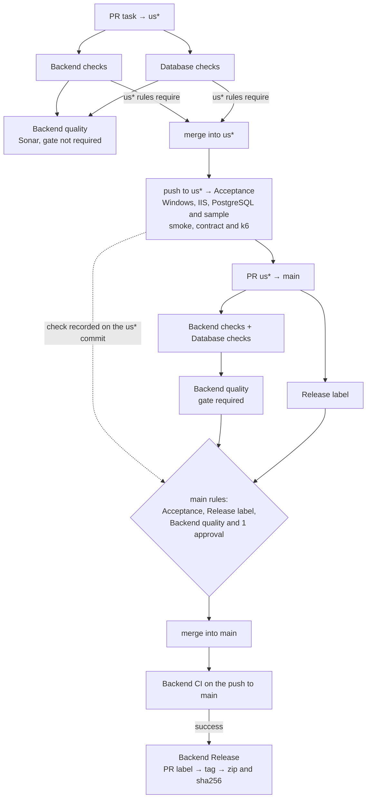

# CI

Continuous integration tests, measures the quality of and validates end to end every code change,
lets into `main` only what passed and, after the `main` CI, publishes the versioned release that is
installed on the client's server.

See the portuguese(br) version [here](../../pt_br/DevOps/ci/README.md).

| | |
| --- | --- |
| Built by | `victorgsnogueira` |
| Repositories | [API5-Backend](https://github.com/Concord-API/API5-Backend), [API5-Frontend](https://github.com/Concord-API/API5-Frontend), [API5-Pipeline](https://github.com/Concord-API/API5-Pipeline) |
| Tasks | [DVP-01](https://github.com/Concord-API/API-5/issues/247), [DVP-02](https://github.com/Concord-API/API-5/issues/248), [DVP-03](https://github.com/Concord-API/API-5/issues/249), [DVP-04](https://github.com/Concord-API/API-5/issues/250), [DVP-12](https://github.com/Concord-API/API-5/issues/181), [DVP-32](https://github.com/Concord-API/API-5/issues/279), [DVP-33](https://github.com/Concord-API/API-5/issues/280), [DVP-41](https://github.com/Concord-API/API-5/issues/297), [DVP-59](https://github.com/Concord-API/API-5/issues/370) |
| Updated on | Nov 26, 2026 |

## Overview

Every change goes through four gates before it becomes a release:

1. **PR from the task branch to `us*`:** the repository's CI runs the tests, the coverage, the
   lint and the formatting, and the build.
2. **Push to `us*`** (the task merge): the `Acceptance` workflow brings up the API, the frontend,
   the database and the sample load on Windows with IIS, and runs the smoke test, the contract test
   and the k6 load test.
3. **PR from `us*` to `main`:** the CI runs again, now with the Sonar quality gate required,
   together with `Release label` and the `Acceptance` already recorded on the `us*` commit.
4. **Push to `main`:** the CI runs again and, if it passes, the release workflow publishes the
   version on GitHub Releases.

The installation on the client's server uses the release zip and belongs to the
[Deploy](../deploy/README.md) front.

Who the CI talks to:

- **Backend and Frontend:** each one's `Acceptance` checks out the other repository on the branch
  with the same name, or on `main` if it does not exist.
- **Pipeline:** the `Pipeline compatibility` job publishes the Backend API and checks that the
  load generated by the pipeline is accepted by a database migrated by the API.
- **[Database](../database/README.md) (`JoaoBaranov`):** the schema fixture drift detection
  (DVP-63 and DVP-67) runs inside `Pipeline compatibility`.
- **[Monitoring](../monitoring/README.md) (`thiagosabreu`):** the same `acceptance/k6/load.ts` is
  used against staging by DVP-60.
- **[QA](../qa/README.md) (`RichardCordeiro`):** the contract test `npm run test:contract`
  (DVP-08) runs inside `Acceptance`.
- **[Deploy](../deploy/README.md) (`IsaacOliveiraSouza`):** uses the Backend, Frontend and load
  releases on the server.
- **SonarQube Cloud:** organization `concord-api`.

What breaks if the CI stops:

- `main` loses its automatic gate. The rulesets require checks that only these workflows produce,
  and if a workflow disappears the PRs to `main` get stuck waiting for the check.
- No automatic Backend or Frontend release comes out, because `release.yml` depends on the `main`
  CI.
- Nobody notices if a new migration broke the pipeline, because `Pipeline compatibility` stops
  running.

## What exists

### Workflows and jobs

| Item | Where it is | What it is for |
| --- | --- | --- |
| Workflow `Backend CI` | [`API5-Backend/.github/workflows/ci.yml`](https://github.com/Concord-API/API5-Backend/blob/main/.github/workflows/ci.yml) | backend CI (.NET) |
| Job `Backend checks` (id `tests`) | same | locked restore, `dotnet format`, Release build, application tests with coverage and win-x64 `dotnet publish` |
| Job `Database checks` (id `database`) | same | `Ratio.Infrastructure.Tests` and `Ratio.Api.IntegrationTests` tests against a disposable PostgreSQL, with coverage |
| Job `Backend quality` (id `quality`) | same | SonarQube Cloud analysis with the coverage of the two previous jobs; waits for the quality gate |
| Workflow and job `Acceptance` | [`API5-Backend/.github/workflows/acceptance.yml`](https://github.com/Concord-API/API5-Backend/blob/main/.github/workflows/acceptance.yml) | brings up the API, frontend, PostgreSQL and IIS on Windows with the sample load; smoke, contract and k6 |
| Workflow `Backend Release`, job `Publish release` | [`API5-Backend/.github/workflows/release.yml`](https://github.com/Concord-API/API5-Backend/blob/main/.github/workflows/release.yml) | publishes the backend release after the `main` CI |
| Workflow and job `Release label` | [`API5-Backend/.github/workflows/release-label.yml`](https://github.com/Concord-API/API5-Backend/blob/main/.github/workflows/release-label.yml) | requires exactly one `release:*` label on the PR to `main` and comments the version that will come out |
| Workflow `Frontend CI` | [`API5-Frontend/.github/workflows/ci.yml`](https://github.com/Concord-API/API5-Frontend/blob/main/.github/workflows/ci.yml) | frontend CI (Node and Vite) |
| Job `Frontend checks` (id `checks`) | same | `npm ci`, `format:check`, `lint`, `typecheck`, `test:ci` with coverage and `build` |
| Job `Frontend quality` (id `quality`) | same | Sonar with the previous job's coverage; waits for the gate |
| Workflow and job `Acceptance` | [`API5-Frontend/.github/workflows/acceptance.yml`](https://github.com/Concord-API/API5-Frontend/blob/main/.github/workflows/acceptance.yml) | the same environment as the backend, without k6 and without the panels and latest decision checks |
| Workflow `Frontend Release`, job `Publish release` | [`API5-Frontend/.github/workflows/release.yml`](https://github.com/Concord-API/API5-Frontend/blob/main/.github/workflows/release.yml) | publishes the frontend release after the `main` CI |
| Workflow `Release label` | [`API5-Frontend/.github/workflows/release-label.yml`](https://github.com/Concord-API/API5-Frontend/blob/main/.github/workflows/release-label.yml) | same as the backend's |
| Workflow `Pipeline CI` | [`API5-Pipeline/.github/workflows/ci.yml`](https://github.com/Concord-API/API5-Pipeline/blob/main/.github/workflows/ci.yml) | pipeline CI (Python) |
| Job `Pipeline checks` (id `tests`) | same | `ruff check .` and `pytest` with `--cov=pipeline --cov-branch` |
| Job `Pipeline quality` (id `quality`) | same | Sonar with `coverage.xml` and `test-results/pytest.xml`; waits for the gate |
| Job `Pipeline compatibility` (id `compatibility`) | same | publishes the backend API, lets it migrate two databases, checks the fixture drift, generates the sample through the pipeline and loads it into a database migrated by the API |
| Workflow `Board sync` | `.github/workflows/board-sync.yml` and `.github/scripts/board-sync.sh` in the three repositories | moves the task card on the **API V Tasks** board based on the branch name (see [Board sync](#board-sync)) |

Workflows of other fronts that run in the same repositories: `Observability`
([Monitoring](../monitoring/README.md)), `QA checklist` ([QA](../qa/README.md)) and API-5's
`radar.yml` ([QA](../qa/README.md)).

### Scripts and configuration files

| Item | Where it is | What it is for |
| --- | --- | --- |
| `release-version.sh` | [`API5-Backend/.github/scripts/`](https://github.com/Concord-API/API5-Backend/blob/main/.github/scripts/release-version.sh) and [`API5-Frontend/.github/scripts/`](https://github.com/Concord-API/API5-Frontend/blob/main/.github/scripts/release-version.sh) (identical) | computes `vX.Y.Z` from the `release:*` label and the latest `v*` tag |
| `load.ts` | [`API5-Backend/acceptance/k6/load.ts`](https://github.com/Concord-API/API5-Backend/blob/main/acceptance/k6/load.ts) | k6 scenario: search, theme detail and panels, with the thresholds |
| `Invoke-LoadTest.ps1` | [`API5-Backend/acceptance/k6/Invoke-LoadTest.ps1`](https://github.com/Concord-API/API5-Backend/blob/main/acceptance/k6/Invoke-LoadTest.ps1) | runs the same `load.ts` against staging, sending to Prometheus (DVP-60, [Monitoring](../monitoring/README.md)) |
| `sample-load.sql` | [`API5-Backend/acceptance/sample-load.sql`](https://github.com/Concord-API/API5-Backend/blob/main/acceptance/sample-load.sql) | hand-written sample load, used by the `Acceptance` of both repositories |
| `coverage.runsettings` | [`API5-Backend/Ratio/coverage.runsettings`](https://github.com/Concord-API/API5-Backend/blob/main/Ratio/coverage.runsettings) | collects coverage as `cobertura,opencover` |
| `dotnet-tools.json` | [`API5-Backend/Ratio/.config/dotnet-tools.json`](https://github.com/Concord-API/API5-Backend/blob/main/Ratio/.config/dotnet-tools.json) | pins `dotnet-sonarscanner` 11.3.0 |
| `global.json` | [`API5-Backend/global.json`](https://github.com/Concord-API/API5-Backend/blob/main/global.json) | .NET SDK `10.0.401` (`rollForward: latestPatch`) |
| `.node-version` | [`API5-Frontend/ratio/.node-version`](https://github.com/Concord-API/API5-Frontend/blob/main/ratio/.node-version) | Node `24.15.0`; npm is pinned to `11.12.1` in the workflows |
| `sonar-project.properties` | [`API5-Frontend/ratio/apps/web/`](https://github.com/Concord-API/API5-Frontend/blob/main/ratio/apps/web/sonar-project.properties) | key `Concord-API_API5-Frontend`, lcov and the exclusions of tests and of `routeTree.gen.ts` |
| `sonar-project.properties` | [`API5-Pipeline/`](https://github.com/Concord-API/API5-Pipeline/blob/main/sonar-project.properties) | key `Concord-API_API5-Pipeline`, `coverage.xml`, `pytest.xml` and Python 3.12 |
| `vitest.contract.config.ts` | [`API5-Frontend/ratio/apps/web/`](https://github.com/Concord-API/API5-Frontend/blob/main/ratio/apps/web/vitest.contract.config.ts) | configuration of `npm run test:contract` (reads `CONTRACT_API_URL`) |
| `pipeline/sample.py` | [`API5-Pipeline/pipeline/sample.py`](https://github.com/Concord-API/API5-Pipeline/blob/main/pipeline/sample.py) | generates the `ratio-sample.sql` sample (fixed name) from `pipeline/data/raw_sample.json` |
| `pipeline/publish.py` | [`API5-Pipeline/pipeline/publish.py`](https://github.com/Concord-API/API5-Pipeline/blob/main/pipeline/publish.py) | publishes the load as the versioned release `load-<YYYYMMDD>-<Vnnn>` |
| `scripts/check_schema_drift.py` | [`API5-Pipeline/scripts/check_schema_drift.py`](https://github.com/Concord-API/API5-Pipeline/blob/main/scripts/check_schema_drift.py) | compares `tests/fixtures/dw_schema.sql` with the schema migrated by the API |
| `scripts/refresh_test_schema.py` | [`API5-Pipeline/scripts/refresh_test_schema.py`](https://github.com/Concord-API/API5-Pipeline/blob/main/scripts/refresh_test_schema.py) | rewrites the `tests/fixtures/dw_schema.sql` fixture from a database migrated by the API |
| `requirements.txt` | [`API5-Pipeline/requirements.txt`](https://github.com/Concord-API/API5-Pipeline/blob/main/requirements.txt) | pinned versions (`pytest==8.3.4`, `pytest-cov==7.1.0`, `ruff==0.8.4` and others) |

### Rulesets

All active and with no bypass. All checks come from the GitHub Actions app (`integration_id`
15368).

| Repository | Ruleset | Target | Rules |
| --- | --- | --- | --- |
| `API5-Backend` | `main rules` | `~DEFAULT_BRANCH` | no deletion; no force-push; PR with 1 approval from the `code-reviewers` team; merge commit only; checks `Acceptance`, `Release label` and `Backend quality`; strict off |
| `API5-Backend` | `us* rules` | `refs/heads/us*` | no force-push; PR without approval; merge commit only; checks `Backend checks` and `Database checks` |
| `API5-Frontend` | `main rules` | `~DEFAULT_BRANCH` | same as the backend, with the checks `Acceptance`, `Release label` and `Frontend quality` |
| `API5-Frontend` | `us* rules` | `refs/heads/us*` | check `Frontend checks` |
| `API5-Pipeline` | `main rules` | `~DEFAULT_BRANCH` | same, with the checks `Pipeline checks`, `Pipeline compatibility` and `Pipeline quality` |
| `API5-Pipeline` | `us* rules` | `refs/heads/us*` | check `Pipeline checks` |

### Integrations, artifacts, secrets and labels

| Item | Where it is | What it is for |
| --- | --- | --- |
| SonarQube Cloud, organization `concord-api` | [sonarcloud.io](https://sonarcloud.io/organizations/concord-api) | projects `Concord-API_API5-Backend`, `Concord-API_API5-Frontend` and `Concord-API_API5-Pipeline`, all three with the default `Sonar way` gate |
| `sonar.cpd.exclusions="**/Migrations/Scripts/*.sql"` | `API5-Backend` `ci.yml`, step `Start the SonarQube Cloud analysis` | takes the migrations out of the duplication check |
| Artifact `backend-test-results-<sha>` | `Backend CI` | trx and coverage of the application tests (14 days) |
| Artifact `backend-database-test-results-<sha>` | `Backend CI` | trx and coverage of the database and integration tests (14 days) |
| Artifact `ratio-api-win-x64-<sha>` | `Backend CI`, only on the push to `main` | published API (30 days); the release does not reuse this artifact |
| Artifact `frontend-test-results-<sha>` | `Frontend CI` | `test-results/` and `coverage/` (14 days) |
| Artifact `ratio-web-<sha>` | `Frontend CI`, only on the push to `main` | `dist/` (30 days) |
| Artifact `pipeline-test-results-<sha>` | `Pipeline CI` | `coverage.xml` and `test-results/` (14 days) |
| Artifact `ratio-sample-<sha>` | `Pipeline compatibility` | `ratio-sample.sql` and `ratio-sample.manifest.json` (14 days) |
| Artifact `compatibility-api-logs-<sha>` | `Pipeline compatibility`, only on failure | logs of the two API instances |
| Artifact `k6-summary-<sha>` | backend `Acceptance` | `k6-summary.json` (14 days) |
| Artifact `acceptance-logs-<sha>` | `Acceptance`, only on failure | API, PostgreSQL and IIS logs |
| Backend release assets | `API5-Backend` GitHub Releases | `ratio-api-vX.Y.Z-win-x64.zip` and `.zip.sha256` |
| Frontend release assets | `API5-Frontend` GitHub Releases | `ratio-web-vX.Y.Z.zip` and `.zip.sha256` |
| Load release assets | `API5-Pipeline` GitHub Releases | `ratio-load-<tag>.zip`, `.zip.sha256` and `ratio-load.manifest.json` |
| Secret `SONAR_TOKEN` | `Concord-API` organization secret, visible to the three repositories | SonarQube Cloud token, read by the three `ci.yml` |
| Secret `BOARD_TOKEN` | `Concord-API` organization secret, read by `board-sync.yml` | token that moves the cards on the board |
| `github.token` (`GH_TOKEN`) | `release.yml` and `release-label.yml` | creates the release and comments on the PR |
| `Acceptance` variables | `acceptance.yml` | `POSTGRES_VERSION` (16.15), `PGHOST`, `PGPORT` (5433), `PGDATABASE`, `PGUSER`, `PGPASSWORD`, `PGCLIENTENCODING` and `SITE_PATH`, all for the runner's disposable database |
| `Pipeline compatibility` variables | Pipeline `ci.yml` | `PGHOST`, `PGPORT`, `PGUSER`, `PGPASSWORD`, `DATABASE_URL`, `ConnectionStrings__Ratio`, `Kestrel__Endpoints__Http__Url` and `ASPNETCORE_ENVIRONMENT` |
| `publish.py` variable | environment of whoever publishes | `LOAD_FILE_PATH` (default `ratio-load.sql`) |
| Labels `release:sprint`, `release:us`, `release:fix` and `release:none` | `API5-Backend` and `API5-Frontend` | set the version increment |
| Team `code-reviewers` | `Concord-API` organization | reviewers required by the `main` rulesets |

None of the three repositories has its own secrets or repository variables (`vars`).

## How it works

### Triggers

| Workflow | Task PR → `us*` | push to `us*` | PR `us*` → `main` | push to `main` | Manual |
| --- | --- | --- | --- | --- | --- |
| `Backend CI`, `Frontend CI`, `Pipeline CI` | yes | no | yes | yes | `workflow_dispatch` |
| `Acceptance` (backend) | only if `.github/workflows/acceptance.yml` or `acceptance/**` changes | **yes** | no, reuses the check of the `us*` commit | no | no |
| `Acceptance` (frontend) | only if `.github/workflows/acceptance.yml` or `ratio/apps/web/public/web.config` changes | **yes** | no, reuses it | no | no |
| `Release label` | no | no | yes (`opened`, `reopened`, `synchronize`, `labeled`, `unlabeled`) | no | no |
| `Backend Release`, `Frontend Release` | no | no | no | after the `main` CI (`workflow_run`, only with `conclusion == success` and `event == push`) | no |
| `Board sync` | yes (PR to `us*`: opened, reopened and closed) | no | no | no | no; also runs when a branch is created |

- The CIs and `Acceptance` use `concurrency` with `cancel-in-progress: true`: a new push to the same
  ref cancels the previous run. The releases use `cancel-in-progress: false`.
- Every action is pinned by SHA, with the version in a comment (`# v4`).

### Quality job

The same pattern in the three repositories:

- `SONAR_ENABLED` = `SONAR_TOKEN` exists **and** the event is `pull_request` or the ref is `main`.
- `SONAR_REQUIRED` = `github.base_ref == 'main'` or the ref is `main`.
- Without the token on the way to `main`, the job fails (`::error::SONAR_TOKEN is not available...`).
  Outside that path, it only emits a warning.
- With the token, but outside a PR and `main`, the job skips ("Only pull requests and main are
  analyzed").
- The analysis uses `sonar.qualitygate.wait=true` and `sonar.qualitygate.timeout=300`: a red gate
  turns the job red.
- On the push to `main`, the analysis version is the latest `vX.Y.Z` tag (`/v:` in .NET,
  `-Dsonar.projectVersion` in the frontend).
- The job does not run the tests: it downloads the previous job's `*-test-results-<sha>` artifact
  (DVP-01). In the backend, the .NET scanner requires `begin → build → end`, so the build is redone,
  but `dotnet test` is not.

### Path in the Backend

The Frontend follows the same path, without `Database checks` and without k6.



### `Acceptance`

Runs on `windows-2025`, with a 40-minute timeout:

1. **Pick the frontend branch:** `git ls-remote` on the other repository; uses the branch with the
   same name if it exists, otherwise `main`.
2. Checkout of both repositories and setup of .NET (`global.json`), Node (`.node-version`) and k6
   `2.3.0` (`grafana/setup-k6-action`, backend only).
3. **Install PostgreSQL for Windows:** downloads the EnterpriseDB 16.15 binaries, runs `initdb` with
   ICU `pt-BR` on port 5433 and creates `unaccent` and `pg_trgm`.
4. **Install IIS with URL Rewrite and the reverse proxy** (ARR).
5. **Publish the API as it ships to the client:** self-contained win-x64 `dotnet publish`.
6. **Start the API as a Windows service on an empty database:** writes `appsettings.Production.json`,
   creates the `Ratio` service and waits for `/health` for up to 120 s.
7. **Check that the API created the schema and reports no load:** `migrations.schema_versions`
   greater than 0 and `/health/ready` = 503 with `reason` `sem carga publicada`.
8. **Load the sample:** `psql -f backend/acceptance/sample-load.sql`.
9. **Check that the API reports the load:** `/health/ready` with `status` `Pronto`.
10. **Build the frontend** and **Serve the frontend from IIS** on port 8080 (the build needs
    `web.config`).
11. **Check the frontend and the API through IIS:** `/` and `/tema/1` return `<div id="root">`, the
    search `cobranca de divida` returns at least 1 theme and theme 1 has a name. In the backend, it
    also checks the `lastDecisionDate` per court and the panels with `themeKey == 1`.
12. **Check the API responses against the frontend contract:** `npm run test:contract` with
    `CONTRACT_API_URL=http://127.0.0.1:8080` (zod schemas).
13. **Run the load test** (backend only):
    `k6 run --summary-export k6-summary.json backend/acceptance/k6/load.ts`.
    - Stages: 30 s ramping up to 100 VUs, 1 min at 100 and 15 s ramping down.
    - Each iteration does `GET /api/themes?q=cobranca de divida`, `GET /api/themes/1` and
      `GET /api/themes/1/panels`, and then `sleep(1)`.
    - Thresholds: `http_req_duration` `p(95)<500`, `http_req_failed` `rate<0.01` and `checks`
      `rate>0.99`. A broken threshold makes k6 exit with code 99, and the job fails.
14. Always uploads the `k6-summary-<sha>` artifact and, on failure, collects the logs into
    `acceptance-logs-<sha>`.

### `Pipeline compatibility`

Validates the pipeline against the API migrations:

1. **Pick the backend branch:** tries `head_ref` (or `ref_name`), then `base_ref`; if none of them
   exists in `API5-Backend`, uses `main`.
2. Brings up the `postgres:16` service (ICU `pt-BR`) and creates the `carga` and `destino`
   databases, with `unaccent` and `pg_trgm`.
3. **Publish the API** from the backend and **Let the API migrate both databases**: brings up the
   API against `carga` (port 5001), waits for `/health` and stops it; then brings it up against
   `destino` (port 5000).
4. **Check the pipeline schema fixture:** `python -m scripts.check_schema_drift` compares
   `tests/fixtures/dw_schema.sql` with the real schema.
5. **Build the sample with the pipeline:** `python -m pipeline.sample` writes the fixed collection
   into `raw` and runs the real `run`, generating `ratio-sample.sql` and the manifest.
6. **Load the sample into a database migrated by the API:** checks `/health/ready` = 503 before and
   loads it with `psql`.
7. **Check that the API serves the sample:** `/health/ready` with `status` `Pronto` and
   `/api/themes` with at least 1 theme.
8. Uploads `ratio-sample-<sha>` and, on failure, also `compatibility-api-logs-<sha>`.

### Backend and Frontend release

1. **On the PR to `main`,** `Release label` runs `release-version.sh` with the PR labels:
   - it requires **exactly one** `release:*` label, and with no label or with two the check fails;
   - it comments on the PR, editing the last comment, the version that will come out or "This pull
     request does not create a release."
2. **Version rule:** the base is the highest `vX.Y.Z` tag (`v0.0.0` if there is none).
   `release:sprint` → `v(X+1).0.0`; `release:us` → `vX.(Y+1).0`; `release:fix` → `vX.Y.(Z+1)`;
   `release:none` → no release. The meaning of each label is in the
   [README](../../../README.md#releases).
3. **After a successful `main` CI** (`workflow_run`):
   - if the commit already has a `v*` tag, it exits without doing anything;
   - it finds the PR merged into `main` for that SHA, reads the labels and recomputes the tag;
   - in the Backend, `dotnet publish` with `-p:Version`; in the Frontend, `npm ci` and
     `npm run build`;
   - it zips, generates the `sha256sum` and runs
     `gh release create <tag> --target <sha> --generate-notes`.

On Nov 23, 2026, Backend and Frontend were at `v3.0.0`.

### Load release (Pipeline)

- There is no workflow: publishing is manual, through `python -m pipeline.publish`.
- The script reads `LOAD_FILE_PATH` (default `ratio-load.sql`) and the manifest next to it.
- It refuses if git has uncommitted changes, if the manifest has no `extracted_at` or if the tag
  already exists.
- The tag is `load-<YYYYMMDD of extracted_at>-<Vnnn of schema_version>`.
- It uploads `ratio-load-<tag>.zip`, the `.sha256` and `ratio-load.manifest.json`, with notes that
  carry the pipeline commit and the row count per table.
- Existing releases: `carga-2026-10-25` (old format), `load-20261025-V022`, `load-20261026-V024` and
  `load-20261025-V030`, the most recent one, from Nov 23, 2026.

### Board sync

The workflow reads the task ID at the start of the branch name (`1.2-...`, `0.12-...` or
`DVP-85-...`), finds in API-5 the issue whose title starts with that ID and moves the card on the
board:

| Event | Card status |
| --- | --- |
| Branch created | `In Progress` |
| PR to `us*` opened or reopened | `Review`, and comments `Pull request: <url>` on the issue |
| PR merged | `Done`, and closes the issue |
| PR closed without merge | `In Progress` |

If the task still has another open PR, the card stays in `Review`. A branch outside the task
pattern is ignored; an ID with no issue produces a warning, and the job goes on.

## Decisions

### Staged CI, one level of checking per branch type (DVP-04)

- **Context:** the professor criticized that each task was tested four times (task PR, push to
  `usX`, PR `usX → main` and push to `main`) and that the team's QA was just the CI.
- **Alternatives:** keep the CI on every event.
- **Why:** the check is recorded on the SHA, and the ruleset compares only the name and the app.
  So the check from the push to `us*` counts for the PR `us* → main`. Reference: Martin Fowler's
  continuous integration article.
- **Consequences:** `ci.yml` left the push to `us*`. The push to `main` stayed, because the merge
  can change the tree (the case of backend PR #56) and it is what triggers the release.

### The PR `us*` → `main` runs the whole CI again (DVP-33)

- **Context:** in DVP-04, the PR to `main` had left `ci.yml`. The Sonar gate was only awaited on
  task PRs, and no `main` ruleset required Sonar.
- **Alternatives:** require the gate only on the push to `main`.
- **Why:** only on the PR can the merge be blocked before it reaches `main`.
- **Consequences:** formatting, build and tests run again on the PR to `main`, because `quality`
  has `needs`. It is an accepted cost.

### Quality gate required on the way to `main` (DVP-33)

- **Context:** a red gate did not block the merge or the release.
- **Alternatives:** none.
- **Why:** the `main` rulesets require `Backend quality`, `Frontend quality` and
  `Pipeline quality`, and the job fails without `SONAR_TOKEN`.
- **Consequences:** a Sonar outage or timeout (300 s) blocks the merge into `main`, and a red gate
  on the push to `main` prevents the release.

### Sonar only on PRs and on `main`

- **Context:** the SonarQube Cloud plan the team uses does not analyze other branches.
- **Alternatives:** analyze every branch.
- **Why:** it is what the plan allows.
- **Consequences:** pushes to other branches skip the analysis.

### The coverage is reused in the quality job (DVP-01)

- **Context:** `quality` redid the build and the tests only to generate the coverage.
- **Alternatives:** run the tests again in `quality`.
- **Why:** the suite runs once per run.
- **Consequences:** `quality` depends on the `*-test-results-<sha>` artifacts. In the backend, the
  build is still redone, because the .NET scanner requires it.

### The migrations stay out of the Sonar duplication check (DVP-41)

- **Context:** the gate on the push to `main` failed with 12% duplication in new code (limit of 3%),
  because V022 recreates the provenance view by copying V013's SQL, and the fix release was
  skipped.
- **Alternatives:** edit a migration already applied; accept the red gate.
- **Why:** in evolutionary database design, every view change becomes a new migration and an
  applied migration is never edited. Duplication between migrations is a consequence of the method.
- **Consequences:** `sonar.cpd.exclusions="**/Migrations/Scripts/*.sql"`. Bugs, security,
  maintainability and coverage are still measured on those files.

### `Acceptance` on Windows with IIS and native PostgreSQL (DVP-03)

- **Context:** DVP-03 planned Ubuntu with `postgres:16`.
- **Alternatives:** Ubuntu with a container.
- **Why:** it is the same environment as the client's (Windows Server, IIS, Windows service and
  PostgreSQL for Windows), that is, the test runs on a production clone.
- **Consequences:** the job is slower, about 7 minutes.

### `Acceptance` on the push to `us*`, not on the push to `main`

- **Context:** not validating the same thing twice.
- **Alternatives:** also run it on `main`.
- **Why:** the check from the push to `us*` is reused on the PR to `main`.
- **Consequences:** the published version does not go through `Acceptance` on the merge commit
  (see [Carrying on](#carrying-on)).

### Hand-written `Acceptance` sample in the backend (DVP-02)

- **Context:** decision of Oct 21, 2026, recorded in DVP-02.
- **Alternatives:** use the sample from the pipeline release.
- **Why:** the fixed sample does not block the user stories that create migrations.
- **Consequences:** the compatibility between the pipeline and the API started being tested in the
  Pipeline CI (`Pipeline compatibility`).

### The pipeline is validated against the migrations in the Pipeline CI (DVP-02)

- **Context:** a new API migration could break the load without anyone seeing it.
- **Alternatives:** validate it in the backend.
- **Why:** the pipeline is what produces the load.
- **Consequences:** the job depends on the branch with the same name in the backend; if it does
  not exist, it uses `base_ref` and then `main`.

### The sample has a fixed name, `ratio-sample.sql` (DVP-32)

- **Context:** the gate of the Pipeline PR `us0 → main` (#40) failed on security (grade C) because
  of path traversal (`pythonsecurity:S8707`), since the output path came as an argument.
- **Alternatives:** validate the received path.
- **Why:** with no argument, there is no path controlled from outside.
- **Consequences:** `python -m pipeline.sample` always writes to the current folder, and
  `ratio-sample*` is in `.gitignore`.

### The load is distributed as a GitHub Release, with the tag `load-<date>-<schema version>` (DVP-12)

- **Context:** the load file was not distributed.
- **Alternatives:** commit the file to the repository with Git LFS; keep it in a shared folder;
  use a semantic `vX.Y.Z` tag.
- **Why:** it is the same mechanism as the Backend and the Frontend, needs no new service, keeps the
  history and comes with the `.sha256`. The file is too big for git. The tag says what matters to
  whoever installs it: how recent the data is and which migration the database must have, which a
  `vX.Y.Z` would not say.
- **Consequences:** publishing is manual and requires `gh` authenticated with write access and a
  clean git tree.

### k6 as the load tool (DVP-59)

- **Context:** there was no load test.
- **Alternatives:** NBomber (C#), Locust (Python), JMeter, Gatling, Artillery.
- **Why:** the same ecosystem as the observability stack (Grafana, Prometheus, Loki), scripts in
  TypeScript, an official action, and the thresholds give a pass or fail.
- **Consequences:** the same script serves the CI and staging (DVP-60).

### k6 inside the backend `Acceptance`, with 100 VUs (DVP-59)

- **Context:** with 1000 VUs, the p95 was 1.89 s and the test failed.
- **Alternatives:** a separate, manual workflow; run it on the PR `us* → main`; loosen the
  threshold.
- **Why:** it reuses the environment `Acceptance` already builds. It stayed in the same place, with
  the load reduced to 100 VUs.
- **Consequences:** only the backend runs k6, because the frontend would repeat the validation. A
  broken threshold blocks `main`.

### The version comes from the PR's `release:*` label

- **Context:** the automatic release needs to know the type of delivery.
- **Alternatives:** Conventional Commits with semantic-release, where the version comes from the
  commit prefixes; writing the version by hand in the tag.
- **Why:** the project's commits are per task (`feat:`, `test:`, `chore:`) and do not say whether
  the PR is the end of a sprint, a user story or a fix. With the label, the decision is explicit on
  the PR before the merge, and the workflow already comments which version will come out. Each
  number has a meaning in the project: X = sprint, Y = user story, Z = fix.
- **Consequences:** the label is a required check, and the version commented on the PR is only
  final at the merge.

### Actions pinned by SHA

- **Context:** a tag such as `@v4` can be moved by the action's owner to another commit; the SHA
  does not change.
- **Alternatives:** version tags (`@v4`).
- **Why:** the workflow runs exactly the code that was reviewed, and a compromised action does not
  get in without the team seeing it. It is the recommendation of the GitHub Actions security guide.
- **Consequences:** updating an action requires changing the SHA by hand. The version stays in the
  comment (`# v4`) to make that easier.

## How to

### Add a job or a step to the CI

**When:** a new code check.

**Before you start:** write access to the repository and a task branch created from `us*`.

1. Edit the repository's `.github/workflows/ci.yml`. Pin the actions by SHA, like the others.
2. If the job needs the tests, use `needs:` and download the `*-test-results-${{ github.sha }}`
   artifact instead of running the suite again.
3. Open the PR to `us*`. The job shows up in the PR checks.
4. If it has to be required, follow [Change a required check](#change-a-required-check).

**How to check:** `gh run list -R Concord-API/<repo> -b <branch> -L 3` shows the run, and
`gh pr checks <n> -R Concord-API/<repo>` shows the check name.

**How to undo:** `git revert <sha>`. If the check was already in the ruleset, remove it from the
ruleset **first**, otherwise the PRs get stuck waiting for it.

### Change a required check

**When:** a new required job, a renamed job or to turn strict on.

**Before you start:** admin on the repository and `gh` authenticated.

1. Find the ruleset and save the current version:
   ```
   gh api repos/Concord-API/<repo>/rulesets --jq '.[]|"\(.id) \(.name)"'
   gh api repos/Concord-API/<repo>/rulesets/<id> > ruleset.json
   ```
2. Edit `rules[] | select(.type=="required_status_checks") | .parameters.required_status_checks`.
   The `context` is the **job's `name:`** (for example, `Backend quality`), not its id. Use
   `"integration_id": 15368`.
3. To turn strict on, use `"strict_required_status_checks_policy": true`.
4. Apply it:
   ```
   gh api -X PUT repos/Concord-API/<repo>/rulesets/<id> --input ruleset.json
   ```
   It can also be done on GitHub, under Settings → Rules → Rulesets.

**How to check:**
`gh api repos/Concord-API/<repo>/rulesets/<id> --jq '.rules[]|select(.type=="required_status_checks").parameters'`.

**How to undo:** apply again the `ruleset.json` saved in step 1.

Careful: a check that does not run on the PR head stays at "Expected — Waiting for status" forever.
`Acceptance` only runs on the push to `us*`.

### Run the CI locally

**Before you start:** .NET SDK `10.0.401` and Docker (the database tests use Testcontainers), Node
`24.15.0` with npm `11.12.1`, Python 3.12 and k6 `2.3.0`.

1. Backend, in `Ratio/`:
   ```
   dotnet restore Ratio.slnx --locked-mode
   dotnet format Ratio.slnx --verify-no-changes --no-restore
   dotnet build Ratio.slnx --configuration Release --no-restore
   dotnet test Ratio.slnx --configuration Release --no-build --no-restore --settings coverage.runsettings --filter "FullyQualifiedName!~Ratio.Infrastructure.Tests&FullyQualifiedName!~Ratio.Api.IntegrationTests"
   ```
   `dotnet format` should print nothing and exit with code 0.
2. Backend database tests (needs Docker):
   ```
   dotnet test Ratio.Infrastructure.Tests/Ratio.Infrastructure.Tests.csproj -c Release
   dotnet test Ratio.Api.IntegrationTests/Ratio.Api.IntegrationTests.csproj -c Release
   ```
3. Frontend, in `ratio/`:
   ```
   npm ci
   npm run format:check
   npm run lint
   npm run typecheck
   npm run test:ci
   npm run build
   ```
4. Pipeline:
   ```
   pip install -r requirements.txt
   ruff check .
   pytest --cov=pipeline --cov-branch
   ```
5. k6, against an API running with the sample:
   ```
   k6 run --env BASE_URL=http://127.0.0.1:8080 acceptance/k6/load.ts
   ```
   At the end, the thresholds show a ✓ and k6 exits with code 0.

**How to check:** every command exits with code 0.

The whole `Acceptance` (Windows and IIS) has no local script: it only runs on GitHub.

### Investigate a red CI

**Before you start:** `gh` authenticated with read access to the repository.

1. See the job and the step that failed:
   `gh run view <id> -R Concord-API/<repo> --json jobs --jq '.jobs[]|"\(.name) \(.conclusion)"'`.
2. See the failure log: `gh run view <id> -R Concord-API/<repo> --log-failed`.
3. Download the artifacts: `gh run download <id> -R Concord-API/<repo>`.
   - `acceptance-logs-<sha>`: API, PostgreSQL and IIS logs.
   - `compatibility-api-logs-<sha>`: API logs from `Pipeline compatibility`.
   - `k6-summary-<sha>`: k6 metrics.
4. If it is `quality`, open the project on sonarcloud.io (organization `concord-api`) and see the
   condition that failed. From the terminal:
   `curl -s "https://sonarcloud.io/api/qualitygates/project_status?projectKey=<key>&pullRequest=<n>"`.
5. Compare it with [Known issues](#known-issues).
6. If it is flakiness, run it again: `gh run rerun <id> --failed -R Concord-API/<repo>`.

**How to check:** the new run ends with `success`.

**How to undo:** not applicable, because nothing is changed.

### Publish a Backend or Frontend release

**When:** on every PR to `main`.

**Before you start:** be part of the `code-reviewers` team or have someone from it to approve.

1. On the PR `us*` → `main`, add **one** label:
   `gh pr edit <n> -R Concord-API/<repo> --add-label release:us`.
2. Check the workflow's comment: "Merging this pull request publishes **vX.Y.Z**...".
3. With the approval and the checks green, merge it (merge commit only).
4. Wait for the `Backend CI` or `Frontend CI` of the push to `main` and then for `Backend Release`
   or `Frontend Release`.

**How to check:** `gh release list -R Concord-API/<repo> -L 3` shows the new tag with the zip and
the `.sha256`.

**How to undo:** `gh release delete <tag> -R Concord-API/<repo> --cleanup-tag`, agreed with the
team. Without the tag, the next computation starts from the previous tag.

If the release did not come out, check whether the PR had `release:none`, whether the `main` CI
failed or whether the commit already had a tag. After fixing the CI, `gh run rerun` on the `main`
`Backend CI` triggers the release again.

### Publish the load release

**Before you start:** `gh` authenticated with write access to `Concord-API/API5-Pipeline`, the load
generated by the pipeline (`python -m pipeline`) with `ratio-load.sql` and
`ratio-load.manifest.json` (or `LOAD_FILE_PATH`), and the repository with no local changes.

1. Run `python -m pipeline.publish`. The expected output is `release: load-<YYYYMMDD>-<Vnnn>`.
2. If it exits with code 1, the message says why: "o pipeline tem alterações não commitadas",
   "manifesto não encontrado" or "a release ... já existe".

**How to check:** `gh release view <tag> -R Concord-API/API5-Pipeline` shows the 3 assets.

**How to undo:** `gh release delete <tag> -R Concord-API/API5-Pipeline --cleanup-tag`.

### Update the Pipeline schema fixture

**When:** the `Check the pipeline schema fixture` step failed after a new API migration.

**Before you start:** the API from the matching branch and an empty PostgreSQL.

1. Bring the API up against the empty database so it migrates it.
2. Run `python scripts/refresh_test_schema.py <dsn>`. The expected output is
   `test schema: .../tests/fixtures/dw_schema.sql`.
3. Commit it (`chore: refresh the dw test schema ...`, like the existing commits).

**How to check:** `python -m scripts.check_schema_drift <dsn>` exits with code 0.

**How to undo:** revert the commit.

### Change the k6 load or limits

**Before you start:** a task branch in `API5-Backend`.

1. Edit `options` in `acceptance/k6/load.ts` (`stages` and `thresholds`).
2. Open the PR to `us*`. `Acceptance` runs on the PR because the file is in `acceptance/**`.

**How to check:** the `Run the load test` log shows `http_req_duration`, `p(95)` and the
thresholds, and the artifact is in `k6-summary-<sha>`.

**How to undo:** revert the commit.

## How to tell it is working

- **PR checks:** `gh pr checks <n> -R Concord-API/<repo>` shows them all green.
- **`main` runs:** `gh run list -R Concord-API/<repo> -b main -L 6`. On Nov 23, 2026, the latest
  `main` `Backend CI`, `Frontend CI` and `Pipeline CI` were at `success`, and so were the releases.
- **Releases:** `gh release list -R Concord-API/<repo>` shows a new tag for every PR with a label
  other than `release:none`.
- **`main` quality gate:**
  `curl -s "https://sonarcloud.io/api/qualitygates/project_status?projectKey=Concord-API_API5-Backend&branch=main"`
  returns `"status":"OK"`. On Nov 26, 2026, it was `OK` in all three projects.
- **Rulesets:** `gh api repos/Concord-API/<repo>/rulesets` shows `main rules` and `us* rules`
  active.
- **Release label:** the comment with the version shows up on the PR to `main`.
- **k6:** in the `Acceptance` log, `p(95)` below 500 ms and `http_req_failed` below 1%. In the run
  of Nov 23, 2026, with 100 VUs: p95 of 9.2 ms, 0% errors and 24,516 requests.
- **Reference durations** (early November 2026): `Backend CI` about 9 min, `Frontend CI` about
  3 min, `Pipeline CI` about 2 min and `Acceptance` about 7 min.
- **Sonar dashboard:** sonarcloud.io, organization `concord-api`. The "Ratio · Carga" dashboard in
  the staging Grafana belongs to [Monitoring](../monitoring/README.md).

## Known issues

| Symptom | Cause | What to do |
| --- | --- | --- |
| PR to `main` stuck with `Acceptance` at "Expected — Waiting for status" | `Acceptance` only runs on the push to `us*`. If the `us*` head never had an `Acceptance`, the check does not exist on the SHA | Push to `us*` (for example, bringing `main` into it) |
| `Backend quality`, `Frontend quality` or `Pipeline quality` red with `SONAR_TOKEN is not available...` | Secret missing or not accessible (for example, a PR from a fork) on a PR to `main` or on the push to `main` | Check the secret. The block is intentional |
| `quality` red because of a timeout | The gate did not answer within 300 s | `gh run rerun --failed`. A Sonar outage blocks `main`, and that is accepted |
| Gate failed on security because of path traversal (`pythonsecurity:S8707`) | A file path received as an argument | Do not receive paths from outside; that is what DVP-32 did in `pipeline.sample` |
| Gate on the push to `main` failed because of duplication | Repeated code in new files. The migrations are already out of the check (DVP-41); other file types are not | Remove the duplication or, if it is a consequence of a method, record the exclusion as a decision |
| `Acceptance` red at `Run the load test`, with k6 exiting with code 99 | A broken threshold. With 1000 VUs on the 4-core runner, the p95 was 1.89 s | See `k6-summary-<sha>`. The runner is shared (k6, IIS, API and PostgreSQL on the same machine), so the number is pessimistic |
| `Pipeline compatibility` red at `Check the pipeline schema fixture` | `tests/fixtures/dw_schema.sql` out of date with the API migrations | Follow [Update the Pipeline schema fixture](#update-the-pipeline-schema-fixture). Differences that are only PostgreSQL metadata are already filtered since DVP-67 (`pg_attver`) |
| `Pipeline compatibility` tested against the API of the wrong branch | The job picks the branch with the same name, then `base_ref`, then `main` | Create a branch with the same name in the backend when the change depends on both repositories |
| `Release label` red with "Exactly one release label is required ..." | No label or more than one `release:*` | Leave exactly one |
| Release not published after the merge | `release:none`, a `main` CI that failed or was cancelled (`concurrency` cancels previous runs), or a commit that already had a tag | See [Publish a release](#publish-a-backend-or-frontend-release). `Frontend Release` shows as `skipped` when the CI did not succeed or did not come from a push |
| `typecheck` green locally and red in the CI | Incremental cache of `tsc -b` | Run `npx tsc -b --force` locally |
| Prettier flags every file on Windows | CRLF line endings | Ignore it locally; the CI runs on Linux |
| `routeTree.gen.ts` shows as changed with no real change | Generated file, only the line ending changes | Do not commit it |
| `##[warning]Failed to restore: Cache service responded with 400` | `setup-python` or `setup-dotnet` cache | Harmless; the job goes on |
| `psql -f /tmp/...` in Git Bash does not read the file | MSYS path conversion | `export MSYS_NO_PATHCONV=1` |
| `Board sync` with the warning "No issue titled ..." | The branch ID does not match the title of any API-5 issue | Check that the branch starts with the task ID and that the issue title starts with the same ID |

## Carrying on

**Left halfway:**

- **The release recompiles instead of using the tested artifact** (Backend and Frontend). The `main`
  CI keeps `ratio-api-win-x64-<sha>` and `ratio-web-<sha>`, but `release.yml` runs `dotnet publish`
  and `npm run build` again, which goes against continuous delivery's "build once". To fix it, the
  `main` CI would have to compute the version first, because the backend writes `-p:Version` into
  the binary.
- **Strict off** in the `main` rulesets. If another user story got into `main` first, the merge can
  be a combination that neither `Acceptance` nor the PR CI tested, and only the CI on the push to
  `main` catches it. Turning it on requires admin, and the day's second user story then has to
  bring `main` in before the merge.
- **The Pipeline has no automatic release:** `python -m pipeline.publish` is manual.
- **There is no performance target agreed with the PO.** The k6 limits (p95 below 500 ms and errors
  below 1%) were chosen by the team, with the small sample; with the full DW, it was not measured.

**Accepted limitations:**

- The CI runs again on the PR `us*` → `main` and on the push to `main`.
- `Acceptance` tests `us*`, not the merge into `main`.
- k6 runs on GitHub's shared runner: the result shows a trend and catches a large regression, but
  does not measure the capacity of the client's server.
- A SonarQube Cloud outage blocks `main`.
- The frontend `Acceptance` does not run k6 or the panels and latest decision per court checks.
- On a task PR, `Acceptance` only runs if the workflow file or `acceptance/**` (in the frontend,
  `web.config`) changes.

**Suggested improvements:** a release that uses the `main` CI artifact; strict on; a Pipeline
release workflow; a performance target agreed with the PO; k6 with a random pause (5 to 15 s) to
simulate real use.

**Access for whoever takes over:**

- Admin on the `API5-Backend`, `API5-Frontend` and `API5-Pipeline` repositories, for rulesets.
- Owner of the `Concord-API` organization, to change the `SONAR_TOKEN` and `BOARD_TOKEN` secrets,
  which belong to the organization.
- Member of the `concord-api` organization on SonarQube Cloud, with permission to administer the
  three projects (quality gate, exclusions and tokens).
- Member of the `code-reviewers` team, to approve PRs to `main`.
- `gh` authenticated with write access, for releases and `gh api`.
- Permission to manage labels in the repositories.

## References

**Tasks and PRs:**

| Task | PRs |
| --- | --- |
| [DVP-01](https://github.com/Concord-API/API-5/issues/247) Reuse the test coverage in the quality job instead of running the tests again | [Backend #71](https://github.com/Concord-API/API5-Backend/pull/71), [Frontend #56](https://github.com/Concord-API/API5-Frontend/pull/56), [Pipeline #34](https://github.com/Concord-API/API5-Pipeline/pull/34) |
| [DVP-02](https://github.com/Concord-API/API-5/issues/248) Validate the pipeline against the API migrations in CI | [Pipeline #42](https://github.com/Concord-API/API5-Pipeline/pull/42) |
| [DVP-03](https://github.com/Concord-API/API-5/issues/249) Run the API and the frontend together with the sample load in an acceptance workflow | [Backend #73](https://github.com/Concord-API/API5-Backend/pull/73), [Frontend #58](https://github.com/Concord-API/API5-Frontend/pull/58) |
| [DVP-04](https://github.com/Concord-API/API-5/issues/250) Run the commit checks only on task pull requests and on main, and require the acceptance check to merge into main | [Backend #75](https://github.com/Concord-API/API5-Backend/pull/75), [Frontend #60](https://github.com/Concord-API/API5-Frontend/pull/60), [Pipeline #36](https://github.com/Concord-API/API5-Pipeline/pull/36) |
| [DVP-12](https://github.com/Concord-API/API-5/issues/181) Publish the load script as a versioned pipeline release | [Pipeline #41](https://github.com/Concord-API/API5-Pipeline/pull/41) |
| [DVP-32](https://github.com/Concord-API/API-5/issues/279) Write the sample load to a fixed file name | [Pipeline #52](https://github.com/Concord-API/API5-Pipeline/pull/52) |
| [DVP-33](https://github.com/Concord-API/API-5/issues/280) Require the Sonar quality gate on the way to main | [Backend #86](https://github.com/Concord-API/API5-Backend/pull/86), [Frontend #67](https://github.com/Concord-API/API5-Frontend/pull/67), [Pipeline #53](https://github.com/Concord-API/API5-Pipeline/pull/53) |
| [DVP-41](https://github.com/Concord-API/API-5/issues/297) Exclude the migration scripts from the Sonar duplication check | [Backend #153](https://github.com/Concord-API/API5-Backend/pull/153) |
| [DVP-59](https://github.com/Concord-API/API-5/issues/370) Run a k6 load test against the API in the acceptance workflow | [Backend #161](https://github.com/Concord-API/API5-Backend/pull/161) |

Earlier than the DVP tasks: `release.yml` and `release-label.yml` (Sep 20, 2026) and `Board sync`
(Sep 22, 2026), all by `victorgsnogueira`.

**Related tasks of other fronts:** DVP-08, zod contract (`RichardCordeiro`); DVP-15, database job,
DVP-63, fixture drift, and DVP-67, false drift (`JoaoBaranov`); DVP-36, integration with a
disposable PostgreSQL (`vp-p`); DVP-60, k6 in Grafana (`thiagosabreu`); DVP-34, gate in the DoD
(`RichardCordeiro`).

**Official documentation:**

- [GitHub Actions](https://docs.github.com/actions): workflow syntax, `workflow_run` and
  `concurrency`. Runners `ubuntu-24.04` and `windows-2025`.
- Actions used: `actions/checkout` v4, `actions/setup-dotnet` v5, `actions/setup-node` v6,
  `actions/setup-python` v5, `actions/upload-artifact` v4, `actions/download-artifact` v4,
  `grafana/setup-k6-action` v1 and `SonarSource/sonarqube-scan-action` v8.2.2.
- [GitHub rulesets](https://docs.github.com/repositories/configuring-branches-and-merges-in-your-repository/managing-rulesets).
- [SonarQube Cloud](https://docs.sonarsource.com/sonarqube-cloud/): `dotnet-sonarscanner` 11.3.0,
  the `Sonar way` gate, the `sonar.qualitygate.wait` and `sonar.cpd.exclusions` parameters.
- [k6](https://grafana.com/docs/k6/latest/) 2.3.0: thresholds and `--summary-export`.
- [.NET](https://learn.microsoft.com/dotnet/) SDK 10.0.401: `dotnet format`, `dotnet test` and
  coverlet.
- Node 24.15.0, npm 11.12.1 and [Vitest](https://vitest.dev).
- Python 3.12, pytest 8.3.4, pytest-cov 7.1.0 and ruff 0.8.4.
- [PostgreSQL 16](https://www.postgresql.org/docs/16/) (16.15 in `Acceptance`).
- Martin Fowler, [Continuous Integration](https://martinfowler.com/articles/continuousIntegration.html).
