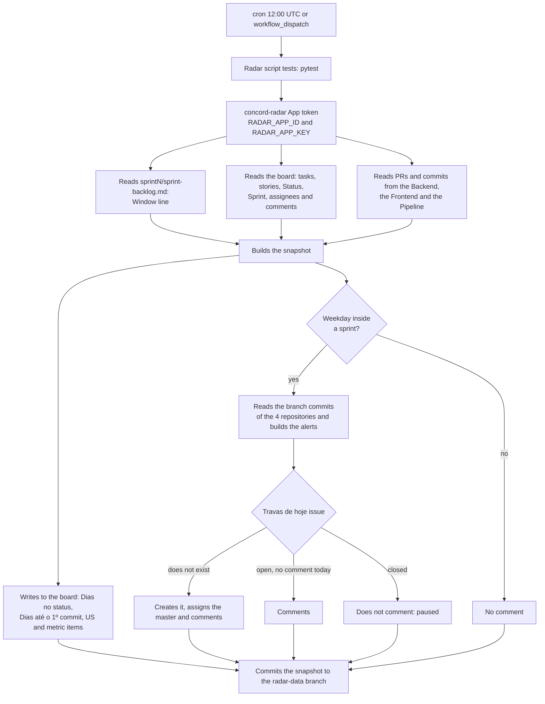

# QA

The QA front defines what "done" means and at which point of the process each item is checked,
makes sure the screen and the API speak the same contract, and measures the team's own process: the
**QA Radar** records each sprint's metrics on the board and warns, every weekday, who is stalling
the sprint.

See the portuguese(br) version [here](../../pt_br/DevOps/qa/README.md).

| | |
| --- | --- |
| Built by | `RichardCordeiro` |
| Repositories | [API-5](https://github.com/Concord-API/API-5), [API5-Backend](https://github.com/Concord-API/API5-Backend), [API5-Frontend](https://github.com/Concord-API/API5-Frontend) |
| Tasks | [DVP-06](https://github.com/Concord-API/API-5/issues/252), [DVP-07](https://github.com/Concord-API/API-5/issues/253), [DVP-08](https://github.com/Concord-API/API-5/issues/254), [DVP-34](https://github.com/Concord-API/API-5/issues/281), [DVP-35](https://github.com/Concord-API/API-5/issues/285), [DVP-69](https://github.com/Concord-API/API-5/issues/381), [DVP-70](https://github.com/Concord-API/API-5/issues/382), [DVP-71](https://github.com/Concord-API/API-5/issues/383), [DVP-72](https://github.com/Concord-API/API-5/issues/384), [DVP-85](https://github.com/Concord-API/API-5/issues/419) |
| Updated on | Nov 27, 2026 |

## Overview

The front has four parts:

1. **DoD (Definition of Done):** what "done" means, at which level of the path each item is checked
   and by whom. The text is in the [DoD](../../Scrum/definition-of-done.md).
2. **QA checklist:** added to the `usX → main` PR, for the story's author to check the product items
   of the DoD.
3. **Contract test:** validates the real API responses against the `zod` schemas the screen uses.
4. **QA Radar:** measures the team's process (metrics and charts in the board's Insights) and
   mentions on GitHub, every weekday, who is stalling the sprint, in the "🚨 Travas de hoje" issue.

Where each part comes into the process:

- **Push to `usX`:** the contract test (`npm run test:contract`) runs inside the Frontend
  `Acceptance`, which belongs to the [CI](../ci/README.md) front.
- **PR `usX → main`:** the `QA checklist` workflow adds the checklist to the PR body, and the
  story's author fills it in. The Sonar quality gate is required by the `main` ruleset.
- **Outside the code path:** the Radar runs every day in API-5 and only reads the code
  repositories.

Who the front talks to:

- **[CI](../ci/README.md) (`victorgsnogueira`):** owns the `ci.yml`, `acceptance.yml` and
  `release*.yml` workflows and the quality jobs. The QA front defines in the DoD what they need to
  prove.
- **SM (`joaoandrade17`):** is the master mentioned in the alerts and creates
  `sprintN/sprint-backlog.md`, from which the Radar reads the sprint window.
- **[API V Tasks](https://github.com/orgs/Concord-API/projects/5) board:** the `Sprint` field, the
  tasks with the ID in the title and the branches with the ID in the name are the Radar's input.

What breaks if the front stops:

- **QA checklist:** the `usX → main` PR opens without it, and nobody checks the DoD's product items.
- **Contract test:** an API contract change the screen does not accept passes `Acceptance` without
  anyone noticing.
- **Radar:** the fields and charts stop at the last collected day, the alerts issue stops getting
  comments and the daily history on `radar-data` stops growing.
- **What does not stop:** the product code, the CI and the release.

## What exists

### DoD, checklist and contract

| Item | Where it is | What it is for |
| --- | --- | --- |
| Definition of Done (DoD) | [`Docs/Scrum/definition-of-done.md`](../../Scrum/definition-of-done.md) and [`Docs/pt_br/Scrum/definition-of-done.md`](../../pt_br/Scrum/definition-of-done.md) | what done means, at which level and by whom it is checked |
| `qa-checklist.md` | `.github/qa-checklist.md` in [API5-Backend](https://github.com/Concord-API/API5-Backend/blob/main/.github/qa-checklist.md) and [API5-Frontend](https://github.com/Concord-API/API5-Frontend/blob/main/.github/qa-checklist.md) (identical) | text of the QA checklist: exploratory test and the DoD's product items |
| `qa-checklist.sh` | `.github/scripts/qa-checklist.sh` in [API5-Backend](https://github.com/Concord-API/API5-Backend/blob/main/.github/scripts/qa-checklist.sh) and [API5-Frontend](https://github.com/Concord-API/API5-Frontend/blob/main/.github/scripts/qa-checklist.sh) | takes the PR body and returns the body with the checklist; only adds it if the base is `main`, the head matches `^us[1-9][0-9]*$` and the `## QA da história` heading is not in the body yet |
| `qa-checklist.test.sh` | `.github/scripts/tests/qa-checklist.test.sh` in both repositories | tests of the script |
| Workflow `QA checklist` | `.github/workflows/qa-checklist.yml` in [API5-Backend](https://github.com/Concord-API/API5-Backend/blob/main/.github/workflows/qa-checklist.yml) and [API5-Frontend](https://github.com/Concord-API/API5-Frontend/blob/main/.github/workflows/qa-checklist.yml) | job `QA checklist`: adds the checklist to the PR to `main` (`opened` and `reopened` events); job `QA checklist script tests`: runs the tests on PRs to `us*` |
| Sonar quality gate | jobs `Backend quality`, `Frontend quality` and `Pipeline quality` in each repository's `ci.yml`, required by the `main` ruleset | SonarQube Cloud's `Sonar way` gate; how it works is in the [CI](../ci/README.md#quality-job) doc |
| Script `test:contract` | [`API5-Frontend/ratio/apps/web/package.json`](https://github.com/Concord-API/API5-Frontend/blob/main/ratio/apps/web/package.json) | runs `vitest run --config vitest.contract.config.ts`, that is, the `src/**/*.contract.test.ts` files against the real API at `CONTRACT_API_URL` |
| `themes.contract.test.ts` | [`API5-Frontend/ratio/apps/web/src/api/themes.contract.test.ts`](https://github.com/Concord-API/API5-Frontend/blob/main/ratio/apps/web/src/api/themes.contract.test.ts) | searches `cobranca de divida` and validates the search, the detail, the panels and the STJ theses of the first theme with the `zod` schemas (`getJson` does `schema.parse`) |
| Step `Check the API responses against the frontend contract` | [`API5-Frontend/.github/workflows/acceptance.yml`](https://github.com/Concord-API/API5-Frontend/blob/main/.github/workflows/acceptance.yml) | where `test:contract` runs in `Acceptance`, with `CONTRACT_API_URL: http://127.0.0.1:8080` (the runner's IIS) |

### QA Radar

| Item | Where it is | What it is for |
| --- | --- | --- |
| Workflow `Radar` | [`.github/workflows/radar.yml`](../../../.github/workflows/radar.yml) | jobs `Radar script tests` (pytest) and `Radar` (collects, writes to the board, comments the alerts and saves the snapshot). Triggered by `cron: "0 12 * * *"` (9 a.m. in São Paulo), by `workflow_dispatch` and by PRs that touch `radar/**`, `.github/radar.yml` or the workflow itself; on a PR, it only runs the tests |
| Radar code | [`radar/radar/`](../../../radar/radar) | `github.py`: GraphQL client. `fetch.py`: reads the board, the PRs and the branch commits. `collect.py`: builds the snapshot. `sprints.py`: reads the sprint window. `links.py`: links the task to the story and the branch. `metrics.py`: metrics. `board.py`: writes to the board. `alerts.py`: alert rules. `issue.py`: alerts issue. `__main__.py`: orchestrates |
| Radar tests | [`radar/tests/`](../../../radar/tests), with `radar/pytest.ini` and `radar/requirements.txt` (`pytest==8.3.3`, `pyyaml==6.0.2`) | 76 tests |
| `radar.yml` | [`.github/radar.yml`](../../../.github/radar.yml) | configuration: `owner`, `project: 5`, `board_repo: API-5`, `code_repos`, `timezone: America/Sao_Paulo`, `sprint_backlogs: sprint*/sprint-backlog.md` and the `alerts` block |
| GitHub App `concord-radar` | `Concord-API` organization → Settings → GitHub Apps; owned by the organization | generates the Radar's token on every run. Permissions: `contents: read`, `issues: write`, `metadata: read`, `organization_projects: write` and `pull_requests: read`; installed only on the selected repositories |
| Secret `RADAR_APP_ID` | API-5 → Settings → Secrets → Actions | the App's ID |
| Secret `RADAR_APP_KEY` | API-5 → Settings → Secrets → Actions | the App's private key |
| Branch `radar-data` | API-5 | one `radar/data/YYYY-MM-DD.json` file per day, with the collection snapshot. It is history only: the Radar never reads it back |
| Field `Dias no status` (number) | board | days since the last `Status` change of an open task outside `Done` |
| Field `Dias até o 1º commit` (number) | board | per task: days from the issue's creation to the first commit of its PRs (PRs to `main` do not count); an open task with no PR counts up to today |
| Field `US` (single select) | board | the task's story: `US-NN`, `Foundation` (`0.Y`) or `DevOps` (`DVP-NN`) |
| Fields `Radar`, `Semana`, `Etapa` and `Valor` | board | metric items (draft issues): `Radar` = `Métrica`; `Semana` = `SN·0 planning` to `SN·3` (weeks) or `SN` (sprint); `Etapa` = `Tasks criadas`, `Commits` or `Commits por pessoa`; `Valor` = number |
| Board views | `View 1`, `Quadro` and `Radar · tempos` | all three filter `-radar:Métrica`; `Radar · tempos` shows the tasks (`has:parent-issue`) with the times |
| Insights charts | board → Insights | 2 charts (see [Metrics and charts](#metrics-and-charts)) |
| Issue "🚨 Travas de hoje" | [API-5 #423](https://github.com/Concord-API/API-5/issues/423), assigned to `joaoandrade17` | gets one comment per weekday with the sprint's alerts |

## How it works

### The DoD in practice

The [DoD](../../Scrum/definition-of-done.md) says what is checked and at which level. Each level has
a mechanism that makes the check happen:

| DoD level | Mechanism | Front |
| --- | --- | --- |
| Task PR | `ci.yml`: formatting, lint, build, tests and Sonar analysis | [CI](../ci/README.md) |
| Acceptance | `acceptance.yml`, with this front's contract test inside it | [CI](../ci/README.md) and QA |
| PR `usX → main` | code review (1 approval from the `code-reviewers` team), release label, quality gate required by the ruleset and the [QA checklist](#qa-checklist) | CI and QA |
| Push to `main` | CI and quality gate; the release only comes out with everything green | [CI](../ci/README.md) |

The DoD's **Product** items (source and date of every value, visible scope, empty state handled)
have no automatic check: they are the items of the QA checklist.

### QA checklist

1. Someone opens or reopens a PR to `main` in the Backend or the Frontend.
2. The `QA checklist` job reads the PR body and passes it through `qa-checklist.sh`.
3. If the head is `usN` with N ≥ 1 and the body does not have `## QA da história` yet, the
   checklist is appended to the end of the body with `gh pr edit`. A `us0 → main` PR gets no
   checklist.
4. **The story's author** fills in the exploratory test and checks the product items. It is a
   self-review, since DVP-35. The review by another person stays in the code review, with the
   approval required by the `main` ruleset.
5. The checklist is not a required status check: nothing blocks the merge with an unchecked box.

### Contract test

1. A push to the Frontend's `usX` triggers `Acceptance`, which installs the API and the screen on
   Windows Server with IIS, on an empty database, and loads the sample.
2. The `Check the API responses against the frontend contract` step runs `npm run test:contract`.
3. Each function in `src/api/*.ts` calls the real API and does `schema.parse` with the screen's
   `zod` schema. If the response does not match the schema, the test fails and `Acceptance` turns
   red. `Acceptance` is a required check on `main`.

### Radar: the daily collection



The Radar reads from GitHub:

- **Task:** a board issue with the title `X.Y ...` or `DVP-NN ...`.
- **Story:** an issue with the title `US-NN ...`.
- **Sprint of the task and the story:** the `Sprint` issue field, with the value `Sprint N`.
- **Sprint window:** the `**Window:** Nov 23 to Dec 11, 2026` line of the sprint backlog, with the
  month abbreviated in English.
- **Task PR:** branch `X.Y-...` or `DVP-NN-...`.

### Metrics and charts

- **Per week** (`SN·0 planning` is the week before the start; `SN·1` to `SN·3`): `Tasks criadas`
  and `Commits`. The commits are those of the PRs, without merge commits, counted once and in the
  São Paulo time zone.
- **Per sprint** (`SN`): `Commits por pessoa`, one item per person, with the person as the assignee.
  The commits of the planning week count for the next sprint.
- **Per task:** `Dias até o 1º commit` and `Dias no status`.
- **Week with no option in the field:** the metric is skipped and shows in `weeks_without_option`
  in the output.

The two Insights charts, as they were built on screen in DVP-72 (the chart configuration is not
available through the API):

1. **"1 · Tinha task? E o time fez?":** items with `Etapa` = `Tasks criadas` and `Commits`; X axis
   `Semana`; Y axis the sum of `Valor`.
2. **"2 · Quem fez os commits de cada sprint":** `Commits por pessoa` items; X axis `Semana` (`SN`);
   Y axis the sum of `Valor`, per assignee.

### Alerts

The rules are in [`radar/radar/alerts.py`](../../../radar/radar/alerts.py), with the values of the
`alerts` block of [`.github/radar.yml`](../../../.github/radar.yml).

**Activity** is the most recent day with any of these:

- a commit on any branch of API-5, the Backend, the Frontend or the Pipeline, from 14 days before
  the sprint start up to today;
- a PR commit;
- a comment on a task;
- a `Status` change of a task (it counts for all of its assignees).

**A `team` member with an open sprint task outside `Done`:** counts the weekdays since
`max(last activity, sprint start)`.

- `>= idle_days` (2): ⏰ and a mention of the person.
- `>= escalate_days` (4): 🔥 and a mention of the `master` too, unless the person is the master.

**For the `master`:**

- a sprint with no task at all, neither open nor closed: 📭, every day;
- an open sprint task with no assignee: 📌;
- an open sprint story with no task: 📝;
- a `team` member with no open task: 🙋, only if the sprint has some story. They show up by their
  login in backticks, with no mention, and whoever is in `no_task_expected` (`vp-p`) never shows up.

**With no alerts:** "✅ Nenhuma trava hoje."

**Marker:** the comment starts with `<!-- radar:YYYY-MM-DD -->`. If the last comment already has
the day's marker, the Radar does not comment again.

**Comment format**, built by the `render` function:

```
### 🚨 Travas de DD/MM · Sprint N

**Parados com task no nome**
- ⏰ @login, **2 dias úteis** sem commit, comentário ou card movido, com 1 task no nome: #123
- 🔥 @login, **4 dias úteis** sem commit, comentário ou card movido, com 2 tasks no nome: #124, #125 · @master

**Para o @master**
- 📭 A Sprint N começou há 1 dia útil e não tem nenhuma task.
- 📌 1 task sem ninguém: #126
- 🙋 Sem task na sprint: `login`
- 📝 US sem nenhuma task: US-NN

_Fechar esta issue pausa as cobranças. Reabrir volta._
```

Each block only shows when it has items. When the issue does not exist, the Radar creates it with
an introduction to the rules (the `INTRO` constant in
[`radar/radar/issue.py`](../../../radar/radar/issue.py)), assigns it to the master and comments
right away.

### Alerts: what each team member needs to know

- **Where:** in the "🚨 Travas de hoje" issue ([#423](https://github.com/Concord-API/API-5/issues/423)).
  The mention arrives as a GitHub notification, by email or in the app.
- **When:** one comment per weekday, scheduled for 9 a.m. Brasília time. GitHub's scheduling often
  runs a few hours late.
- **Why was I mentioned (⏰):** you have an open sprint task in your name and have had no activity
  for 2 weekdays or more.
- **Why the master came along (🔥):** it reached 4 weekdays.
- **What counts as activity:** a commit on any branch of API-5, the Backend, the Frontend or the
  Pipeline, a comment on one of your tasks or moving the card of one of your tasks on the board.
- **I have no task and was not mentioned:** that is right. With no task in your name, it is the
  master's responsibility; you only show up in the 🙋 line of their part, with no mention.
- **I am on a task with no code (installation, documentation):** comment on the task what you did
  or move the card. That already counts as activity.
- **The task is no longer mine:** remove your name from it on the board; the mention goes away the
  next day.
- **I am done:** move the task to `Done` or close the issue; it stops counting.
- **Pause everything:** closing the issue pauses the mentions for everyone; reopening it brings them
  back.

## Decisions

### The Radar does not write to the code repositories

- **Context:** a team rule: the client's repositories (API5-Backend, API5-Frontend and
  API5-Pipeline) can only be read.
- **Alternatives:** labels, comments or bots in the code repositories.
- **Why:** it is a project rule.
- **Consequences:** everything the Radar writes stays in API-5 and on the board.

### No extra manual work for the team

- **Context:** a constraint from the team and from the professor.
- **Alternatives:** a form, a delay reason, a summary passed on by hand.
- **Why:** it is a project rule.
- **Consequences:** only data GitHub already records goes in.

### A GitHub App instead of a personal token

- **Context:** the Radar needs to read 4 repositories and write to the board and to the issue.
- **Alternatives:** a personal access token (PAT) from someone on the team.
- **Why:** it does not depend on one person's account, and the token is generated on every run.
- **Consequences:** changing the permissions or the installation requires an organization owner.

### A daily snapshot on the `radar-data` branch

- **Context:** keep the history without a database.
- **Alternatives:** an Actions artifact (expires), GitHub Pages, a database.
- **Why:** it stays in the repository, at no cost and without expiring.
- **Consequences:** it is history only; deleting the branch does not affect the fields or the
  charts.

### Charts in the board's Insights

- **Context:** show the metrics where the team already works.
- **Alternatives:** a site on GitHub Pages, a spreadsheet.
- **Why:** it is native to GitHub and needs no hosting.
- **Consequences:** the X axis only accepts a single select field, so `Semana` is a single select,
  with the options in calendar order.

### The task's sprint comes from the `Sprint` field, not from the creation date

- **Context:** by creation date, DVP-14 and DVP-39 fell into the wrong sprint.
- **Alternatives:** the issue's creation date.
- **Why:** the field is what the team plans.
- **Consequences:** a task without `Sprint` is in no sprint; the window comes from the sprint
  backlog.

### Only two charts

- **Context:** the other charts showed no bottleneck and led to no action.
- **Alternatives:** the 5 charts of the original DVP-72, burn up, sum of times, wait until the first
  commit and when the tasks were created.
- **Why:** chart 1 shows whether the sprint had tasks and whether the team did them; chart 2 shows
  who stalled, which is what the alerts chase.
- **Consequences:** the `Dias até o 1º commit` and `Dias no status` fields have no chart, and the
  `Criada` field was deleted from the board.

### Mention people in an issue (DVP-85)

- **Context:** the professor pointed out that looking at a chart, whether the team or the master
  does it, solves nothing.
- **Alternatives:** Discord (rarely seen, needs a webhook), WhatsApp (no reliable free automation),
  email through SMTP, a summary passed on by hand.
- **Why:** a GitHub mention notifies by email and in the app, with nothing to configure and no
  manual work.
- **Consequences:** it only reaches whoever has not turned GitHub notifications off.

### The 2 and 4 weekday limits are a process rule

- **Context:** the average `Dias até o 1º commit` of the tasks rose from 2.3 days in Sprint 1 to 9.8
  in Sprint 3 (measured in an Insights chart that was later deleted; the field is still on the
  board).
- **Alternatives:** treat the limits as configuration only, with no process value.
- **Why:** set by `RichardCordeiro` as a rule of the QA front.
- **Consequences:** changing `idle_days` or `escalate_days` in `.github/radar.yml` changes the
  process and needs to be agreed with the team.

### Chase the person, not the task

- **Context:** whoever is working on another task is not stalled.
- **Alternatives:** one alert per stalled task.
- **Why:** the team asked for it.
- **Consequences:** the person leaves the list with any activity.

### A comment and a moved card count as activity

- **Context:** tasks with no code (for example, DVP-68, installation on the server) showed up as
  stalled, as `joaoandrade17` pointed out.
- **Alternatives:** register an exception per task; accept the alarm.
- **Why:** it needs no registration and shows someone is looking at the task.
- **Consequences:** a comment can silence the alert; the `Dias até o 1º commit` field measures per
  task and is not affected.

### API-5 counts as a commit repository

- **Context:** documentation tasks only have commits in API-5, as `joaoandrade17` pointed out.
- **Alternatives:** count only the `code_repos`.
- **Why:** without API-5, whoever only writes documentation showed up as stalled.
- **Consequences:** the bot's commits on `radar-data` show up, but the bot is not in `team`.

### "No task" only when the sprint has stories

- **Context:** a sprint with only DVP tasks would flag the master every day, as `joaoandrade17`
  pointed out.
- **Alternatives:** always flag.
- **Why:** with no story, there is no product work to hand out.
- **Consequences:** a sprint with no story and no task falls into 📭.

### The PO is only chased with a task in their name

- **Context:** the PO (`vp-p`) does not usually take tasks.
- **Alternatives:** take the PO out of `team`.
- **Why:** the team asked for it.
- **Consequences:** `no_task_expected: [vp-p]`.

### Pause by closing the issue

- **Context:** a way to stop the mentions without touching code is needed.
- **Alternatives:** a flag in `radar.yml`, a label.
- **Why:** anyone with access does it in one click.
- **Consequences:** the Radar does not recreate a closed issue; to come back, just reopen it.

### Checklist added by a workflow, not by a template (DVP-07)

- **Context:** GitHub does not pick the PR template by the target branch.
- **Alternatives:** `PULL_REQUEST_TEMPLATE`.
- **Why:** only the `usX → main` PR needs the checklist; the task PR stays title only.
- **Consequences:** it is an exception to the "title-only PR" rule, approved by the PO and recorded
  in DVP-07.

### Checklist as the author's self-review (DVP-35)

- **Context:** in the DVP-07 version, another person ran the test and the PO gave the acceptance on
  the PR.
- **Alternatives:** keep the test by another person and the PO's acceptance.
- **Why:** a team decision in DVP-35.
- **Consequences:** the review by another person stays in the code review, with 1 approval.

### Contract test with the screen's `zod` schemas (DVP-08)

- **Context:** the screen and the API could diverge without anyone seeing it.
- **Alternatives:** a separate contract (OpenAPI, Pact).
- **Why:** it reuses the schemas the screen already uses.
- **Consequences:** it only covers the search, the detail, the panels and the STJ theses of the
  first theme of `cobranca de divida`.

## How to

### Open a new sprint in the Radar

**When:** before the first day of the sprint.

**Before you start:** board admin and write access to API-5.

1. Create `sprintN/sprint-backlog.md` in API-5 with the line
   `**Window:** Mon D to Mon D, YYYY` (for example, `**Window:** Nov 23 to Dec 11, 2026`).
2. On the board → Settings → `Semana` field, add the options `SN·0 planning`, `SN·1`, `SN·2`,
   `SN·3` and `SN`. The `·` is the middle dot (U+00B7). Keep the calendar order: the weeks of sprint
   N after those of N−1, and `SN` together with the other `S1`, `S2`… at the end.
3. For each new story, add the `US-NN` option to the `US` field.
4. Set the tasks and the stories to `Sprint` = `Sprint N`.

**How to check:** run the Radar by hand and see `"weeks_without_option": []` in the output of the
`Collect and update the board` step.

**How to undo:** delete the file; options with no items do not show in the charts.

### Run the Radar by hand

**When:** to check a change or when the scheduled run is late.

**Before you start:** `gh` authenticated with write access to API-5.

1. Trigger the workflow:
   ```
   gh workflow run radar.yml -R Concord-API/API-5 --ref main
   ```
2. Follow it:
   ```
   gh run list -w Radar -R Concord-API/API-5 -L 1
   ```
   Expected output: `workflow_dispatch` … `completed success`.

**How to check:** in the JSON output of the `Collect and update the board` step,
`"dry_run": false` and `"alerts": {"step": ...}` with one of these values:

- `create`: created the issue;
- `comment`: commented;
- `already`: the day's comment was already there;
- `paused`: the issue is closed;
- `off`: weekend, outside a sprint or no `alerts` in `radar.yml`.

And a new commit shows up on `radar-data`.

**How to undo:** not applicable. The collection only overwrites the day's snapshot and updates
values.

### Run the Radar on your own computer, writing nothing

**Before you start:** Python 3.12 and a `gh auth token` with read access to the repositories and
the project.

1. At the root of API-5, create the environment:
   ```
   python3.12 -m venv .venv && .venv/bin/pip install -r radar/requirements.txt
   ```
2. Run it in simulation mode:
   ```
   RADAR_TOKEN=$(gh auth token) PYTHONPATH=radar .venv/bin/python -m radar --out /tmp/radar-out --dry-run
   ```
   Expected output: a JSON with `"dry_run": true`. On a sprint day, `alerts.message` holds the text
   that would be commented. The snapshot goes to `/tmp/radar-out/`.
3. Run the tests:
   ```
   cd radar && ../.venv/bin/python -m pytest -q
   ```
   Expected output: `76 passed`.

**How to check:** steps 2 and 3 end with the expected output.

**How to undo:** not applicable, because nothing is written to GitHub.

### Adjust the alert limits or people

**When:** the team agreed on a new limit or someone joined or left the team.

**Before you start:** write access to API-5. Remember that changing the limits changes the process
(see [Decisions](#the-2-and-4-weekday-limits-are-a-process-rule)).

1. On a task branch created from `us0`, change the `alerts` block of `.github/radar.yml`:
   - `idle_days` and `escalate_days`: the limits;
   - `master`: who gets the process alerts;
   - `team`: every login evaluated;
   - `no_task_expected`: who is only chased with a task in their name;
   - `title`: the issue title. When the title changes, the Radar creates a new issue.
2. Run the tests (see [Run the Radar on your own computer](#run-the-radar-on-your-own-computer-writing-nothing)).
3. Open the PR to `us0` and then the one from `us0` to `main`. The scheduled run uses the code on
   `main`.

**How to check:** run the Radar by hand on a weekday and read the comment.

**How to undo:** revert the commit.

### Pause or resume the alerts

1. Close issue [#423](https://github.com/Concord-API/API-5/issues/423) to pause; reopen it to
   resume.

**How to check:** the next run returns `"step": "paused"`.

### Change an alert rule or add a metric or chart

**Before you start:** write access to API-5 and, for a field or chart, board admin.

1. Write the test first, in `radar/tests/test_alerts.py` or `radar/tests/test_metrics.py`. The
   commit order is `test:` and then `feat:`.
2. For a rule, change `plan_alerts` and `render` in `radar/radar/alerts.py`.
3. For a metric, change `radar/radar/metrics.py`, returning
   `Metric(semana, etapa, valor, pessoa, pessoa_id)`. A new `Etapa` needs the option in the board's
   `Etapa` field first. A new per-task field needs to be created on the board and read in `ITEMS`
   in `fetch.py`.
4. For a chart, create it by hand in Insights, with the X axis on a single select field and the Y
   axis as a count or the sum/average of a number field.

**How to check:** the tests pass and the manual run shows the new value on the board.

**How to undo:** revert the commits; a chart is deleted by hand in Insights.

### Change the QA checklist

**Before you start:** write access to API5-Backend and API5-Frontend.

1. Change `.github/qa-checklist.md` the same way in both repositories. The first line
   (`## QA da história`) is what prevents duplication: if it changes, reopened PRs that have the old
   version get the checklist again.
2. Run the script tests:
   ```
   bash .github/scripts/tests/qa-checklist.test.sh
   ```
3. Open the PR to `us0` in each repository.

**How to check:** open a `usX → main` PR and see the checklist in the body.

**How to undo:** revert the commit.

### Update the contract when the API changes

**Before you start:** the API running on your own computer, with the sample load.

1. Change the `zod` schema in the Frontend's `ratio/apps/web/src/api/*.ts` together with the
   screen.
2. Run the contract test:
   ```
   cd ratio/apps/web && CONTRACT_API_URL=<API address> npm run test:contract
   ```
3. A new endpoint the screen uses gets an `it(...)` in `themes.contract.test.ts` or in another
   `*.contract.test.ts` file.

**How to check:** `Acceptance` turns green on `usX`.

**How to undo:** revert the commit.

### Recover the history if the collection fails or `radar-data` is deleted

- The fields and the charts do not depend on `radar-data`: every run recomputes everything from
  GitHub.
- If the branch is deleted, the next run creates a new `radar-data`, with no history
  (`git worktree add --orphan`), and keeps saving. The old snapshots are lost.
- The snapshot of a day when the collection failed cannot be redone later, because it holds that
  day's state. Running it by hand on the same day saves the day.

### Rotate the GitHub App key

**Before you start:** owner of the `Concord-API` organization.

1. Organization → Settings → GitHub Apps → `concord-radar` → Private keys → Generate a private key.
   GitHub downloads a `.pem` file.
2. Store the key in the secret:
   ```
   gh secret set RADAR_APP_KEY -R Concord-API/API-5 < file.pem
   ```
3. Run the Radar by hand and see the `app` step green.
4. Delete the old key in the App and delete the `.pem` from your computer.

**How to undo:** generate another key.

### Change the App's permissions or installation

**Before you start:** owner of the `Concord-API` organization.

1. Organization → Settings → GitHub Apps → `concord-radar` → Permissions & events, and Save.
2. Organization → Settings → Installed GitHub Apps → `concord-radar` → accept the new permissions.
   Without that acceptance, nothing changes.

**How to check:** run the Radar by hand and see the run end with `success`.

## How to tell it is working

- **Radar:**
  - `gh run list -w Radar -R Concord-API/API-5` shows one `schedule` run with `success` per day. It
    can run hours late: on Nov 25 and Nov 26, 2026, it only started at 5:47 p.m. and 5:39 p.m.
  - One `chore: add the radar snapshot of YYYY-MM-DD` commit per day on `radar-data`.
  - On the board, `Dias no status` and `Dias até o 1º commit` filled in on the tasks, and the metric
    items of the current week with an updated `Valor`.
  - The 2 Insights charts show the current week.
- **Alerts:**
  - Issue [#423](https://github.com/Concord-API/API-5/issues/423) gets one comment per weekday
    inside the sprint, starting with the day's marker.
  - The people mentioned get the email or the notification.
- **Checklist:** every new `usX → main` PR in the Backend or the Frontend opens with the
  `## QA da história` block.
- **Contract:** the `Check the API responses against the frontend contract` step is green in the
  Frontend's `usX` `Acceptance`.
- **Sonar:** `Backend quality`, `Frontend quality` and `Pipeline quality` green on the PR to `main`.

## Known issues

| Symptom | Cause | What to do |
| --- | --- | --- |
| Insights does not allow `Semana` on the X axis | The field was text; the X axis only accepts single select | Already fixed: `Semana` is a single select, with the options in calendar order |
| DVP-14 and DVP-39 showed up in Sprint 2 | The sprint came from the issue's creation date | Already fixed: it comes from the `Sprint` field |
| The wait for review looked inflated | A PR closed without merge counted up to today | Fixed and, later, the review metric was removed |
| Task `PRC-01` showed up as "No Criada" | `links.py` only recognizes `X.Y` and `DVP-NN`; the Process container was removed in DVP-74 | Use only the `X.Y` and `DVP-NN` prefixes; another prefix requires changing `TASK` in `links.py` |
| A week's metric is missing | The week's option is missing from the `Semana` field | Create the option (see [Open a new sprint in the Radar](#open-a-new-sprint-in-the-radar)) and check `weeks_without_option` |
| `US-NN` option not filled in | The option is missing from the `US` field | Create the option |
| The 9 a.m. scheduled run happens in the afternoon | GitHub delays `schedule` at peak times | Wait or run it by hand |
| The Radar failed to create the issue | The App had `issues: read` | Already fixed on Nov 26, 2026: `issues: write`, accepted in the installation |
| The day's snapshot not saved | If the `Collect and update the board` step fails, including in the alerts, the snapshot step does not run | Read the log and run it by hand on the same day |
| `gh pr create` fails with "Base ref must be a branch" | `us0` is deleted on the `us0 → main` merge | Recreate `us0` from `main` before the next PR |
| The stalled person does not see the mention | GitHub notifications turned off or filtered | The person turns on "Participating, @mentions" at github.com/settings/notifications |
| The person gets every comment on the issue | Whoever is mentioned gets subscribed to the issue | "Unsubscribe" on the issue; they only get comments again when mentioned |
| The `Commits` metric does not count commits outside PRs | `week_metrics` and `person_metrics` only use the PRs' commits | Accepted limitation; the alerts read every branch |
| `us0 → main` PR without the checklist | The script only accepts a `usN` head with N ≥ 1 | Expected behavior |

## Carrying on

**Left halfway:**

- The `Criada` field was deleted from the board, but the code still computes its value
  (`created_in` in `metrics.py`, the write in `__main__.py` and the alias in `fetch.py`). Without
  the field, the write is dropped by `known_options` and raises no error; that code can be removed.

**Accepted limitations:**

- The QA checklist does not block the merge.
- The contract test only covers 4 calls of the first theme of a fixed search.
- A weekday is only Monday to Friday: holidays count as weekdays in the alerts.
- When reading the alerts, the Radar considers the last 20 comments of each task and up to 50
  commits per branch since 14 days before the sprint start.
- The alerts depend on a `sprintN/sprint-backlog.md` with the `Window` line. Today they exist from
  Sprint 1 to Sprint 4; without the next one, the alerts stop after Dec 11, 2026.
- The Insights charts are configured by hand and are not versioned.

**Suggested improvements:** count commits outside PRs in the metrics; version the chart
configuration in a document; a workflow step that fails when `weeks_without_option` is not empty.

**Access for whoever takes over:**

- Owner of the `Concord-API` organization, for the App and its installation.
- Admin of project 5 (the board), for fields, options, views and Insights.
- Write access to API-5 and access to the `RADAR_APP_ID` and `RADAR_APP_KEY` secrets.
- Write access to API5-Backend and API5-Frontend, for the checklist and the contract.

## References

**Tasks and PRs**, all by `RichardCordeiro`:

| Task | PRs |
| --- | --- |
| [DVP-06](https://github.com/Concord-API/API-5/issues/252) Align the Definition of Done with how the project works today | [API-5 #261](https://github.com/Concord-API/API-5/pull/261) |
| [DVP-07](https://github.com/Concord-API/API-5/issues/253) Add the QA checklist to the pull request template from a US branch to main | [Backend #81](https://github.com/Concord-API/API5-Backend/pull/81), [Frontend #63](https://github.com/Concord-API/API5-Frontend/pull/63) |
| [DVP-08](https://github.com/Concord-API/API-5/issues/254) Validate real API responses against the frontend zod schemas | [Backend #84](https://github.com/Concord-API/API5-Backend/pull/84), [Frontend #65](https://github.com/Concord-API/API5-Frontend/pull/65) |
| [DVP-34](https://github.com/Concord-API/API-5/issues/281) Add the Sonar quality gate to the Definition of Done | [API-5 #282](https://github.com/Concord-API/API-5/pull/282) |
| [DVP-35](https://github.com/Concord-API/API-5/issues/285) Make the QA checklist a self-review by the story's author | [API-5 #286](https://github.com/Concord-API/API-5/pull/286), [Backend #94](https://github.com/Concord-API/API5-Backend/pull/94), [Frontend #71](https://github.com/Concord-API/API5-Frontend/pull/71) |
| [DVP-69](https://github.com/Concord-API/API-5/issues/381) Add the board fields that the Radar fills | configuration on the board, no PR |
| [DVP-70](https://github.com/Concord-API/API-5/issues/382) Add the Radar workflow that collects the data every day | [API-5 #385](https://github.com/Concord-API/API-5/pull/385) |
| [DVP-71](https://github.com/Concord-API/API-5/issues/383) Measure the planning and the execution of each sprint | [API-5 #387](https://github.com/Concord-API/API-5/pull/387), [#393](https://github.com/Concord-API/API-5/pull/393) |
| [DVP-72](https://github.com/Concord-API/API-5/issues/384) Build the QA charts in Insights | [API-5 #389](https://github.com/Concord-API/API-5/pull/389), [#395](https://github.com/Concord-API/API-5/pull/395), [#397](https://github.com/Concord-API/API-5/pull/397), [#399](https://github.com/Concord-API/API-5/pull/399) |
| [DVP-85](https://github.com/Concord-API/API-5/issues/419) Report the stalled work every weekday in an API-5 issue | [API-5 #420](https://github.com/Concord-API/API-5/pull/420), [#424](https://github.com/Concord-API/API-5/pull/424) |

API-5 PRs from `us0` to `main` with this work:
[#394](https://github.com/Concord-API/API-5/pull/394), [#396](https://github.com/Concord-API/API-5/pull/396),
[#398](https://github.com/Concord-API/API-5/pull/398), [#400](https://github.com/Concord-API/API-5/pull/400),
[#422](https://github.com/Concord-API/API-5/pull/422) and [#425](https://github.com/Concord-API/API-5/pull/425).

**Tools and versions:**

- Python 3.12, `pytest==8.3.3` and `pyyaml==6.0.2`.
- `actions/checkout@v4`, `actions/setup-python@v5` and `actions/create-github-app-token@v1`.
- `zod` `^4.6.5` and `vitest` `^5.0.1` in the Frontend.
- [SonarQube Cloud](https://docs.sonarsource.com/sonarqube-cloud/), `Sonar way` gate.
- [GitHub Projects: Insights](https://docs.github.com/issues/planning-and-tracking-with-projects/viewing-insights-from-your-project).
- [GitHub GraphQL API](https://docs.github.com/graphql).
- [GitHub Apps](https://docs.github.com/apps).

**Docs of the other fronts:** [CI](../ci/README.md), where the workflows, `Acceptance` and the
quality gate are.
