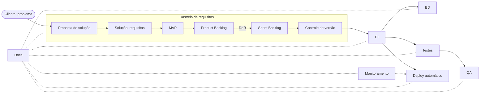

# DevOps

Esta documentação registra o processo de DevOps do Ratio frente por frente. Para cada frente, ela
diz:

- **quem construiu** cada parte e o que quem assumir precisa ter de acesso;
- **como funciona**: o que existe, o que dispara cada passo e o que ele entrega;
- **por que foi feita assim**: cada decisão, com o contexto e as alternativas;
- **como operar**: os procedimentos, os sinais de que está saudável e o que fazer quando quebra.

**O objetivo é que outra equipe consiga continuar o projeto sem o time que o construiu.**

O processo vai da necessidade do cliente até o servidor dele: o requisito passa pelo backlog e pela
sprint, vira código, é integrado, testado e validado, é publicado e instalado, e continua sendo
monitorado depois. Desenvolver não é a mesma coisa que fazer DevOps: o DevOps é esse processo
inteiro, feito de pessoas, processos e ferramentas.

Veja a versão em inglês [aqui](../../DevOps/README.md).

## Sumário
- [O processo](#o-processo)
- [Frentes](#frentes)
- [O papel da documentação no DevOps](#o-papel-da-documentação-no-devops)
  - [Como a documentação ajuda o processo](#como-a-documentação-ajuda-o-processo)
- [Fundamentos do modelo](#fundamentos-do-modelo)
- [Como manter esta documentação](#como-manter-esta-documentação)
  - [Estrutura](#estrutura)
  - [O modelo de cada frente](#o-modelo-de-cada-frente)
  - [Regras de escrita](#regras-de-escrita)
  - [Fluxo para criar e atualizar uma doc](#fluxo-para-criar-e-atualizar-uma-doc)
- [Referências bibliográficas](#referências-bibliográficas)

## O processo

O processo começa antes do código, no rastreio de requisitos, e termina no servidor do cliente. As
frentes do DevOps entram a partir do controle de versão, e a frente Docs atravessa todas as etapas,
porque cada uma precisa estar registrada para continuar existindo sem quem a construiu.



| Etapa | O que acontece no Ratio | Onde está documentado |
| --- | --- | --- |
| Rastreio de requisitos | o problema do cliente vira requisitos, o MVP vira o Product Backlog, e uma história só entra na sprint quando cumpre a DoR | [Product Backlog](../README.md#product-backlog), [Critérios de aceitação](../Scrum/acceptance-criteria.md), [DoR](../Scrum/definition-of-ready.md), [Modelo de tasks](../Scrum/task-model.md), [Sprint Backlog](../../../sprint4/sprint-backlog_pt.md) |
| Controle de versão | cada task vira uma branch e um PR, nos padrões de branch e commit do time | [Como contribuir](../README.md#como-contribuir) |
| CI | cada PR e cada merge passam por testes, análise de qualidade e validação de ponta a ponta, e a `main` gera a release versionada | [CI](ci/README.md) |
| BD | o schema muda só por migration, e a carga é validada contra ele | [BD](database/README.md) |
| Testes | os testes unitários e de integração da API rodam a cada mudança | [Testes](tests/README.md) |
| QA | a [DoD](../Scrum/definition-of-done.md), o checklist do PR, o contrato da API e o Radar de QA verificam o que foi entregue | [QA](qa/README.md) |
| Deploy | a release é instalada na homologação e no servidor do cliente | [Deploy](deploy/README.md) |
| Monitoramento | métricas, logs e traces mostram se o que foi instalado está saudável | [Monitoramento](monitoring/README.md) |
| Docs | registra todas as etapas acima | este README |

## Frentes

| Frente | Construída por | Doc | Task da doc |
| --- | --- | --- | --- |
| CI | `victorgsnogueira` | [ci](ci/README.md) | [DVP-79](https://github.com/Concord-API/API-5/issues/409) |
| Deploy | `IsaacOliveiraSouza` | [deploy](deploy/README.md) | [DVP-80](https://github.com/Concord-API/API-5/issues/410) |
| QA | `RichardCordeiro` | [qa](qa/README.md) | [DVP-81](https://github.com/Concord-API/API-5/issues/411) |
| Monitoramento | `thiagosabreu` | [monitoring](monitoring/README.md) | [DVP-82](https://github.com/Concord-API/API-5/issues/412) |
| Testes | `vp-p` | [tests](tests/README.md) | [DVP-83](https://github.com/Concord-API/API-5/issues/413) |
| BD | `JoaoBaranov` | [database](database/README.md) | [DVP-65](https://github.com/Concord-API/API-5/issues/376) |
| Docs | `joaoandrade17` | este README | [DVP-84](https://github.com/Concord-API/API-5/issues/414) |

## O papel da documentação no DevOps

Cada frente do DevOps do Ratio foi construída por uma pessoa. O que essa pessoa sabe e não está
escrito (por que um job roda só na `main`, o que fazer quando a carga falha, qual exceção foi
aceita e por quê) é **conhecimento tácito**: existe só na cabeça dela e sai do projeto junto com
ela. Nonaka e Takeuchi (1995) chamam de externalização a conversão desse conhecimento em
conhecimento explícito, que pode ser lido, discutido e reaproveitado por outras pessoas. A
documentação de cada frente é essa externalização.

O compartilhamento também é um dos pilares do próprio DevOps: é o S de CAMS (*Culture, Automation,
Measurement, Sharing*), proposto por John Willis e Damon Edwards e descrito por Willis (2010). E a pesquisa do DORA mostra que a
documentação não é um trabalho à parte das práticas técnicas: no relatório State of DevOps de 2022,
o efeito de cada prática técnica estudada no desempenho da organização foi muito maior nos times
com documentação acima da média (por exemplo, na integração contínua, 750% contra 34% nos times
abaixo da média) (DORA, 2022).

O Manifesto Ágil valoriza "software em funcionamento mais que documentação abrangente" (Beck et
al., 2001), e este modelo segue essa ideia: ele não tenta documentar tudo. Cada frente responde às
mesmas nove perguntas, as que outra equipe precisa responder para continuar o trabalho, e o resto
fica no código, que é a fonte da verdade.

### Como a documentação ajuda o processo

| Risco para o processo | O que o modelo faz |
| --- | --- |
| Quem construiu a frente sai do projeto | a seção **Para continuar** registra o que ficou pela metade e os acessos necessários, e a tabela do topo diz quem construiu |
| Uma decisão é desfeita sem que se saiba por que foi tomada | a seção **Decisões** guarda o contexto, as alternativas e as consequências de cada escolha |
| Algo quebra na entrega ou em produção | as seções **Como fazer** e **Problemas conhecidos** trazem o procedimento pronto, com como conferir e como desfazer |
| Cada frente é documentada de um jeito | todas seguem o mesmo [`template.md`](template.md), e quem leu uma sabe onde encontrar cada coisa nas outras |
| A documentação fica desatualizada | ela mora no mesmo repositório do processo, muda por PR e é revisada pelo dono da frente |

O modelo cobre os três elementos do DevOps: as **pessoas** na tabela do topo e na seção Para
continuar, os **processos** em Como funciona, Decisões e Como fazer, e as **ferramentas** em O que
existe.

## Fundamentos do modelo

O modelo não foi inventado do zero: cada parte vem de uma referência reconhecida de documentação
técnica ou de operação de sistemas, escolhida pelo problema que resolve aqui.

### Diátaxis

**O que é:** um sistema de Daniele Procida que separa a documentação técnica em quatro tipos, de
acordo com a necessidade de quem lê: tutoriais, guias de como fazer, referência e explicação
(Procida, s.d.).

**Por que foi escolhido:** a causa mais comum de doc difícil de usar é misturar esses tipos: uma
explicação no meio de um passo a passo, uma lista de arquivos dentro de um texto corrido. O Diátaxis
dá o critério para separar, e cada seção do modelo tem um tipo só.

**No modelo:** **Visão geral** e **Como funciona** são explicação, **O que existe** é referência e
**Como fazer** é guia. Não há tutorial, porque quem continua o projeto é uma equipe de
desenvolvimento que já conhece as ferramentas e precisa entender, consultar e executar, não
aprender do começo.

### Architecture Decision Records (ADR)

**O que é:** o formato proposto por Michael Nygard para registrar cada decisão importante com o seu
contexto, a decisão e as consequências (Nygard, 2011).

**Por que foi escolhido:** Nygard mostra que quem chega a um projeto sem saber o motivo de uma
decisão só tem duas saídas, aceitar sem entender ou mudar sem saber o que vai quebrar. É o risco de
uma equipe nova assumindo o Ratio.

**No modelo:** a seção **Decisões**, com contexto, alternativas, motivo e consequências de cada
escolha.

### The Good Docs Project

**O que é:** uma comunidade aberta de redatores técnicos que mantém modelos de documentação
testados em projetos de código aberto (The Good Docs Project, s.d.).

**Por que foi escolhido:** em vez de inventar a estrutura de um procedimento, o modelo usa a de
modelos já validados pela comunidade. O modelo de *how-to* define um procedimento como passos
numerados para uma tarefa só, e o de *troubleshooting*, como sintoma, causa e solução.

**No modelo:** o formato de cada tarefa em **Como fazer** e a tabela de **Problemas conhecidos**.

### Runbook (Site Reliability Engineering do Google)

**O que é:** o procedimento de operação escrito antes de ser necessário, prática descrita no livro
de Site Reliability Engineering do Google.

**Por que foi escolhido:** segundo o livro, registrar as boas práticas antes em um *playbook*
melhora o tempo médio de reparo (MTTR) em cerca de três vezes em relação a improvisar (Beyer et
al., 2016). Na entrega ao cliente e em produção, quem executa não pode depender de lembrar.

**No modelo:** em **Como fazer**, os blocos "Antes de começar", "Como conferir" e "Como desfazer";
e a seção **Como saber se está funcionando**.

### Google developer documentation style guide

**O que é:** o guia de estilo público que o Google usa na sua documentação para desenvolvedores
(Google, s.d.).

**Por que foi escolhido:** dá regras concretas e verificáveis em vez de "escreva bem": voz ativa,
frases curtas, imperativo nos procedimentos, um passo por ação e nomes de código em fonte de código.
Regras verificáveis permitem que a revisão no PR seja objetiva.

**No modelo:** as [regras de escrita](#regras-de-escrita) 4 a 6.

### Docs as code

**O que é:** a prática de tratar a documentação como código: ela mora no repositório, é escrita em
texto simples, muda por PR e passa por revisão (Write the Docs, s.d.).

**Por que foi escolhido:** a documentação acompanha o processo que descreve, tem histórico de
versões e é revisada por quem conhece a frente. É a mesma esteira de PR e revisão que o time já
usa no código.

**No modelo:** a pasta no API-5, o diagrama em mermaid (texto que o GitHub desenha), o
[fluxo](#fluxo-para-criar-e-atualizar-uma-doc) por PR e as regras de escrita 8 e 9.

## Como manter esta documentação

### Estrutura

```
Docs/DevOps/          (inglês)
Docs/pt_br/DevOps/    (português)
├── README.md         este índice
├── template.md       o modelo em branco de cada frente
├── ci/
│   └── README.md     a doc da frente
├── deploy/
├── qa/
├── monitoring/
├── tests/
└── database/
```

- Cada frente é uma pasta com um `README.md`. No GitHub, abrir a pasta já mostra a doc.
- Arquivo extra na pasta só para procedimento longo (mais de 10 passos), e o `README.md` da
  frente aponta para ele na seção **Como fazer**.
- Nomes de pasta e de arquivo em inglês, minúsculos, com hífen.
- `Docs/DevOps/` e `Docs/pt_br/DevOps/` têm os mesmos nomes de pasta e de arquivo.

### O modelo de cada frente

Toda frente segue o [`template.md`](template.md): as mesmas 9 seções, na mesma ordem. Para uma
frente nova, copie o template para `<frente>/README.md`. Os comentários `<!-- -->` do template
explicam o que vai em cada seção e não aparecem no GitHub.

| Seção | O que responde | Fundamento |
| --- | --- | --- |
| Visão geral | o papel da frente no processo, com quem ela conversa e o que quebra se ela parar | [Diátaxis](#diátaxis): explicação |
| O que existe | tudo o que a frente criou ou configura e onde fica | [Diátaxis](#diátaxis): referência |
| Como funciona | o que dispara, a ordem dos passos, o que entra e o que sai | [Diátaxis](#diátaxis): explicação |
| Decisões | cada escolha com contexto, alternativas, motivo e consequências | [ADR](#architecture-decision-records-adr) |
| Como fazer | as tarefas de quem continuar, com antes de começar, passos, como conferir e como desfazer | [Good Docs Project](#the-good-docs-project) e [runbook](#runbook-site-reliability-engineering-do-google) |
| Como saber se está funcionando | os checks e sinais que provam que a frente está saudável | [runbook](#runbook-site-reliability-engineering-do-google) |
| Problemas conhecidos | sintoma, causa e o que fazer | [Good Docs Project](#the-good-docs-project) |
| Para continuar | o que ficou pela metade, as limitações aceitas, as melhorias e os acessos necessários | o objetivo da documentação: outra equipe continuar o projeto |
| Referências | as tasks, os PRs e a documentação oficial das ferramentas | — |

### Regras de escrita

1. Toda frente tem as 9 seções, na mesma ordem. Seção sem conteúdo fica com "Não se aplica" e o
   motivo, nunca é apagada.
2. Conteúdo a mais entra como subseção (`###`) de uma seção do modelo, nunca como seção nova.
3. Tudo o que é citado aponta para onde está: link relativo dentro do API-5, link completo para os
   outros repositórios.
4. Nome de arquivo, workflow, job, comando, campo e variável entre crases, igual ao código.
5. Passo a passo numerado, uma ação por passo, com o comando exato e a saída esperada.
6. Frases curtas e na voz ativa. Nos procedimentos, imperativo, falando com quem executa.
7. Nunca valor de secret, senha, token ou chave: só o nome e onde está configurado.
8. Diagrama em mermaid (o GitHub desenha e qualquer um edita), não em imagem.
9. A documentação oficial do DevOps é a deste repositório, e muda só por PR revisado pelo dono da
   frente.
10. Versão em português e em inglês com a mesma estrutura, cada uma com o link para a outra.

### Fluxo para criar e atualizar uma doc

1. O SM manda ao dono da frente o [prompt](#prompt-para-o-dono-da-frente) abaixo, já com as tasks
   e os tópicos da task da doc.
2. O dono roda o prompt na IA que tem o contexto do trabalho dele, lê a resposta, corrige o que
   estiver errado e devolve ao SM. Essa é a doc simples: tópicos e fatos, sem formatação.
3. O SM escreve a doc no modelo, em português e em inglês, numa branch `RATIO-DOCS-<Frente>`, e
   abre o PR para a `main`.
4. O dono da frente revisa o conteúdo no PR.
5. Merge, e a task da doc vai para Done.

O conhecimento sai de quem construiu a frente (passo 2), ganha a forma comum do modelo (passo 3) e
volta para quem construiu conferir se nada se perdeu (passo 4).

#### Prompt para o dono da frente

O SM preenche o que está entre colchetes antes de mandar. A seção 10 do retorno não vai para a doc:
são as perguntas que o SM resolve com o dono da frente antes de escrever.

<details>
<summary>Ver o prompt</summary>

```text
Sou [NOME], responsável pela frente [FRENTE] do DevOps do projeto Ratio (organização
Concord-API no GitHub: API5-Backend, API5-Frontend, API5-Pipeline e API-5). O SM do time vai
escrever a documentação oficial desta frente no repositório API-5. Ela precisa ser suficiente
para que outra equipe continue o projeto sem nenhum de nós.

Você já tem o contexto do que eu fiz. Use esse contexto e confira no código e nos repositórios
antes de afirmar qualquer coisa.

Tasks desta frente: [DVP-xx, DVP-yy, ...]

A documentação precisa cobrir pelo menos:
[TÓPICOS, copiados das linhas Data: da task da doc]

Responda em português, em Markdown, com exatamente as seções abaixo, nesta ordem. Não precisa de
texto bonito: tópicos curtos e fatos. O SM formata depois.

## 1. Visão geral
O que a frente faz, em que ponto do caminho do código até o servidor do cliente ela entra, de
quais outras frentes ela depende ou com quais conversa, e o que quebra se ela parar.

## 2. O que existe
Uma linha por item: nome | repositório e caminho (ou onde está configurado) | para que serve.
Inclua workflows, jobs, scripts, arquivos de configuração, serviços, dashboards, portas, URLs,
secrets e variáveis (secrets e variáveis só pelo nome, nunca o valor).

## 3. Como funciona
O que dispara, a ordem dos passos, o que entra e o que sai. Se tiver mais de três passos, inclua
um diagrama em mermaid.

## 4. Decisões
Para cada escolha relevante (ferramenta, abordagem, regra, exceção aceita): decisão | contexto
ou problema | alternativas consideradas | por que essa | consequências.

## 5. Como fazer
As tarefas que quem continuar vai precisar fazer (por exemplo: rodar localmente, mudar algo,
instalar no servidor, recuperar de uma falha). Para cada uma: quando usar | antes de começar
(acessos, ferramentas, versões) | passos numerados com o comando exato e a saída esperada | como
conferir | como desfazer.

## 6. Como saber se está funcionando
Os checks, comandos, dashboards ou sinais que provam que a frente está saudável.

## 7. Problemas conhecidos
sintoma | causa | o que fazer. Inclua os erros que já aconteceram durante o projeto.

## 8. Para continuar
O que ficou pela metade, as limitações aceitas, as melhorias que você faria e os acessos que
quem assumir precisa ter.

## 9. Referências
Tasks e PRs com número, e a documentação oficial das ferramentas com a versão usada.

## 10. Não confirmado
Tudo o que você não conseguiu conferir no código ou nos repositórios, e as perguntas que só eu
posso responder.

Regras:
- Só fatos que estão no código, nos repositórios ou que eu confirmei. Se não souber, escreva
  "não sei". Não complete com o que é comum em outros projetos.
- Nomes de arquivo, workflow, job, comando, campo e variável entre crases, exatamente como estão
  no código.
- Nunca inclua valor de secret, senha, token ou chave.
- Toda pessoa citada vai pelo login do GitHub (ex.: `JoaoBaranov`), não só pelo primeiro nome.
- Seção sem conteúdo: escreva "não se aplica" e o motivo.
```

</details>

## Referências bibliográficas

- BECK, Kent et al. **Manifesto para Desenvolvimento Ágil de Software**. 2001. Disponível em:
  <https://agilemanifesto.org/iso/ptbr/manifesto.html>.
- BEYER, Betsy; JONES, Chris; PETOFF, Jennifer; MURPHY, Niall Richard (org.). **Site Reliability
  Engineering: How Google Runs Production Systems**. Sebastopol: O'Reilly, 2016. Cap. 1. Disponível
  em: <https://sre.google/sre-book/introduction/>.
- DORA. **Documentation quality**. Dados do relatório Accelerate State of DevOps 2022. Disponível
  em: <https://dora.dev/capabilities/documentation-quality/>.
- GOOGLE. **Google developer documentation style guide**. Disponível em:
  <https://developers.google.com/style>.
- NONAKA, Ikujiro; TAKEUCHI, Hirotaka. **The Knowledge-Creating Company: How Japanese Companies
  Create the Dynamics of Innovation**. New York: Oxford University Press, 1995.
- NYGARD, Michael. **Documenting Architecture Decisions**. Cognitect, 15 nov. 2011. Disponível em:
  <https://cognitect.com/blog/2011/11/15/documenting-architecture-decisions>.
- PROCIDA, Daniele. **Diátaxis: a systematic approach to technical documentation authoring**.
  Disponível em: <https://diataxis.fr/>.
- THE GOOD DOCS PROJECT. **Templates**. Disponível em:
  <https://www.thegooddocsproject.dev/template>.
- WILLIS, John. **What DevOps Means to Me**. 2010.
- WRITE THE DOCS. **Docs as Code**. Disponível em:
  <https://www.writethedocs.org/guide/docs-as-code/>.
