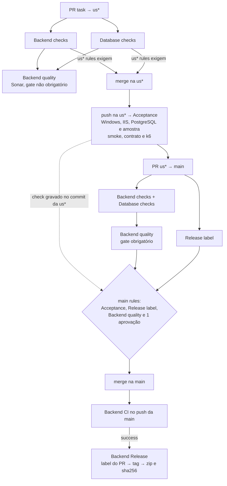

# CI

A integração contínua testa, mede a qualidade e valida de ponta a ponta cada mudança de código,
deixa entrar na `main` só o que passou e, depois do CI da `main`, publica a release versionada que
é instalada no servidor do cliente.

Veja a versão em inglês [aqui](../../../DevOps/ci/README.md).

| | |
| --- | --- |
| Construída por | `victorgsnogueira` |
| Repositórios | [API5-Backend](https://github.com/Concord-API/API5-Backend), [API5-Frontend](https://github.com/Concord-API/API5-Frontend), [API5-Pipeline](https://github.com/Concord-API/API5-Pipeline) |
| Tasks | [DVP-01](https://github.com/Concord-API/API-5/issues/247), [DVP-02](https://github.com/Concord-API/API-5/issues/248), [DVP-03](https://github.com/Concord-API/API-5/issues/249), [DVP-04](https://github.com/Concord-API/API-5/issues/250), [DVP-12](https://github.com/Concord-API/API-5/issues/181), [DVP-32](https://github.com/Concord-API/API-5/issues/279), [DVP-33](https://github.com/Concord-API/API-5/issues/280), [DVP-41](https://github.com/Concord-API/API-5/issues/297), [DVP-59](https://github.com/Concord-API/API-5/issues/370) |
| Atualizada em | 26/11/2026 |

## Visão geral

Cada mudança passa por quatro portões até virar release:

1. **PR da branch de task para a `us*`:** o CI do repositório roda os testes, a cobertura, o
   lint e a formatação, e o build.
2. **Push na `us*`** (merge da task): o workflow `Acceptance` sobe a API, o frontend, o banco e a
   carga de amostra em Windows com IIS, e roda o smoke, o contrato e o teste de carga k6.
3. **PR da `us*` para a `main`:** o CI roda de novo, agora com o quality gate do Sonar
   obrigatório, junto com o `Release label` e o `Acceptance` já gravado no commit da `us*`.
4. **Push na `main`:** o CI roda de novo e, se passar, o workflow de release publica a versão no
   GitHub Releases.

A instalação no servidor do cliente usa o zip da release e é da frente de [Deploy](../deploy/README.md).

Com quem a CI conversa:

- **Backend e Frontend:** o `Acceptance` de cada um faz checkout do outro repositório na branch de
  mesmo nome, ou na `main` se ela não existir.
- **Pipeline:** o job `Pipeline compatibility` publica a API do Backend e confere se a carga gerada
  pelo pipeline é aceita por um banco migrado pela API.
- **[BD](../database/README.md) (`JoaoBaranov`):** a detecção de drift da fixture de schema
  (DVP-63 e DVP-67) roda dentro do `Pipeline compatibility`.
- **[Monitoramento](../monitoring/README.md) (`thiagosabreu`):** o mesmo `acceptance/k6/load.ts` é
  usado contra a homologação pela DVP-60.
- **[QA](../qa/README.md) (`RichardCordeiro`):** o teste de contrato `npm run test:contract`
  (DVP-08) roda dentro do `Acceptance`.
- **[Deploy](../deploy/README.md) (`IsaacOliveiraSouza`):** usa as releases do Backend, do Frontend
  e da carga no servidor.
- **SonarQube Cloud:** organização `concord-api`.

O que quebra se a CI parar:

- A `main` fica sem portão automático. Os rulesets exigem checks que só estes workflows produzem,
  e se um workflow sumir os PRs para a `main` ficam travados esperando o check.
- Não sai release automática do Backend nem do Frontend, porque o `release.yml` depende do CI da
  `main`.
- Ninguém percebe se uma migration nova quebrou o pipeline, porque o `Pipeline compatibility`
  deixa de rodar.

## O que existe

### Workflows e jobs

| Item | Onde fica | Para que serve |
| --- | --- | --- |
| Workflow `Backend CI` | [`API5-Backend/.github/workflows/ci.yml`](https://github.com/Concord-API/API5-Backend/blob/main/.github/workflows/ci.yml) | CI do backend (.NET) |
| Job `Backend checks` (id `tests`) | idem | restore travado, `dotnet format`, build Release, testes de aplicação com cobertura e `dotnet publish` win-x64 |
| Job `Database checks` (id `database`) | idem | testes de `Ratio.Infrastructure.Tests` e `Ratio.Api.IntegrationTests` contra um PostgreSQL descartável, com cobertura |
| Job `Backend quality` (id `quality`) | idem | análise do SonarQube Cloud com a cobertura dos dois jobs anteriores; espera o quality gate |
| Workflow e job `Acceptance` | [`API5-Backend/.github/workflows/acceptance.yml`](https://github.com/Concord-API/API5-Backend/blob/main/.github/workflows/acceptance.yml) | sobe API, frontend, PostgreSQL e IIS em Windows com a carga de amostra; smoke, contrato e k6 |
| Workflow `Backend Release`, job `Publish release` | [`API5-Backend/.github/workflows/release.yml`](https://github.com/Concord-API/API5-Backend/blob/main/.github/workflows/release.yml) | publica a release do backend depois do CI da `main` |
| Workflow e job `Release label` | [`API5-Backend/.github/workflows/release-label.yml`](https://github.com/Concord-API/API5-Backend/blob/main/.github/workflows/release-label.yml) | exige exatamente um label `release:*` no PR para a `main` e comenta a versão que vai sair |
| Workflow `Frontend CI` | [`API5-Frontend/.github/workflows/ci.yml`](https://github.com/Concord-API/API5-Frontend/blob/main/.github/workflows/ci.yml) | CI do frontend (Node e Vite) |
| Job `Frontend checks` (id `checks`) | idem | `npm ci`, `format:check`, `lint`, `typecheck`, `test:ci` com cobertura e `build` |
| Job `Frontend quality` (id `quality`) | idem | Sonar com a cobertura do job anterior; espera o gate |
| Workflow e job `Acceptance` | [`API5-Frontend/.github/workflows/acceptance.yml`](https://github.com/Concord-API/API5-Frontend/blob/main/.github/workflows/acceptance.yml) | o mesmo ambiente do backend, sem o k6 e sem a checagem dos painéis e da última decisão |
| Workflow `Frontend Release`, job `Publish release` | [`API5-Frontend/.github/workflows/release.yml`](https://github.com/Concord-API/API5-Frontend/blob/main/.github/workflows/release.yml) | publica a release do frontend depois do CI da `main` |
| Workflow `Release label` | [`API5-Frontend/.github/workflows/release-label.yml`](https://github.com/Concord-API/API5-Frontend/blob/main/.github/workflows/release-label.yml) | igual ao do backend |
| Workflow `Pipeline CI` | [`API5-Pipeline/.github/workflows/ci.yml`](https://github.com/Concord-API/API5-Pipeline/blob/main/.github/workflows/ci.yml) | CI do pipeline (Python) |
| Job `Pipeline checks` (id `tests`) | idem | `ruff check .` e `pytest` com `--cov=pipeline --cov-branch` |
| Job `Pipeline quality` (id `quality`) | idem | Sonar com `coverage.xml` e `test-results/pytest.xml`; espera o gate |
| Job `Pipeline compatibility` (id `compatibility`) | idem | publica a API do backend, deixa ela migrar dois bancos, confere o drift da fixture, gera a amostra pelo pipeline e carrega num banco migrado pela API |
| Workflow `Board sync` | `.github/workflows/board-sync.yml` e `.github/scripts/board-sync.sh` nos três repositórios | move o card da task no board **API V Tasks** a partir do nome da branch (ver [Board sync](#board-sync)) |

Workflows de outras frentes que rodam nos mesmos repositórios: `Observability`
([Monitoramento](../monitoring/README.md)), `QA checklist` ([QA](../qa/README.md)) e o `radar.yml`
do API-5 ([QA](../qa/README.md)).

### Scripts e arquivos de configuração

| Item | Onde fica | Para que serve |
| --- | --- | --- |
| `release-version.sh` | [`API5-Backend/.github/scripts/`](https://github.com/Concord-API/API5-Backend/blob/main/.github/scripts/release-version.sh) e [`API5-Frontend/.github/scripts/`](https://github.com/Concord-API/API5-Frontend/blob/main/.github/scripts/release-version.sh) (iguais) | calcula `vX.Y.Z` a partir do label `release:*` e da última tag `v*` |
| `load.ts` | [`API5-Backend/acceptance/k6/load.ts`](https://github.com/Concord-API/API5-Backend/blob/main/acceptance/k6/load.ts) | cenário do k6: busca, detalhe do tema e painéis, com os thresholds |
| `Invoke-LoadTest.ps1` | [`API5-Backend/acceptance/k6/Invoke-LoadTest.ps1`](https://github.com/Concord-API/API5-Backend/blob/main/acceptance/k6/Invoke-LoadTest.ps1) | roda o mesmo `load.ts` contra a homologação, mandando para o Prometheus (DVP-60, [Monitoramento](../monitoring/README.md)) |
| `sample-load.sql` | [`API5-Backend/acceptance/sample-load.sql`](https://github.com/Concord-API/API5-Backend/blob/main/acceptance/sample-load.sql) | carga de amostra escrita à mão, usada pelo `Acceptance` dos dois repositórios |
| `coverage.runsettings` | [`API5-Backend/Ratio/coverage.runsettings`](https://github.com/Concord-API/API5-Backend/blob/main/Ratio/coverage.runsettings) | coleta a cobertura em `cobertura,opencover` |
| `dotnet-tools.json` | [`API5-Backend/Ratio/.config/dotnet-tools.json`](https://github.com/Concord-API/API5-Backend/blob/main/Ratio/.config/dotnet-tools.json) | fixa o `dotnet-sonarscanner` 11.3.0 |
| `global.json` | [`API5-Backend/global.json`](https://github.com/Concord-API/API5-Backend/blob/main/global.json) | SDK .NET `10.0.401` (`rollForward: latestPatch`) |
| `.node-version` | [`API5-Frontend/ratio/.node-version`](https://github.com/Concord-API/API5-Frontend/blob/main/ratio/.node-version) | Node `24.15.0`; o npm é fixado em `11.12.1` nos workflows |
| `sonar-project.properties` | [`API5-Frontend/ratio/apps/web/`](https://github.com/Concord-API/API5-Frontend/blob/main/ratio/apps/web/sonar-project.properties) | chave `Concord-API_API5-Frontend`, lcov e exclusões de teste e do `routeTree.gen.ts` |
| `sonar-project.properties` | [`API5-Pipeline/`](https://github.com/Concord-API/API5-Pipeline/blob/main/sonar-project.properties) | chave `Concord-API_API5-Pipeline`, `coverage.xml`, `pytest.xml` e Python 3.12 |
| `vitest.contract.config.ts` | [`API5-Frontend/ratio/apps/web/`](https://github.com/Concord-API/API5-Frontend/blob/main/ratio/apps/web/vitest.contract.config.ts) | configuração do `npm run test:contract` (lê `CONTRACT_API_URL`) |
| `pipeline/sample.py` | [`API5-Pipeline/pipeline/sample.py`](https://github.com/Concord-API/API5-Pipeline/blob/main/pipeline/sample.py) | gera a amostra `ratio-sample.sql` (nome fixo) a partir de `pipeline/data/raw_sample.json` |
| `pipeline/publish.py` | [`API5-Pipeline/pipeline/publish.py`](https://github.com/Concord-API/API5-Pipeline/blob/main/pipeline/publish.py) | publica a carga como release versionada `load-<AAAAMMDD>-<Vnnn>` |
| `scripts/check_schema_drift.py` | [`API5-Pipeline/scripts/check_schema_drift.py`](https://github.com/Concord-API/API5-Pipeline/blob/main/scripts/check_schema_drift.py) | compara `tests/fixtures/dw_schema.sql` com o schema migrado pela API |
| `scripts/refresh_test_schema.py` | [`API5-Pipeline/scripts/refresh_test_schema.py`](https://github.com/Concord-API/API5-Pipeline/blob/main/scripts/refresh_test_schema.py) | regrava a fixture `tests/fixtures/dw_schema.sql` a partir de um banco migrado pela API |
| `requirements.txt` | [`API5-Pipeline/requirements.txt`](https://github.com/Concord-API/API5-Pipeline/blob/main/requirements.txt) | versões travadas (`pytest==8.3.4`, `pytest-cov==7.1.0`, `ruff==0.8.4` e outras) |

### Rulesets

Todos ativos e sem bypass. Todos os checks são do app GitHub Actions (`integration_id` 15368).

| Repositório | Ruleset | Alvo | Regras |
| --- | --- | --- | --- |
| `API5-Backend` | `main rules` | `~DEFAULT_BRANCH` | sem deleção; sem force-push; PR com 1 aprovação do time `code-reviewers`; só merge commit; checks `Acceptance`, `Release label` e `Backend quality`; strict desligado |
| `API5-Backend` | `us* rules` | `refs/heads/us*` | sem force-push; PR sem aprovação; só merge commit; checks `Backend checks` e `Database checks` |
| `API5-Frontend` | `main rules` | `~DEFAULT_BRANCH` | igual ao backend, com os checks `Acceptance`, `Release label` e `Frontend quality` |
| `API5-Frontend` | `us* rules` | `refs/heads/us*` | check `Frontend checks` |
| `API5-Pipeline` | `main rules` | `~DEFAULT_BRANCH` | igual, com os checks `Pipeline checks`, `Pipeline compatibility` e `Pipeline quality` |
| `API5-Pipeline` | `us* rules` | `refs/heads/us*` | check `Pipeline checks` |

### Integrações, artefatos, secrets e labels

| Item | Onde fica | Para que serve |
| --- | --- | --- |
| SonarQube Cloud, organização `concord-api` | [sonarcloud.io](https://sonarcloud.io/organizations/concord-api) | projetos `Concord-API_API5-Backend`, `Concord-API_API5-Frontend` e `Concord-API_API5-Pipeline`, os três com o gate padrão `Sonar way` |
| `sonar.cpd.exclusions="**/Migrations/Scripts/*.sql"` | `API5-Backend` `ci.yml`, passo `Start the SonarQube Cloud analysis` | tira as migrations da checagem de duplicação |
| Artefato `backend-test-results-<sha>` | `Backend CI` | trx e cobertura dos testes de aplicação (14 dias) |
| Artefato `backend-database-test-results-<sha>` | `Backend CI` | trx e cobertura dos testes de banco e de integração (14 dias) |
| Artefato `ratio-api-win-x64-<sha>` | `Backend CI`, só no push da `main` | API publicada (30 dias); a release não reaproveita esse artefato |
| Artefato `frontend-test-results-<sha>` | `Frontend CI` | `test-results/` e `coverage/` (14 dias) |
| Artefato `ratio-web-<sha>` | `Frontend CI`, só no push da `main` | `dist/` (30 dias) |
| Artefato `pipeline-test-results-<sha>` | `Pipeline CI` | `coverage.xml` e `test-results/` (14 dias) |
| Artefato `ratio-sample-<sha>` | `Pipeline compatibility` | `ratio-sample.sql` e `ratio-sample.manifest.json` (14 dias) |
| Artefato `compatibility-api-logs-<sha>` | `Pipeline compatibility`, só em falha | logs das duas instâncias da API |
| Artefato `k6-summary-<sha>` | `Acceptance` do backend | `k6-summary.json` (14 dias) |
| Artefato `acceptance-logs-<sha>` | `Acceptance`, só em falha | logs da API, do PostgreSQL e do IIS |
| Assets da release do backend | GitHub Releases do `API5-Backend` | `ratio-api-vX.Y.Z-win-x64.zip` e `.zip.sha256` |
| Assets da release do frontend | GitHub Releases do `API5-Frontend` | `ratio-web-vX.Y.Z.zip` e `.zip.sha256` |
| Assets da release da carga | GitHub Releases do `API5-Pipeline` | `ratio-load-<tag>.zip`, `.zip.sha256` e `ratio-load.manifest.json` |
| Secret `SONAR_TOKEN` | secret da organização `Concord-API`, visível nos três repositórios | token do SonarQube Cloud, lido nos três `ci.yml` |
| Secret `BOARD_TOKEN` | secret da organização `Concord-API`, lido no `board-sync.yml` | token que move os cards no board |
| `github.token` (`GH_TOKEN`) | `release.yml` e `release-label.yml` | criar a release e comentar no PR |
| Variáveis do `Acceptance` | `acceptance.yml` | `POSTGRES_VERSION` (16.15), `PGHOST`, `PGPORT` (5433), `PGDATABASE`, `PGUSER`, `PGPASSWORD`, `PGCLIENTENCODING` e `SITE_PATH`, todas do banco descartável do runner |
| Variáveis do `Pipeline compatibility` | `ci.yml` do Pipeline | `PGHOST`, `PGPORT`, `PGUSER`, `PGPASSWORD`, `DATABASE_URL`, `ConnectionStrings__Ratio`, `Kestrel__Endpoints__Http__Url` e `ASPNETCORE_ENVIRONMENT` |
| Variável do `publish.py` | ambiente de quem publica | `LOAD_FILE_PATH` (padrão `ratio-load.sql`) |
| Labels `release:sprint`, `release:us`, `release:fix` e `release:none` | `API5-Backend` e `API5-Frontend` | definem o incremento de versão |
| Time `code-reviewers` | organização `Concord-API` | revisores exigidos pelos rulesets da `main` |

Nenhum dos três repositórios tem secret próprio nem variáveis de repositório (`vars`).

## Como funciona

### Gatilhos

| Workflow | PR de task → `us*` | push na `us*` | PR `us*` → `main` | push na `main` | Manual |
| --- | --- | --- | --- | --- | --- |
| `Backend CI`, `Frontend CI`, `Pipeline CI` | sim | não | sim | sim | `workflow_dispatch` |
| `Acceptance` (backend) | só se mudar `.github/workflows/acceptance.yml` ou `acceptance/**` | **sim** | não, reaproveita o check do commit da `us*` | não | não |
| `Acceptance` (frontend) | só se mudar `.github/workflows/acceptance.yml` ou `ratio/apps/web/public/web.config` | **sim** | não, reaproveita | não | não |
| `Release label` | não | não | sim (`opened`, `reopened`, `synchronize`, `labeled`, `unlabeled`) | não | não |
| `Backend Release`, `Frontend Release` | não | não | não | depois do CI da `main` (`workflow_run`, só com `conclusion == success` e `event == push`) | não |
| `Board sync` | sim (PR para `us*`: aberto, reaberto e fechado) | não | não | não | não; também roda na criação de branch |

- Os CI e o `Acceptance` usam `concurrency` com `cancel-in-progress: true`: um push novo na mesma
  ref cancela a execução anterior. As releases usam `cancel-in-progress: false`.
- Todas as actions são fixadas por SHA, com a versão em comentário (`# v4`).

### Job de qualidade

O mesmo padrão nos três repositórios:

- `SONAR_ENABLED` = existe `SONAR_TOKEN` **e** o evento é `pull_request` ou a ref é `main`.
- `SONAR_REQUIRED` = `github.base_ref == 'main'` ou a ref é `main`.
- Sem token no caminho para a `main`, o job falha (`::error::SONAR_TOKEN is not available...`).
  Fora desse caminho, só gera um warning.
- Com token, mas fora de PR e da `main`, o job pula ("Only pull requests and main are analyzed").
- A análise usa `sonar.qualitygate.wait=true` e `sonar.qualitygate.timeout=300`: gate vermelho
  deixa o job vermelho.
- No push da `main`, a versão da análise é a última tag `vX.Y.Z` (`/v:` no .NET,
  `-Dsonar.projectVersion` no frontend).
- O job não roda os testes: baixa o artefato `*-test-results-<sha>` do job anterior (DVP-01). No
  backend, o scanner .NET exige `begin → build → end`, então o build é refeito, mas o
  `dotnet test` não.

### Caminho no Backend

O Frontend segue o mesmo caminho, sem o `Database checks` e sem o k6.



### `Acceptance`

Roda em `windows-2025`, com timeout de 40 minutos:

1. **Pick the frontend branch:** `git ls-remote` no outro repositório; usa a branch de mesmo nome
   se existir, senão a `main`.
2. Checkout dos dois repositórios e setup do .NET (`global.json`), do Node (`.node-version`) e do
   k6 `2.3.0` (`grafana/setup-k6-action`, só no backend).
3. **Install PostgreSQL for Windows:** baixa os binários 16.15 da EnterpriseDB, roda o `initdb`
   com ICU `pt-BR` na porta 5433 e cria `unaccent` e `pg_trgm`.
4. **Install IIS with URL Rewrite and the reverse proxy** (ARR).
5. **Publish the API as it ships to the client:** `dotnet publish` win-x64 self-contained.
6. **Start the API as a Windows service on an empty database:** grava o
   `appsettings.Production.json`, cria o serviço `Ratio` e espera o `/health` por até 120 s.
7. **Check that the API created the schema and reports no load:** `migrations.schema_versions`
   maior que 0 e `/health/ready` = 503 com `reason` `sem carga publicada`.
8. **Load the sample:** `psql -f backend/acceptance/sample-load.sql`.
9. **Check that the API reports the load:** `/health/ready` com `status` `Pronto`.
10. **Build the frontend** e **Serve the frontend from IIS** na porta 8080 (o build precisa do
    `web.config`).
11. **Check the frontend and the API through IIS:** `/` e `/tema/1` devolvem `<div id="root">`, a
    busca `cobranca de divida` traz pelo menos 1 tema e o tema 1 tem nome. No backend, confere
    também a `lastDecisionDate` por tribunal e os painéis com `themeKey == 1`.
12. **Check the API responses against the frontend contract:** `npm run test:contract` com
    `CONTRACT_API_URL=http://127.0.0.1:8080` (schemas zod).
13. **Run the load test** (só no backend):
    `k6 run --summary-export k6-summary.json backend/acceptance/k6/load.ts`.
    - Estágios: 30 s subindo até 100 VUs, 1 min com 100 e 15 s descendo.
    - Cada iteração faz `GET /api/themes?q=cobranca de divida`, `GET /api/themes/1` e
      `GET /api/themes/1/panels`, e depois `sleep(1)`.
    - Thresholds: `http_req_duration` `p(95)<500`, `http_req_failed` `rate<0.01` e `checks`
      `rate>0.99`. Um threshold estourado faz o k6 sair com código 99, e o job falha.
14. Sobe o artefato `k6-summary-<sha>` sempre e, em falha, coleta os logs no
    `acceptance-logs-<sha>`.

### `Pipeline compatibility`

Valida o pipeline contra as migrations da API:

1. **Pick the backend branch:** tenta a `head_ref` (ou `ref_name`), depois a `base_ref`; se
   nenhuma existir no `API5-Backend`, usa a `main`.
2. Sobe o serviço `postgres:16` (ICU `pt-BR`) e cria os bancos `carga` e `destino`, com
   `unaccent` e `pg_trgm`.
3. **Publish the API** do backend e **Let the API migrate both databases**: sobe a API contra o
   `carga` (porta 5001), espera o `/health` e derruba; depois sobe contra o `destino` (porta 5000).
4. **Check the pipeline schema fixture:** `python -m scripts.check_schema_drift` compara
   `tests/fixtures/dw_schema.sql` com o schema real.
5. **Build the sample with the pipeline:** `python -m pipeline.sample` grava a coleta fixa em
   `raw` e roda o `run` real, gerando o `ratio-sample.sql` e o manifesto.
6. **Load the sample into a database migrated by the API:** confere `/health/ready` = 503 antes e
   carrega com `psql`.
7. **Check that the API serves the sample:** `/health/ready` com `status` `Pronto` e `/api/themes`
   com pelo menos 1 tema.
8. Sobe o `ratio-sample-<sha>` e, em falha, também o `compatibility-api-logs-<sha>`.

### Release do Backend e do Frontend

1. **No PR para a `main`,** o `Release label` roda o `release-version.sh` com os labels do PR:
   - exige **exatamente um** label `release:*`, e sem label ou com dois o check falha;
   - comenta no PR, editando o último comentário, a versão que vai sair ou "This pull request does
     not create a release."
2. **Regra de versão:** a base é a maior tag `vX.Y.Z` (`v0.0.0` se não houver).
   `release:sprint` → `v(X+1).0.0`; `release:us` → `vX.(Y+1).0`; `release:fix` → `vX.Y.(Z+1)`;
   `release:none` → sem release. O significado de cada label está no
   [README](../../README.md#releases).
3. **Depois do CI da `main` com sucesso** (`workflow_run`):
   - se o commit já tem tag `v*`, sai sem fazer nada;
   - acha o PR mergeado na `main` daquele SHA, lê os labels e recalcula a tag;
   - no Backend, `dotnet publish` com `-p:Version`; no Frontend, `npm ci` e `npm run build`;
   - zipa, gera o `sha256sum` e roda `gh release create <tag> --target <sha> --generate-notes`.

Em 23/11/2026, Backend e Frontend estavam em `v3.0.0`.

### Release da carga (Pipeline)

- Não há workflow: a publicação é manual, por `python -m pipeline.publish`.
- O script lê o `LOAD_FILE_PATH` (padrão `ratio-load.sql`) e o manifesto ao lado.
- Recusa se o git tiver alterações não commitadas, se o manifesto não tiver `extracted_at` ou se a
  tag já existir.
- A tag é `load-<AAAAMMDD de extracted_at>-<Vnnn da schema_version>`.
- Sobe o `ratio-load-<tag>.zip`, o `.sha256` e o `ratio-load.manifest.json`, com notas que trazem o
  commit do pipeline e a contagem de linhas por tabela.
- Releases existentes: `carga-2026-10-25` (formato antigo), `load-20261025-V022`,
  `load-20261026-V024` e `load-20261025-V030`, a mais recente, de 23/11/2026.

### Board sync

O workflow lê o ID da task no começo do nome da branch (`1.2-...`, `0.12-...` ou `DVP-85-...`),
acha no API-5 a issue cujo título começa com esse ID e move o card no board:

| Evento | Status do card |
| --- | --- |
| Branch criada | `In Progress` |
| PR para a `us*` aberto ou reaberto | `Review`, e comenta `Pull request: <url>` na issue |
| PR mergeado | `Done`, e fecha a issue |
| PR fechado sem merge | `In Progress` |

Se a task ainda tiver outro PR aberto, o card fica em `Review`. Branch fora do padrão de task é
ignorada; ID sem issue gera um warning, e o job segue.

## Decisões

### CI em estágios, um nível de verificação por tipo de branch (DVP-04)

- **Contexto:** o professor criticou que cada task era testada quatro vezes (PR da task, push na
  `usX`, PR `usX → main` e push na `main`) e que o QA do time era só o CI.
- **Alternativas:** manter o CI em todos os eventos.
- **Por quê:** o check fica gravado no SHA, e o ruleset compara só o nome e o app. Então o check
  do push na `us*` vale para o PR `us* → main`. Referência: o artigo de integração contínua do
  Martin Fowler.
- **Consequências:** o `ci.yml` saiu do push na `us*`. O push na `main` ficou, porque o merge pode
  mudar a árvore (caso do PR #56 do backend) e é ele que dispara a release.

### O PR `us*` → `main` voltou a rodar o CI inteiro (DVP-33)

- **Contexto:** na DVP-04, o PR para a `main` tinha saído do `ci.yml`. O gate do Sonar só era
  esperado nos PRs de task, e nenhum ruleset da `main` exigia o Sonar.
- **Alternativas:** exigir o gate só no push da `main`.
- **Por quê:** só no PR dá para barrar o merge antes de chegar na `main`.
- **Consequências:** formatação, build e testes rodam de novo no PR para a `main`, porque o
  `quality` tem `needs`. É um custo aceito.

### Quality gate obrigatório no caminho para a `main` (DVP-33)

- **Contexto:** gate vermelho não impedia o merge nem a release.
- **Alternativas:** nenhuma.
- **Por quê:** os rulesets da `main` exigem `Backend quality`, `Frontend quality` e
  `Pipeline quality`, e o job falha sem `SONAR_TOKEN`.
- **Consequências:** queda ou timeout (300 s) do Sonar bloqueia o merge na `main`, e gate vermelho
  no push da `main` impede a release.

### Sonar só em PR e na `main`

- **Contexto:** o plano do SonarQube Cloud usado pelo time não analisa outras branches.
- **Alternativas:** analisar todas as branches.
- **Por quê:** é o que o plano permite.
- **Consequências:** pushes em outras branches pulam a análise.

### A cobertura é reaproveitada no job de qualidade (DVP-01)

- **Contexto:** o `quality` refazia o build e os testes só para gerar a cobertura.
- **Alternativas:** rodar os testes de novo no `quality`.
- **Por quê:** a suíte roda uma vez por execução.
- **Consequências:** o `quality` depende dos artefatos `*-test-results-<sha>`. No backend, o build
  continua sendo refeito, porque o scanner .NET exige.

### As migrations ficam fora da checagem de duplicação do Sonar (DVP-41)

- **Contexto:** o gate do push da `main` reprovou com 12% de duplicação em código novo (limite de
  3%), porque a V022 recria a view de proveniência copiando o SQL da V013, e a release da correção
  foi pulada.
- **Alternativas:** editar uma migration já aplicada; aceitar o gate vermelho.
- **Por quê:** no evolutionary database design, toda mudança de view vira migration nova e
  migration aplicada não se edita. Duplicação entre migrations é consequência do método.
- **Consequências:** `sonar.cpd.exclusions="**/Migrations/Scripts/*.sql"`. Bugs, segurança,
  manutenibilidade e cobertura continuam medidos nesses arquivos.

### `Acceptance` em Windows com IIS e PostgreSQL nativo (DVP-03)

- **Contexto:** a DVP-03 previa Ubuntu com `postgres:16`.
- **Alternativas:** Ubuntu com container.
- **Por quê:** é o mesmo ambiente do cliente (Windows Server, IIS, serviço Windows e PostgreSQL
  para Windows), ou seja, o teste roda num clone de produção.
- **Consequências:** o job é mais lento, cerca de 7 minutos.

### `Acceptance` no push da `us*`, não no push da `main`

- **Contexto:** não validar duas vezes a mesma coisa.
- **Alternativas:** rodar também na `main`.
- **Por quê:** o check do push na `us*` é reaproveitado no PR para a `main`.
- **Consequências:** a versão publicada não passa pelo `Acceptance` sobre o merge commit (ver
  [Para continuar](#para-continuar)).

### Amostra do `Acceptance` escrita à mão no backend (DVP-02)

- **Contexto:** decisão de 21/10/2026, registrada na DVP-02.
- **Alternativas:** usar a amostra da release do pipeline.
- **Por quê:** a amostra fixa não trava as US que criam migration.
- **Consequências:** a compatibilidade entre o pipeline e a API passou a ser testada no CI do
  Pipeline (`Pipeline compatibility`).

### O pipeline é validado contra as migrations no CI do Pipeline (DVP-02)

- **Contexto:** uma migration nova da API podia quebrar a carga sem ninguém ver.
- **Alternativas:** validar no backend.
- **Por quê:** o pipeline é quem produz a carga.
- **Consequências:** o job depende da branch de mesmo nome no backend; se ela não existir, usa a
  `base_ref` e depois a `main`.

### A amostra tem nome fixo, `ratio-sample.sql` (DVP-32)

- **Contexto:** o gate do PR `us0 → main` do Pipeline (#40) reprovou em segurança (nota C) por
  path traversal (`pythonsecurity:S8707`), porque o caminho de saída vinha por argumento.
- **Alternativas:** validar o caminho recebido.
- **Por quê:** sem argumento, não existe caminho controlado de fora.
- **Consequências:** `python -m pipeline.sample` grava sempre na pasta atual, e `ratio-sample*`
  está no `.gitignore`.

### A carga é distribuída como GitHub Release, com tag `load-<data>-<versão do schema>` (DVP-12)

- **Contexto:** o arquivo de carga não era distribuído.
- **Alternativas:** commitar o arquivo no repositório com Git LFS; deixar numa pasta
  compartilhada; usar tag semântica `vX.Y.Z`.
- **Por quê:** é o mesmo mecanismo do Backend e do Frontend, não precisa de serviço novo, guarda o
  histórico e vem com o `.sha256`. O arquivo é grande demais para o git. A tag diz o que importa
  para quem instala: de quando é o dado e qual migration o banco precisa ter, o que uma `vX.Y.Z`
  não diria.
- **Consequências:** a publicação é manual e exige o `gh` autenticado com escrita e a árvore git
  limpa.

### k6 como ferramenta de carga (DVP-59)

- **Contexto:** não havia teste de carga.
- **Alternativas:** NBomber (C#), Locust (Python), JMeter, Gatling, Artillery.
- **Por quê:** mesmo ecossistema da observabilidade (Grafana, Prometheus, Loki), script em
  TypeScript, action oficial, e os thresholds dão um passou ou falhou.
- **Consequências:** o mesmo script serve para a CI e para a homologação (DVP-60).

### k6 dentro do `Acceptance` do backend, com 100 VUs (DVP-59)

- **Contexto:** com 1000 VUs, o p95 foi 1,89 s e o teste reprovou.
- **Alternativas:** workflow separado e manual; rodar no PR `us* → main`; afrouxar o threshold.
- **Por quê:** reaproveita o ambiente que o `Acceptance` já monta. Ficou no mesmo lugar, com a
  carga reduzida para 100 VUs.
- **Consequências:** só o backend roda o k6, porque o frontend repetiria a validação. Um threshold
  estourado bloqueia a `main`.

### A versão sai do label `release:*` do PR

- **Contexto:** a release automática precisa saber o tipo de entrega.
- **Alternativas:** Conventional Commits com semantic-release, em que a versão sai do prefixo dos
  commits; escrever a versão à mão na tag.
- **Por quê:** os commits do projeto são por task (`feat:`, `test:`, `chore:`) e não dizem se o PR é
  fim de sprint, uma US ou uma correção. Com o label, a decisão fica explícita no PR antes do
  merge, e o workflow já comenta qual versão vai sair. Cada número tem um significado no projeto:
  X = sprint, Y = US, Z = correção.
- **Consequências:** o label é check obrigatório, e a versão comentada no PR só é final no merge.

### Actions fixadas por SHA

- **Contexto:** uma tag como `@v4` pode ser movida pelo dono da action para outro commit; o SHA
  não muda.
- **Alternativas:** tags de versão (`@v4`).
- **Por quê:** o workflow roda exatamente o código que foi revisado, e uma action comprometida não
  entra sem o time ver. É a recomendação do guia de segurança do GitHub Actions.
- **Consequências:** atualizar uma action exige trocar o SHA à mão. A versão fica no comentário
  (`# v4`) para facilitar.

## Como fazer

### Adicionar um job ou um passo ao CI

**Quando:** uma verificação nova de código.

**Antes de começar:** permissão de escrita no repositório e uma branch de task criada a partir da
`us*`.

1. Edite o `.github/workflows/ci.yml` do repositório. Fixe as actions por SHA, como as demais.
2. Se o job precisar dos testes, use `needs:` e baixe o artefato `*-test-results-${{ github.sha }}`
   em vez de rodar a suíte de novo.
3. Abra o PR para a `us*`. O job aparece nos checks do PR.
4. Se ele tiver que ser obrigatório, siga [Mudar um check obrigatório](#mudar-um-check-obrigatório).

**Como conferir:** `gh run list -R Concord-API/<repo> -b <branch> -L 3` mostra a execução, e
`gh pr checks <n> -R Concord-API/<repo>` mostra o nome do check.

**Como desfazer:** `git revert <sha>`. Se o check já estava no ruleset, tire do ruleset **antes**,
senão os PRs travam esperando por ele.

### Mudar um check obrigatório

**Quando:** um job novo obrigatório, um job renomeado ou para ligar o strict.

**Antes de começar:** admin no repositório e o `gh` autenticado.

1. Ache o ruleset e salve a versão atual:
   ```
   gh api repos/Concord-API/<repo>/rulesets --jq '.[]|"\(.id) \(.name)"'
   gh api repos/Concord-API/<repo>/rulesets/<id> > ruleset.json
   ```
2. Edite `rules[] | select(.type=="required_status_checks") | .parameters.required_status_checks`.
   O `context` é o **`name:` do job** (por exemplo, `Backend quality`), não o id. Use
   `"integration_id": 15368`.
3. Para ligar o strict, use `"strict_required_status_checks_policy": true`.
4. Aplique:
   ```
   gh api -X PUT repos/Concord-API/<repo>/rulesets/<id> --input ruleset.json
   ```
   Também dá pelo GitHub, em Settings → Rules → Rulesets.

**Como conferir:**
`gh api repos/Concord-API/<repo>/rulesets/<id> --jq '.rules[]|select(.type=="required_status_checks").parameters'`.

**Como desfazer:** aplique de novo o `ruleset.json` salvo no passo 1.

Cuidado: um check que não roda no head do PR fica em "Expected — Waiting for status" para sempre.
O `Acceptance` só roda no push da `us*`.

### Rodar a CI localmente

**Antes de começar:** .NET SDK `10.0.401` e Docker (os testes de banco usam Testcontainers), Node
`24.15.0` com npm `11.12.1`, Python 3.12 e k6 `2.3.0`.

1. Backend, em `Ratio/`:
   ```
   dotnet restore Ratio.slnx --locked-mode
   dotnet format Ratio.slnx --verify-no-changes --no-restore
   dotnet build Ratio.slnx --configuration Release --no-restore
   dotnet test Ratio.slnx --configuration Release --no-build --no-restore --settings coverage.runsettings --filter "FullyQualifiedName!~Ratio.Infrastructure.Tests&FullyQualifiedName!~Ratio.Api.IntegrationTests"
   ```
   O `dotnet format` não deve imprimir nada e deve sair com código 0.
2. Testes de banco do backend (precisa do Docker):
   ```
   dotnet test Ratio.Infrastructure.Tests/Ratio.Infrastructure.Tests.csproj -c Release
   dotnet test Ratio.Api.IntegrationTests/Ratio.Api.IntegrationTests.csproj -c Release
   ```
3. Frontend, em `ratio/`:
   ```
   npm ci
   npm run format:check
   npm run lint
   npm run typecheck
   npm run test:ci
   npm run build
   ```
4. Pipeline:
   ```
   pip install -r requirements.txt
   ruff check .
   pytest --cov=pipeline --cov-branch
   ```
5. k6, contra uma API rodando com a amostra:
   ```
   k6 run --env BASE_URL=http://127.0.0.1:8080 acceptance/k6/load.ts
   ```
   No fim, os thresholds aparecem com ✓ e o k6 sai com código 0.

**Como conferir:** todos os comandos saem com código 0.

O `Acceptance` inteiro (Windows e IIS) não tem script local: só roda no GitHub.

### Investigar uma CI vermelha

**Antes de começar:** o `gh` autenticado com leitura no repositório.

1. Veja o job e o passo que falharam:
   `gh run view <id> -R Concord-API/<repo> --json jobs --jq '.jobs[]|"\(.name) \(.conclusion)"'`.
2. Veja o log da falha: `gh run view <id> -R Concord-API/<repo> --log-failed`.
3. Baixe os artefatos: `gh run download <id> -R Concord-API/<repo>`.
   - `acceptance-logs-<sha>`: logs da API, do PostgreSQL e do IIS.
   - `compatibility-api-logs-<sha>`: logs da API no `Pipeline compatibility`.
   - `k6-summary-<sha>`: métricas do k6.
4. Se for o `quality`, abra o projeto no sonarcloud.io (organização `concord-api`) e veja a
   condição que reprovou. Pelo terminal:
   `curl -s "https://sonarcloud.io/api/qualitygates/project_status?projectKey=<chave>&pullRequest=<n>"`.
5. Compare com [Problemas conhecidos](#problemas-conhecidos).
6. Se for instabilidade, rode de novo: `gh run rerun <id> --failed -R Concord-API/<repo>`.

**Como conferir:** a nova execução termina com `success`.

**Como desfazer:** não se aplica, porque nada é alterado.

### Publicar uma release do Backend ou do Frontend

**Quando:** em todo PR para a `main`.

**Antes de começar:** fazer parte do time `code-reviewers` ou ter alguém dele para aprovar.

1. No PR `us*` → `main`, ponha **um** label:
   `gh pr edit <n> -R Concord-API/<repo> --add-label release:us`.
2. Confira o comentário do workflow: "Merging this pull request publishes **vX.Y.Z**...".
3. Com a aprovação e os checks verdes, faça o merge (só merge commit).
4. Espere o `Backend CI` ou `Frontend CI` do push da `main` e, depois, o `Backend Release` ou
   `Frontend Release`.

**Como conferir:** `gh release list -R Concord-API/<repo> -L 3` mostra a tag nova com o zip e o
`.sha256`.

**Como desfazer:** `gh release delete <tag> -R Concord-API/<repo> --cleanup-tag`, combinado com o
time. Sem a tag, o próximo cálculo parte da tag anterior.

Se a release não saiu, veja se o PR tinha `release:none`, se o CI da `main` falhou ou se o commit
já tinha tag. Depois de corrigir o CI, `gh run rerun` no `Backend CI` da `main` dispara a release
de novo.

### Publicar a release da carga

**Antes de começar:** o `gh` autenticado com escrita em `Concord-API/API5-Pipeline`, a carga
gerada pelo pipeline (`python -m pipeline`) com o `ratio-load.sql` e o `ratio-load.manifest.json`
(ou o `LOAD_FILE_PATH`), e o repositório sem alterações locais.

1. Rode `python -m pipeline.publish`. A saída esperada é `release: load-<AAAAMMDD>-<Vnnn>`.
2. Se sair com código 1, a mensagem diz o motivo: "o pipeline tem alterações não commitadas",
   "manifesto não encontrado" ou "a release ... já existe".

**Como conferir:** `gh release view <tag> -R Concord-API/API5-Pipeline` mostra os 3 assets.

**Como desfazer:** `gh release delete <tag> -R Concord-API/API5-Pipeline --cleanup-tag`.

### Atualizar a fixture de schema do Pipeline

**Quando:** o passo `Check the pipeline schema fixture` falhou depois de uma migration nova da API.

**Antes de começar:** a API da branch correspondente e um PostgreSQL vazio.

1. Suba a API contra o banco vazio para ela migrar.
2. Rode `python scripts/refresh_test_schema.py <dsn>`. A saída esperada é
   `test schema: .../tests/fixtures/dw_schema.sql`.
3. Faça o commit (`chore: refresh the dw test schema ...`, como nos commits existentes).

**Como conferir:** `python -m scripts.check_schema_drift <dsn>` sai com código 0.

**Como desfazer:** reverta o commit.

### Mudar a carga ou os limites do k6

**Antes de começar:** uma branch de task no `API5-Backend`.

1. Edite `options` em `acceptance/k6/load.ts` (`stages` e `thresholds`).
2. Abra o PR para a `us*`. O `Acceptance` roda no PR porque o arquivo está em `acceptance/**`.

**Como conferir:** o log de `Run the load test` mostra `http_req_duration`, `p(95)` e os
thresholds, e o artefato fica em `k6-summary-<sha>`.

**Como desfazer:** reverta o commit.

## Como saber se está funcionando

- **Checks dos PRs:** `gh pr checks <n> -R Concord-API/<repo>` mostra todos verdes.
- **Execuções da `main`:** `gh run list -R Concord-API/<repo> -b main -L 6`. Em 23/11/2026, o último
  `Backend CI`, `Frontend CI` e `Pipeline CI` da `main` estavam em `success`, e as releases também.
- **Releases:** `gh release list -R Concord-API/<repo>` mostra uma tag nova a cada PR com label
  diferente de `release:none`.
- **Quality gate da `main`:**
  `curl -s "https://sonarcloud.io/api/qualitygates/project_status?projectKey=Concord-API_API5-Backend&branch=main"`
  devolve `"status":"OK"`. Em 26/11/2026, estava `OK` nos três projetos.
- **Rulesets:** `gh api repos/Concord-API/<repo>/rulesets` mostra `main rules` e `us* rules` ativos.
- **Release label:** o comentário com a versão aparece no PR para a `main`.
- **k6:** no log do `Acceptance`, `p(95)` abaixo de 500 ms e `http_req_failed` abaixo de 1%. Na
  execução de 23/11/2026, com 100 VUs: p95 de 9,2 ms, 0% de erro e 24.516 requisições.
- **Duração de referência** (início de novembro de 2026): `Backend CI` cerca de 9 min,
  `Frontend CI` cerca de 3 min, `Pipeline CI` cerca de 2 min e `Acceptance` cerca de 7 min.
- **Painel do Sonar:** sonarcloud.io, organização `concord-api`. O painel "Ratio · Carga" no
  Grafana da homologação é do [Monitoramento](../monitoring/README.md).

## Problemas conhecidos

| Sintoma | Causa | O que fazer |
| --- | --- | --- |
| PR para a `main` parado com `Acceptance` em "Expected — Waiting for status" | O `Acceptance` só roda no push da `us*`. Se o head da `us*` nunca teve `Acceptance`, o check não existe no SHA | Faça um push na `us*` (por exemplo, trazendo a `main` para ela) |
| `Backend quality`, `Frontend quality` ou `Pipeline quality` vermelho com `SONAR_TOKEN is not available...` | Secret ausente ou inacessível (por exemplo, PR de fork) num PR para a `main` ou no push da `main` | Confira o secret. O bloqueio é intencional |
| `quality` vermelho por timeout | O gate não respondeu em 300 s | `gh run rerun --failed`. Queda do Sonar bloqueia a `main`, e isso é aceito |
| Gate reprovado em segurança por path traversal (`pythonsecurity:S8707`) | Caminho de arquivo recebido por argumento | Não receber caminho de fora; foi o que a DVP-32 fez no `pipeline.sample` |
| Gate do push da `main` reprovado por duplicação | Código repetido em arquivos novos. As migrations já estão fora da checagem (DVP-41); outros tipos de arquivo não | Tire a duplicação ou, se for consequência de método, registre a exclusão como decisão |
| `Acceptance` vermelho em `Run the load test`, com o k6 saindo com código 99 | Threshold estourado. Com 1000 VUs no runner de 4 núcleos, o p95 foi 1,89 s | Veja o `k6-summary-<sha>`. O runner é compartilhado (k6, IIS, API e PostgreSQL na mesma máquina), então o número é pessimista |
| `Pipeline compatibility` vermelho em `Check the pipeline schema fixture` | `tests/fixtures/dw_schema.sql` desatualizada em relação às migrations da API | Siga [Atualizar a fixture de schema do Pipeline](#atualizar-a-fixture-de-schema-do-pipeline). Diferenças só de metadados do PostgreSQL já são filtradas desde a DVP-67 (`pg_attver`) |
| `Pipeline compatibility` testou contra a API da branch errada | O job escolhe a branch de mesmo nome, depois a `base_ref`, depois a `main` | Crie no backend uma branch com o mesmo nome quando a mudança depender dos dois repositórios |
| `Release label` vermelho com "Exactly one release label is required ..." | Nenhum label ou mais de um `release:*` | Deixe exatamente um |
| Release não publicada depois do merge | `release:none`, CI da `main` com falha ou cancelado (o `concurrency` cancela execuções anteriores), ou commit que já tinha tag | Veja [Publicar uma release](#publicar-uma-release-do-backend-ou-do-frontend). O `Frontend Release` aparece como `skipped` quando o CI não teve sucesso ou não veio de push |
| `typecheck` verde localmente e vermelho na CI | Cache incremental do `tsc -b` | Rode `npx tsc -b --force` localmente |
| Prettier acusa todos os arquivos no Windows | Fim de linha CRLF | Ignore localmente; a CI roda em Linux |
| `routeTree.gen.ts` aparece alterado sem mudança real | Arquivo gerado, só o fim de linha muda | Não faça commit dele |
| `##[warning]Failed to restore: Cache service responded with 400` | Cache do `setup-python` ou do `setup-dotnet` | Inofensivo; o job segue |
| `psql -f /tmp/...` no Git Bash não lê o arquivo | Conversão de caminho do MSYS | `export MSYS_NO_PATHCONV=1` |
| `Board sync` com warning "No issue titled ..." | O ID da branch não corresponde ao título de nenhuma issue do API-5 | Confira se a branch começa pelo ID da task e se o título da issue começa pelo mesmo ID |

## Para continuar

**Pela metade:**

- **A release recompila em vez de usar o artefato testado** (Backend e Frontend). O CI da `main`
  guarda o `ratio-api-win-x64-<sha>` e o `ratio-web-<sha>`, mas o `release.yml` roda
  `dotnet publish` e `npm run build` de novo, o que contraria o "build once" da entrega contínua.
  Para corrigir, o CI da `main` teria que calcular a versão antes, porque o backend grava
  `-p:Version` no binário.
- **Strict desligado** nos rulesets da `main`. Se outra US entrou na `main` antes, o merge pode ser
  uma combinação que nem o `Acceptance` nem o CI do PR testaram, e só o CI do push da `main` pega
  isso. Ligar exige admin, e a segunda US do dia passa a ter que trazer a `main` antes do merge.
- **O Pipeline não tem release automática:** o `python -m pipeline.publish` é manual.
- **Não há meta de desempenho combinada com o PO.** Os limites do k6 (p95 abaixo de 500 ms e erro
  abaixo de 1%) foram escolhidos pelo time, com a amostra pequena; com o DW completo, não foi
  medido.

**Limitações aceitas:**

- O CI roda de novo no PR `us*` → `main` e no push da `main`.
- O `Acceptance` testa a `us*`, não o merge na `main`.
- O k6 roda no runner compartilhado do GitHub: o resultado mostra tendência e pega uma piora
  grande, mas não mede a capacidade do servidor do cliente.
- Queda do SonarQube Cloud bloqueia a `main`.
- O `Acceptance` do frontend não roda o k6 nem as checagens dos painéis e da última decisão por
  tribunal.
- No PR de task, o `Acceptance` só roda se o arquivo do workflow ou `acceptance/**` (no frontend,
  o `web.config`) mudar.

**Melhorias sugeridas:** release usando o artefato do CI da `main`; strict ligado; workflow de
release do Pipeline; meta de desempenho combinada com o PO; k6 com pausa aleatória (5 a 15 s)
para simular uso real.

**Acessos para quem assumir:**

- Admin nos repositórios `API5-Backend`, `API5-Frontend` e `API5-Pipeline`, para rulesets e
  secrets.
- Owner da organização `Concord-API`, para trocar os secrets `SONAR_TOKEN` e `BOARD_TOKEN`, que
  são da organização.
- Membro da organização `concord-api` no SonarQube Cloud, com permissão para administrar os três
  projetos (quality gate, exclusões e tokens).
- Membro do time `code-reviewers`, para aprovar PRs para a `main`.
- `gh` autenticado com escrita, para releases e `gh api`.
- Permissão para gerenciar labels nos repositórios.

## Referências

**Tasks e PRs:**

| Task | PRs |
| --- | --- |
| [DVP-01](https://github.com/Concord-API/API-5/issues/247) Reuse the test coverage in the quality job instead of running the tests again | [Backend #71](https://github.com/Concord-API/API5-Backend/pull/71), [Frontend #56](https://github.com/Concord-API/API5-Frontend/pull/56), [Pipeline #34](https://github.com/Concord-API/API5-Pipeline/pull/34) |
| [DVP-02](https://github.com/Concord-API/API-5/issues/248) Validate the pipeline against the API migrations in CI | [Pipeline #42](https://github.com/Concord-API/API5-Pipeline/pull/42) |
| [DVP-03](https://github.com/Concord-API/API-5/issues/249) Run the API and the frontend together with the sample load in an acceptance workflow | [Backend #73](https://github.com/Concord-API/API5-Backend/pull/73), [Frontend #58](https://github.com/Concord-API/API5-Frontend/pull/58) |
| [DVP-04](https://github.com/Concord-API/API-5/issues/250) Run the commit checks only on task pull requests and on main, and require the acceptance check to merge into main | [Backend #75](https://github.com/Concord-API/API5-Backend/pull/75), [Frontend #60](https://github.com/Concord-API/API5-Frontend/pull/60), [Pipeline #36](https://github.com/Concord-API/API5-Pipeline/pull/36) |
| [DVP-12](https://github.com/Concord-API/API-5/issues/181) Publish the load script as a versioned pipeline release | [Pipeline #41](https://github.com/Concord-API/API5-Pipeline/pull/41) |
| [DVP-32](https://github.com/Concord-API/API-5/issues/279) Write the sample load to a fixed file name | [Pipeline #52](https://github.com/Concord-API/API5-Pipeline/pull/52) |
| [DVP-33](https://github.com/Concord-API/API-5/issues/280) Require the Sonar quality gate on the way to main | [Backend #86](https://github.com/Concord-API/API5-Backend/pull/86), [Frontend #67](https://github.com/Concord-API/API5-Frontend/pull/67), [Pipeline #53](https://github.com/Concord-API/API5-Pipeline/pull/53) |
| [DVP-41](https://github.com/Concord-API/API-5/issues/297) Exclude the migration scripts from the Sonar duplication check | [Backend #153](https://github.com/Concord-API/API5-Backend/pull/153) |
| [DVP-59](https://github.com/Concord-API/API-5/issues/370) Run a k6 load test against the API in the acceptance workflow | [Backend #161](https://github.com/Concord-API/API5-Backend/pull/161) |

Anteriores às tasks DVP: o `release.yml` e o `release-label.yml` (20/09/2026) e o `Board sync`
(22/09/2026), todos de `victorgsnogueira`.

**Tasks relacionadas de outras frentes:** DVP-08, contrato zod (`RichardCordeiro`); DVP-15, job de
banco, DVP-63, drift da fixture, e DVP-67, falso drift (`JoaoBaranov`); DVP-36, integração com
PostgreSQL descartável (`vp-p`); DVP-60, k6 no Grafana (`thiagosabreu`); DVP-34, gate na DoD
(`RichardCordeiro`).

**Documentação oficial:**

- [GitHub Actions](https://docs.github.com/actions): workflow syntax, `workflow_run` e
  `concurrency`. Runners `ubuntu-24.04` e `windows-2025`.
- Actions usadas: `actions/checkout` v4, `actions/setup-dotnet` v5, `actions/setup-node` v6,
  `actions/setup-python` v5, `actions/upload-artifact` v4, `actions/download-artifact` v4,
  `grafana/setup-k6-action` v1 e `SonarSource/sonarqube-scan-action` v8.2.2.
- [Rulesets do GitHub](https://docs.github.com/repositories/configuring-branches-and-merges-in-your-repository/managing-rulesets).
- [SonarQube Cloud](https://docs.sonarsource.com/sonarqube-cloud/): `dotnet-sonarscanner` 11.3.0,
  gate `Sonar way`, parâmetros `sonar.qualitygate.wait` e `sonar.cpd.exclusions`.
- [k6](https://grafana.com/docs/k6/latest/) 2.3.0: thresholds e `--summary-export`.
- [.NET](https://learn.microsoft.com/dotnet/) SDK 10.0.401: `dotnet format`, `dotnet test` e
  coverlet.
- Node 24.15.0, npm 11.12.1 e [Vitest](https://vitest.dev).
- Python 3.12, pytest 8.3.4, pytest-cov 7.1.0 e ruff 0.8.4.
- [PostgreSQL 16](https://www.postgresql.org/docs/16/) (16.15 no `Acceptance`).
- Martin Fowler, [Continuous Integration](https://martinfowler.com/articles/continuousIntegration.html).
