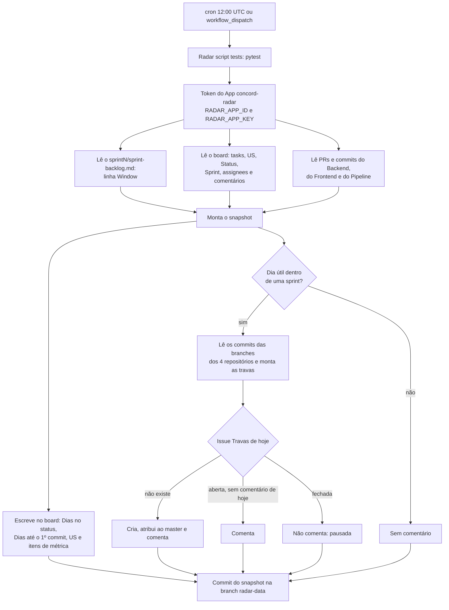

# QA

A frente de QA define o que é "pronto" e em que ponto do processo cada item é conferido, garante que
a tela e a API falam o mesmo contrato e mede o próprio processo do time: o **Radar de QA** registra
as métricas de cada sprint no board e avisa, todo dia útil, quem está travando a sprint.

Veja a versão em inglês [aqui](../../../DevOps/qa/README.md).

| | |
| --- | --- |
| Construída por | `RichardCordeiro` |
| Repositórios | [API-5](https://github.com/Concord-API/API-5), [API5-Backend](https://github.com/Concord-API/API5-Backend), [API5-Frontend](https://github.com/Concord-API/API5-Frontend) |
| Tasks | [DVP-06](https://github.com/Concord-API/API-5/issues/252), [DVP-07](https://github.com/Concord-API/API-5/issues/253), [DVP-08](https://github.com/Concord-API/API-5/issues/254), [DVP-34](https://github.com/Concord-API/API-5/issues/281), [DVP-35](https://github.com/Concord-API/API-5/issues/285), [DVP-69](https://github.com/Concord-API/API-5/issues/381), [DVP-70](https://github.com/Concord-API/API-5/issues/382), [DVP-71](https://github.com/Concord-API/API-5/issues/383), [DVP-72](https://github.com/Concord-API/API-5/issues/384), [DVP-85](https://github.com/Concord-API/API-5/issues/419) |
| Atualizada em | 27/11/2026 |

## Visão geral

A frente tem quatro partes:

1. **DoD (Definition of Done):** o que é "pronto", em que nível do caminho cada item é verificado
   e por quem. O texto está na [DoD](../../Scrum/definition-of-done.md).
2. **Checklist de QA:** inserido no PR `usX → main`, para o autor da história conferir os itens de
   produto da DoD.
3. **Teste de contrato:** valida as respostas reais da API contra os schemas `zod` que a tela usa.
4. **Radar de QA:** mede o processo do time (métricas e gráficos no Insights do board) e menciona no
   GitHub, todo dia útil, quem está travando a sprint, na issue "🚨 Travas de hoje".

Onde cada parte entra no processo:

- **Push na `usX`:** o teste de contrato (`npm run test:contract`) roda dentro do `Acceptance` do
  Frontend, que é da frente de [CI](../ci/README.md).
- **PR `usX → main`:** o workflow `QA checklist` insere o checklist no corpo do PR, e o autor da
  história preenche. O quality gate do Sonar é exigido pelo ruleset da `main`.
- **Fora do caminho do código:** o Radar roda todo dia no API-5 e só lê os repositórios de código.

Com quem a frente conversa:

- **[CI](../ci/README.md) (`victorgsnogueira`):** dona dos workflows `ci.yml`, `acceptance.yml` e
  `release*.yml` e dos jobs de qualidade. A frente de QA define na DoD o que eles precisam provar.
- **SM (`joaoandrade17`):** é o master mencionado nas travas e cria o `sprintN/sprint-backlog.md`,
  de onde o Radar lê a janela da sprint.
- **Board [API V Tasks](https://github.com/orgs/Concord-API/projects/5):** o campo `Sprint`, as
  tasks com o ID no título e as branches com o ID no nome são a entrada do Radar.

O que quebra se a frente parar:

- **Checklist de QA:** o PR `usX → main` abre sem ele, e ninguém confere os itens de produto da DoD.
- **Teste de contrato:** uma mudança de contrato na API que a tela não aceita passa no `Acceptance`
  sem ninguém perceber.
- **Radar:** os campos e os gráficos param no último dia coletado, a issue de travas deixa de ser
  comentada e o histórico diário na `radar-data` para de crescer.
- **O que não para:** o código do produto, o CI e a release.

## O que existe

### DoD, checklist e contrato

| Item | Onde fica | Para que serve |
| --- | --- | --- |
| Definition of Done (DoD) | [`Docs/pt_br/Scrum/definition-of-done.md`](../../Scrum/definition-of-done.md) e [`Docs/Scrum/definition-of-done.md`](../../../Scrum/definition-of-done.md) | o que é pronto, em que nível e por quem é verificado |
| `qa-checklist.md` | `.github/qa-checklist.md` do [API5-Backend](https://github.com/Concord-API/API5-Backend/blob/main/.github/qa-checklist.md) e do [API5-Frontend](https://github.com/Concord-API/API5-Frontend/blob/main/.github/qa-checklist.md) (iguais) | texto do checklist de QA: teste exploratório e itens de produto da DoD |
| `qa-checklist.sh` | `.github/scripts/qa-checklist.sh` do [API5-Backend](https://github.com/Concord-API/API5-Backend/blob/main/.github/scripts/qa-checklist.sh) e do [API5-Frontend](https://github.com/Concord-API/API5-Frontend/blob/main/.github/scripts/qa-checklist.sh) | recebe o corpo do PR e devolve o corpo com o checklist; só insere se a base é `main`, a head bate com `^us[1-9][0-9]*$` e o título `## QA da história` ainda não está no corpo |
| `qa-checklist.test.sh` | `.github/scripts/tests/qa-checklist.test.sh` nos dois repositórios | testes do script |
| Workflow `QA checklist` | `.github/workflows/qa-checklist.yml` do [API5-Backend](https://github.com/Concord-API/API5-Backend/blob/main/.github/workflows/qa-checklist.yml) e do [API5-Frontend](https://github.com/Concord-API/API5-Frontend/blob/main/.github/workflows/qa-checklist.yml) | job `QA checklist`: insere o checklist no PR para a `main` (eventos `opened` e `reopened`); job `QA checklist script tests`: roda os testes nos PRs para `us*` |
| Quality gate do Sonar | jobs `Backend quality`, `Frontend quality` e `Pipeline quality` do `ci.yml` de cada repositório, exigidos pelo ruleset da `main` | gate `Sonar way` do SonarQube Cloud; o funcionamento está na doc da [CI](../ci/README.md#job-de-qualidade) |
| Script `test:contract` | [`API5-Frontend/ratio/apps/web/package.json`](https://github.com/Concord-API/API5-Frontend/blob/main/ratio/apps/web/package.json) | roda `vitest run --config vitest.contract.config.ts`, ou seja, os `src/**/*.contract.test.ts` contra a API real em `CONTRACT_API_URL` |
| `themes.contract.test.ts` | [`API5-Frontend/ratio/apps/web/src/api/themes.contract.test.ts`](https://github.com/Concord-API/API5-Frontend/blob/main/ratio/apps/web/src/api/themes.contract.test.ts) | busca `cobranca de divida` e valida a busca, o detalhe, os painéis e as teses do STJ do primeiro tema com os schemas `zod` (`getJson` faz `schema.parse`) |
| Passo `Check the API responses against the frontend contract` | [`API5-Frontend/.github/workflows/acceptance.yml`](https://github.com/Concord-API/API5-Frontend/blob/main/.github/workflows/acceptance.yml) | onde o `test:contract` roda no `Acceptance`, com `CONTRACT_API_URL: http://127.0.0.1:8080` (o IIS do runner) |

### Radar de QA

| Item | Onde fica | Para que serve |
| --- | --- | --- |
| Workflow `Radar` | [`.github/workflows/radar.yml`](../../../../.github/workflows/radar.yml) | jobs `Radar script tests` (pytest) e `Radar` (coleta, escreve no board, comenta as travas e salva o snapshot). Dispara pelo `cron: "0 12 * * *"` (9h em São Paulo), por `workflow_dispatch` e por PR que mexe em `radar/**`, no `.github/radar.yml` ou no próprio workflow; no PR, só roda os testes |
| Código do Radar | [`radar/radar/`](../../../../radar/radar) | `github.py`: cliente GraphQL. `fetch.py`: leitura do board, dos PRs e dos commits das branches. `collect.py`: monta o snapshot. `sprints.py`: lê a janela da sprint. `links.py`: liga a task à US e à branch. `metrics.py`: métricas. `board.py`: escrita no board. `alerts.py`: regras das travas. `issue.py`: issue de travas. `__main__.py`: orquestra |
| Testes do Radar | [`radar/tests/`](../../../../radar/tests), com `radar/pytest.ini` e `radar/requirements.txt` (`pytest==8.3.3`, `pyyaml==6.0.2`) | 76 testes |
| `radar.yml` | [`.github/radar.yml`](../../../../.github/radar.yml) | configuração: `owner`, `project: 5`, `board_repo: API-5`, `code_repos`, `timezone: America/Sao_Paulo`, `sprint_backlogs: sprint*/sprint-backlog.md` e o bloco `alerts` |
| GitHub App `concord-radar` | organização `Concord-API` → Settings → GitHub Apps; o dono é a organização | gera o token do Radar a cada execução. Permissões: `contents: read`, `issues: write`, `metadata: read`, `organization_projects: write` e `pull_requests: read`; instalado só nos repositórios selecionados |
| Secret `RADAR_APP_ID` | API-5 → Settings → Secrets → Actions | ID do App |
| Secret `RADAR_APP_KEY` | API-5 → Settings → Secrets → Actions | chave privada do App |
| Branch `radar-data` | API-5 | um arquivo `radar/data/AAAA-MM-DD.json` por dia, com o snapshot da coleta. É só histórico: o Radar nunca lê de volta |
| Campo `Dias no status` (número) | board | dias desde a última mudança de `Status` da task aberta e fora de `Done` |
| Campo `Dias até o 1º commit` (número) | board | por task: dias da criação da issue até o primeiro commit dos PRs dela (PRs para a `main` não contam); task aberta sem PR conta até hoje |
| Campo `US` (seleção única) | board | história da task: `US-NN`, `Foundation` (`0.Y`) ou `DevOps` (`DVP-NN`) |
| Campos `Radar`, `Semana`, `Etapa` e `Valor` | board | itens de métrica (draft issues): `Radar` = `Métrica`; `Semana` = `SN·0 planning` a `SN·3` (semanas) ou `SN` (sprint); `Etapa` = `Tasks criadas`, `Commits` ou `Commits por pessoa`; `Valor` = número |
| Visões do board | `View 1`, `Quadro` e `Radar · tempos` | as três filtram `-radar:Métrica`; a `Radar · tempos` mostra as tasks (`has:parent-issue`) com os tempos |
| Gráficos do Insights | board → Insights | 2 gráficos (ver [Métricas e gráficos](#métricas-e-gráficos)) |
| Issue "🚨 Travas de hoje" | [API-5 #423](https://github.com/Concord-API/API-5/issues/423), atribuída ao `joaoandrade17` | recebe um comentário por dia útil com as travas da sprint |

## Como funciona

### A DoD na prática

A [DoD](../../Scrum/definition-of-done.md) diz o que é verificado e em que nível. Cada nível tem um
mecanismo que faz a verificação acontecer:

| Nível da DoD | Mecanismo | Frente |
| --- | --- | --- |
| PR da task | `ci.yml`: formatação, lint, build, testes e análise do Sonar | [CI](../ci/README.md) |
| Acceptance | `acceptance.yml`, com o teste de contrato desta frente dentro | [CI](../ci/README.md) e QA |
| PR `usX → main` | revisão de código (1 aprovação do time `code-reviewers`), label de release, quality gate exigido pelo ruleset e o [checklist de QA](#checklist-de-qa) | CI e QA |
| Push na `main` | CI e quality gate; a release só sai com tudo verde | [CI](../ci/README.md) |

Os itens de **Produto** da DoD (fonte e data de cada valor, escopo visível, estado vazio tratado)
não têm verificação automática: são os itens do checklist de QA.

### Checklist de QA

1. Alguém abre ou reabre um PR para a `main` no Backend ou no Frontend.
2. O job `QA checklist` lê o corpo do PR e passa pelo `qa-checklist.sh`.
3. Se a head é `usN` com N ≥ 1 e o corpo ainda não tem `## QA da história`, o checklist é anexado
   ao fim do corpo com `gh pr edit`. Um PR `us0 → main` não recebe checklist.
4. **O autor da história** preenche o teste exploratório e marca os itens de produto. É uma
   autorrevisão, desde a DVP-35. A revisão por outra pessoa continua no code review, com a
   aprovação exigida pelo ruleset da `main`.
5. O checklist não é um status check exigido: nada bloqueia o merge com uma caixa desmarcada.

### Teste de contrato

1. Um push na `usX` do Frontend dispara o `Acceptance`, que instala a API e a tela em Windows
   Server com IIS, num banco vazio, e carrega a amostra.
2. O passo `Check the API responses against the frontend contract` roda `npm run test:contract`.
3. Cada função de `src/api/*.ts` chama a API real e faz `schema.parse` com o schema `zod` da tela.
   Se a resposta não bate com o schema, o teste falha e o `Acceptance` fica vermelho. O
   `Acceptance` é check exigido na `main`.

### Radar: a coleta diária



O Radar lê do GitHub:

- **Task:** issue do board com título `X.Y ...` ou `DVP-NN ...`.
- **US:** issue com título `US-NN ...`.
- **Sprint da task e da US:** campo de issue `Sprint`, com o valor `Sprint N`.
- **Janela da sprint:** a linha `**Window:** Nov 23 to Dec 11, 2026` do sprint backlog, com o mês
  abreviado em inglês.
- **PR da task:** branch `X.Y-...` ou `DVP-NN-...`.

### Métricas e gráficos

- **Por semana** (`SN·0 planning` é a semana antes do início; `SN·1` a `SN·3`): `Tasks criadas` e
  `Commits`. Os commits são os dos PRs, sem merge commits, contados uma vez e no fuso de São Paulo.
- **Por sprint** (`SN`): `Commits por pessoa`, um item por pessoa, com a pessoa como assignee. Os
  commits da semana de planning contam para a sprint seguinte.
- **Por task:** `Dias até o 1º commit` e `Dias no status`.
- **Semana sem opção no campo:** a métrica é pulada e aparece em `weeks_without_option` na saída.

Os dois gráficos do Insights, como foram montados na tela na DVP-72 (a configuração dos gráficos
não aparece pela API):

1. **"1 · Tinha task? E o time fez?":** itens com `Etapa` = `Tasks criadas` e `Commits`; eixo X
   `Semana`; eixo Y a soma de `Valor`.
2. **"2 · Quem fez os commits de cada sprint":** itens `Commits por pessoa`; eixo X `Semana` (`SN`);
   eixo Y a soma de `Valor`, por assignee.

### Travas

As regras ficam em [`radar/radar/alerts.py`](../../../../radar/radar/alerts.py), com os valores do
bloco `alerts` do [`.github/radar.yml`](../../../../.github/radar.yml).

**Atividade** é o dia mais recente com qualquer uma destas coisas:

- commit em qualquer branch do API-5, do Backend, do Frontend ou do Pipeline, dos 14 dias antes do
  início da sprint até hoje;
- commit de PR;
- comentário numa task;
- mudança de `Status` de uma task (conta para todos os assignees dela).

**Pessoa do `team` com task aberta da sprint e fora de `Done`:** conta os dias úteis desde
`max(última atividade, início da sprint)`.

- `>= idle_days` (2): ⏰ e menção à pessoa.
- `>= escalate_days` (4): 🔥 e menção ao `master` junto, a não ser que a pessoa seja o próprio
  master.

**Para o `master`:**

- sprint sem nenhuma task, nem aberta nem fechada: 📭, todo dia;
- task aberta da sprint sem assignee: 📌;
- US aberta da sprint sem nenhuma task: 📝;
- pessoa do `team` sem task aberta: 🙋, só se a sprint tem alguma US. Ela aparece pelo login entre
  crases, sem menção, e quem está em `no_task_expected` (`vp-p`) nunca aparece.

**Sem nenhuma trava:** "✅ Nenhuma trava hoje."

**Marcador:** o comentário começa com `<!-- radar:AAAA-MM-DD -->`. Se o último comentário já tem o
marcador do dia, o Radar não comenta de novo.

**Formato do comentário**, montado pela função `render`:

```
### 🚨 Travas de DD/MM · Sprint N

**Parados com task no nome**
- ⏰ @login, **2 dias úteis** sem commit, comentário ou card movido, com 1 task no nome: #123
- 🔥 @login, **4 dias úteis** sem commit, comentário ou card movido, com 2 tasks no nome: #124, #125 · @master

**Para o @master**
- 📭 A Sprint N começou há 1 dia útil e não tem nenhuma task.
- 📌 1 task sem ninguém: #126
- 🙋 Sem task na sprint: `login`
- 📝 US sem nenhuma task: US-NN

_Fechar esta issue pausa as cobranças. Reabrir volta._
```

Cada bloco só aparece quando tem item. Quando a issue não existe, o Radar a cria com um texto de
apresentação das regras (constante `INTRO` em [`radar/radar/issue.py`](../../../../radar/radar/issue.py)),
atribui ao master e comenta logo em seguida.

### Travas: o que cada pessoa do time precisa saber

- **Onde:** na issue "🚨 Travas de hoje" ([#423](https://github.com/Concord-API/API-5/issues/423)).
  A menção chega pela notificação do GitHub, por e-mail ou pelo app.
- **Quando:** um comentário por dia útil, programado para as 9h de Brasília. O agendamento do GitHub
  costuma atrasar algumas horas.
- **Por que fui mencionado (⏰):** você tem task aberta da sprint no seu nome e está há 2 dias úteis
  ou mais sem nenhuma atividade.
- **Por que o master veio junto (🔥):** chegou a 4 dias úteis.
- **O que conta como atividade:** um commit em qualquer branch do API-5, do Backend, do Frontend ou
  do Pipeline, um comentário numa task sua ou mover o card de uma task sua no board.
- **Não tenho task e não fui mencionado:** está certo. Sem task no nome, a responsabilidade é do
  master; você aparece só na linha 🙋 da parte dele, sem menção.
- **Estou numa task sem código (instalação, documentação):** comente na task o que fez ou mova o
  card. Isso já conta como atividade.
- **A task não é mais minha:** tire o seu nome dela no board; a menção sai no dia seguinte.
- **Terminei:** mova a task para `Done` ou feche a issue; ela deixa de contar.
- **Pausar tudo:** fechar a issue pausa as menções para todos; reabrir volta.

## Decisões

### O Radar não escreve nos repositórios de código

- **Contexto:** regra do time: os repositórios do cliente (API5-Backend, API5-Frontend e
  API5-Pipeline) só podem ser lidos.
- **Alternativas:** labels, comentários ou bots nos repositórios de código.
- **Por quê:** é regra do projeto.
- **Consequências:** tudo o que o Radar escreve fica no API-5 e no board.

### Nenhum trabalho manual a mais para o time

- **Contexto:** restrição do time e do professor.
- **Alternativas:** formulário, motivo de atraso, resumo repassado à mão.
- **Por quê:** é regra do projeto.
- **Consequências:** só entram dados que o GitHub já registra.

### GitHub App em vez de token pessoal

- **Contexto:** o Radar precisa ler 4 repositórios e escrever no board e na issue.
- **Alternativas:** um token pessoal (PAT) de alguém do time.
- **Por quê:** não depende da conta de uma pessoa, e o token é gerado a cada execução.
- **Consequências:** mudar as permissões ou a instalação exige owner da organização.

### Snapshot diário na branch `radar-data`

- **Contexto:** guardar o histórico sem banco de dados.
- **Alternativas:** artefato do Actions (expira), GitHub Pages, banco de dados.
- **Por quê:** fica no repositório, sem custo e sem expirar.
- **Consequências:** é só histórico; apagar a branch não afeta os campos nem os gráficos.

### Gráficos no Insights do board

- **Contexto:** mostrar as métricas onde o time já trabalha.
- **Alternativas:** um site no GitHub Pages, uma planilha.
- **Por quê:** é nativo do GitHub e não precisa hospedar nada.
- **Consequências:** o eixo X só aceita campo de seleção única, por isso `Semana` é seleção única,
  com as opções na ordem do calendário.

### A sprint da task vem do campo `Sprint`, não da data de criação

- **Contexto:** pela data de criação, a DVP-14 e a DVP-39 caíam na sprint errada.
- **Alternativas:** a data de criação da issue.
- **Por quê:** o campo é o que o time planeja.
- **Consequências:** task sem `Sprint` não entra em nenhuma sprint; a janela vem do sprint backlog.

### Só dois gráficos

- **Contexto:** os outros gráficos não mostravam gargalo nem levavam a uma ação.
- **Alternativas:** os 5 gráficos da DVP-72 original, burn up, soma de tempos, espera até o 1º
  commit e quando as tasks foram criadas.
- **Por quê:** o gráfico 1 mostra se a sprint tinha task e se o time fez; o 2 mostra quem ficou
  parado, que é o que as travas cobram.
- **Consequências:** os campos `Dias até o 1º commit` e `Dias no status` ficaram sem gráfico, e o
  campo `Criada` foi apagado do board.

### Mencionar as pessoas numa issue (DVP-85)

- **Contexto:** o professor apontou que olhar o gráfico, seja o time ou o master, não resolve.
- **Alternativas:** Discord (pouco visto, exige webhook), WhatsApp (sem automação gratuita
  confiável), e-mail por SMTP, resumo repassado à mão.
- **Por quê:** a menção do GitHub notifica por e-mail e pelo app, sem nada a configurar e sem
  trabalho manual.
- **Consequências:** só chega a quem não desligou as notificações do GitHub.

### Os prazos de 2 e 4 dias úteis são regra do processo

- **Contexto:** a média de `Dias até o 1º commit` das tasks subiu de 2,3 dias na Sprint 1 para 9,8
  na Sprint 3 (medida num gráfico do Insights que depois foi apagado; o campo continua no board).
- **Alternativas:** tratar os prazos só como configuração, sem valor de processo.
- **Por quê:** definidos por `RichardCordeiro` como regra da frente de QA.
- **Consequências:** mudar `idle_days` ou `escalate_days` no `.github/radar.yml` é mudar o processo
  e precisa ser combinado com o time.

### Cobrar a pessoa, não a task

- **Contexto:** quem está trabalhando em outra task não está travado.
- **Alternativas:** um aviso por task parada.
- **Por quê:** pedido do time.
- **Consequências:** a pessoa sai da lista com qualquer atividade.

### Comentário e card movido contam como atividade

- **Contexto:** tasks sem código (por exemplo, a DVP-68, de instalação no servidor) apareciam como
  travadas, como apontou `joaoandrade17`.
- **Alternativas:** cadastrar uma exceção por task; aceitar o alarme.
- **Por quê:** não exige cadastro e mostra que alguém está olhando a task.
- **Consequências:** dá para calar o aviso com um comentário; o campo `Dias até o 1º commit` mede
  por task e não é afetado.

### O API-5 conta como repositório de commit

- **Contexto:** as tasks de documentação só têm commit no API-5, como apontou `joaoandrade17`.
- **Alternativas:** contar só os `code_repos`.
- **Por quê:** sem o API-5, quem só documenta aparecia como travado.
- **Consequências:** os commits do bot na `radar-data` aparecem, mas o bot não está no `team`.

### "Sem task" só quando a sprint tem US

- **Contexto:** uma sprint só com tasks DVP marcaria o master todo dia, como apontou
  `joaoandrade17`.
- **Alternativas:** marcar sempre.
- **Por quê:** sem US, não há trabalho de produto para distribuir.
- **Consequências:** uma sprint sem US e sem task cai no 📭.

### O PO só é cobrado quando tem task no nome

- **Contexto:** o PO (`vp-p`) não costuma pegar task.
- **Alternativas:** tirar o PO do `team`.
- **Por quê:** pedido do time.
- **Consequências:** `no_task_expected: [vp-p]`.

### Pausar fechando a issue

- **Contexto:** precisa de um jeito de parar as menções sem mexer em código.
- **Alternativas:** uma flag no `radar.yml`, um label.
- **Por quê:** qualquer pessoa com acesso faz em um clique.
- **Consequências:** o Radar não recria uma issue fechada; para voltar, basta reabrir.

### Checklist inserido por workflow, não por template (DVP-07)

- **Contexto:** o GitHub não escolhe o template de PR pela branch de destino.
- **Alternativas:** `PULL_REQUEST_TEMPLATE`.
- **Por quê:** só o PR `usX → main` precisa do checklist; o PR de task continua só com título.
- **Consequências:** é uma exceção à regra "PR só com título", com aval do PO, registrado na DVP-07.

### Checklist como autorrevisão do autor (DVP-35)

- **Contexto:** na versão da DVP-07, outra pessoa fazia o teste e o PO dava o aceite no PR.
- **Alternativas:** manter o teste por outra pessoa e o aceite do PO.
- **Por quê:** decisão do time na DVP-35.
- **Consequências:** a revisão por outra pessoa continua no code review, com 1 aprovação.

### Teste de contrato com os schemas `zod` da tela (DVP-08)

- **Contexto:** a tela e a API podiam divergir sem ninguém ver.
- **Alternativas:** um contrato separado (OpenAPI, Pact).
- **Por quê:** reaproveita os schemas que a tela já usa.
- **Consequências:** cobre só a busca, o detalhe, os painéis e as teses do STJ do primeiro tema de
  `cobranca de divida`.

## Como fazer

### Abrir uma sprint nova no Radar

**Quando:** antes do primeiro dia da sprint.

**Antes de começar:** admin do board e escrita no API-5.

1. Crie o `sprintN/sprint-backlog.md` no API-5 com a linha
   `**Window:** Mon D to Mon D, AAAA` (por exemplo, `**Window:** Nov 23 to Dec 11, 2026`).
2. No board → Settings → campo `Semana`, adicione as opções `SN·0 planning`, `SN·1`, `SN·2`, `SN·3`
   e `SN`. O `·` é o ponto do meio (U+00B7). Mantenha a ordem do calendário: as semanas da sprint N
   depois das da N−1, e o `SN` junto dos outros `S1`, `S2`… no fim.
3. Para cada US nova, adicione a opção `US-NN` no campo `US`.
4. Ponha as tasks e as US no campo `Sprint` = `Sprint N`.

**Como conferir:** rode o Radar à mão e veja `"weeks_without_option": []` na saída do passo
`Collect and update the board`.

**Como desfazer:** apague o arquivo; as opções sem item não aparecem nos gráficos.

### Rodar o Radar à mão

**Quando:** para conferir uma mudança ou quando o agendado atrasar.

**Antes de começar:** o `gh` autenticado com escrita no API-5.

1. Dispare o workflow:
   ```
   gh workflow run radar.yml -R Concord-API/API-5 --ref main
   ```
2. Acompanhe:
   ```
   gh run list -w Radar -R Concord-API/API-5 -L 1
   ```
   Saída esperada: `workflow_dispatch` … `completed success`.

**Como conferir:** na saída JSON do passo `Collect and update the board`, `"dry_run": false` e
`"alerts": {"step": ...}` com um destes valores:

- `create`: criou a issue;
- `comment`: comentou;
- `already`: já tinha o comentário do dia;
- `paused`: a issue está fechada;
- `off`: fim de semana, fora de sprint ou sem `alerts` no `radar.yml`.

E aparece um commit novo na `radar-data`.

**Como desfazer:** não se aplica. A coleta só sobrescreve o snapshot do dia e atualiza valores.

### Rodar o Radar no próprio computador, sem escrever nada

**Antes de começar:** Python 3.12 e um `gh auth token` com leitura dos repositórios e do projeto.

1. Na raiz do API-5, crie o ambiente:
   ```
   python3.12 -m venv .venv && .venv/bin/pip install -r radar/requirements.txt
   ```
2. Rode em modo de simulação:
   ```
   RADAR_TOKEN=$(gh auth token) PYTHONPATH=radar .venv/bin/python -m radar --out /tmp/radar-out --dry-run
   ```
   Saída esperada: um JSON com `"dry_run": true`. Em dia de sprint, `alerts.message` traz o texto
   que seria comentado. O snapshot fica em `/tmp/radar-out/`.
3. Rode os testes:
   ```
   cd radar && ../.venv/bin/python -m pytest -q
   ```
   Saída esperada: `76 passed`.

**Como conferir:** os passos 2 e 3 terminam com a saída esperada.

**Como desfazer:** não se aplica, porque nada é escrito no GitHub.

### Ajustar os prazos ou as pessoas das travas

**Quando:** o time combinou um prazo novo ou alguém entrou ou saiu do time.

**Antes de começar:** escrita no API-5. Lembre que mudar os prazos é mudar o processo (ver
[Decisões](#os-prazos-de-2-e-4-dias-úteis-são-regra-do-processo)).

1. Numa branch de task criada a partir da `us0`, altere o bloco `alerts` do `.github/radar.yml`:
   - `idle_days` e `escalate_days`: os prazos;
   - `master`: quem recebe as travas do processo;
   - `team`: todos os logins avaliados;
   - `no_task_expected`: quem só é cobrado com task no nome;
   - `title`: o título da issue. Ao mudar o título, o Radar cria uma issue nova.
2. Rode os testes (ver [Rodar o Radar no próprio computador](#rodar-o-radar-no-próprio-computador-sem-escrever-nada)).
3. Abra o PR para a `us0` e, depois, o da `us0` para a `main`. O agendado usa o código da `main`.

**Como conferir:** rode o Radar à mão num dia útil e leia o comentário.

**Como desfazer:** reverta o commit.

### Pausar ou voltar as travas

1. Feche a issue [#423](https://github.com/Concord-API/API-5/issues/423) para pausar; reabra para
   voltar.

**Como conferir:** a próxima execução retorna `"step": "paused"`.

### Mudar uma regra das travas ou adicionar uma métrica ou gráfico

**Antes de começar:** escrita no API-5 e, para campo ou gráfico, admin do board.

1. Escreva o teste primeiro, em `radar/tests/test_alerts.py` ou `radar/tests/test_metrics.py`. A
   ordem dos commits é `test:` e depois `feat:`.
2. Para uma regra, altere `plan_alerts` e `render` em `radar/radar/alerts.py`.
3. Para uma métrica, altere `radar/radar/metrics.py`, devolvendo
   `Metric(semana, etapa, valor, pessoa, pessoa_id)`. Uma `Etapa` nova precisa da opção no campo
   `Etapa` do board antes. Um campo novo por task precisa ser criado no board e lido no `ITEMS` do
   `fetch.py`.
4. Para um gráfico, crie à mão no Insights, com o eixo X num campo de seleção única e o eixo Y em
   contagem ou soma/média de um campo número.

**Como conferir:** os testes passam e a execução à mão mostra o valor novo no board.

**Como desfazer:** reverta os commits; um gráfico é apagado à mão no Insights.

### Mudar o checklist de QA

**Antes de começar:** escrita no API5-Backend e no API5-Frontend.

1. Altere o `.github/qa-checklist.md` igual nos dois repositórios. A primeira linha
   (`## QA da história`) é o que impede a duplicação: se ela mudar, os PRs reabertos que têm a
   versão antiga recebem o checklist de novo.
2. Rode os testes do script:
   ```
   bash .github/scripts/tests/qa-checklist.test.sh
   ```
3. Abra o PR para a `us0` de cada repositório.

**Como conferir:** abra um PR `usX → main` e veja o checklist no corpo.

**Como desfazer:** reverta o commit.

### Atualizar o contrato quando a API muda

**Antes de começar:** a API rodando no próprio computador, com a carga de amostra.

1. Altere o schema `zod` em `ratio/apps/web/src/api/*.ts` do Frontend junto com a tela.
2. Rode o teste de contrato:
   ```
   cd ratio/apps/web && CONTRACT_API_URL=<endereço da API> npm run test:contract
   ```
3. Um endpoint novo que a tela usa ganha um `it(...)` em `themes.contract.test.ts` ou em outro
   arquivo `*.contract.test.ts`.

**Como conferir:** o `Acceptance` fica verde na `usX`.

**Como desfazer:** reverta o commit.

### Recuperar o histórico se a coleta falhar ou a `radar-data` for apagada

- Os campos e os gráficos não dependem da `radar-data`: toda execução recalcula tudo a partir do
  GitHub.
- Se a branch for apagada, a próxima execução cria uma `radar-data` nova, sem histórico
  (`git worktree add --orphan`), e segue salvando. Os snapshots antigos se perdem.
- O snapshot de um dia em que a coleta falhou não pode ser refeito depois, porque ele guarda o
  estado daquele dia. Rodar à mão no mesmo dia salva o dia.

### Trocar a chave do GitHub App

**Antes de começar:** owner da organização `Concord-API`.

1. Organização → Settings → GitHub Apps → `concord-radar` → Private keys → Generate a private key.
   O GitHub baixa um arquivo `.pem`.
2. Grave a chave no secret:
   ```
   gh secret set RADAR_APP_KEY -R Concord-API/API-5 < arquivo.pem
   ```
3. Rode o Radar à mão e veja o passo `app` verde.
4. Apague a chave antiga no App e apague o `.pem` do computador.

**Como desfazer:** gere outra chave.

### Mudar as permissões ou a instalação do App

**Antes de começar:** owner da organização `Concord-API`.

1. Organização → Settings → GitHub Apps → `concord-radar` → Permissions & events, e Save.
2. Organização → Settings → GitHub Apps instalados → `concord-radar` → aceite as novas permissões.
   Sem esse aceite, nada muda.

**Como conferir:** rode o Radar à mão e veja a execução terminar com `success`.

## Como saber se está funcionando

- **Radar:**
  - `gh run list -w Radar -R Concord-API/API-5` mostra uma execução `schedule` com `success` por
    dia. Ela pode atrasar horas: em 25/11 e 26/11/2026, só começou às 17h47 e às 17h39.
  - Um commit `chore: add the radar snapshot of AAAA-MM-DD` por dia na `radar-data`.
  - No board, `Dias no status` e `Dias até o 1º commit` preenchidos nas tasks, e os itens de métrica
    da semana atual com o `Valor` atualizado.
  - Os 2 gráficos do Insights mostram a semana atual.
- **Travas:**
  - A issue [#423](https://github.com/Concord-API/API-5/issues/423) recebe um comentário por dia útil
    dentro da sprint, começando com o marcador do dia.
  - Os mencionados recebem o e-mail ou a notificação.
- **Checklist:** todo PR `usX → main` novo no Backend ou no Frontend abre com o bloco
  `## QA da história`.
- **Contrato:** o passo `Check the API responses against the frontend contract` fica verde no
  `Acceptance` da `usX` do Frontend.
- **Sonar:** `Backend quality`, `Frontend quality` e `Pipeline quality` verdes no PR para a `main`.

## Problemas conhecidos

| Sintoma | Causa | O que fazer |
| --- | --- | --- |
| O Insights não deixa usar `Semana` no eixo X | O campo era texto; o eixo X só aceita seleção única | Já corrigido: `Semana` é seleção única, com as opções na ordem do calendário |
| A DVP-14 e a DVP-39 apareciam na Sprint 2 | A sprint vinha da data de criação da issue | Já corrigido: vem do campo `Sprint` |
| A espera por revisão aparecia inflada | Um PR fechado sem merge contava até hoje | Corrigido e, depois, a métrica de revisão saiu |
| A task `PRC-01` aparecia como "No Criada" | O `links.py` só reconhece `X.Y` e `DVP-NN`; o container Process saiu na DVP-74 | Use só os prefixos `X.Y` e `DVP-NN`; outro prefixo exige mudar `TASK` no `links.py` |
| Métrica sumida de uma semana | Falta a opção da semana no campo `Semana` | Crie a opção (ver [Abrir uma sprint nova no Radar](#abrir-uma-sprint-nova-no-radar)) e confira o `weeks_without_option` |
| Opção `US-NN` não preenchida | Falta a opção no campo `US` | Crie a opção |
| O agendado das 9h roda à tarde | O GitHub atrasa o `schedule` em horário de pico | Espere ou rode à mão |
| O Radar falhava ao criar a issue | O App tinha `issues: read` | Já corrigido em 26/11/2026: `issues: write`, aceito na instalação |
| Snapshot do dia não salvo | Se o passo `Collect and update the board` falha, inclusive nas travas, o passo do snapshot não roda | Veja o log e rode à mão no mesmo dia |
| `gh pr create` falha com "Base ref must be a branch" | A `us0` é apagada no merge `us0 → main` | Recrie a `us0` a partir da `main` antes do PR seguinte |
| A pessoa travada não vê a menção | Notificações do GitHub desligadas ou filtradas | A pessoa liga "Participating, @mentions" em github.com/settings/notifications |
| A pessoa recebe todos os comentários da issue | Quem é mencionado fica inscrito na issue | "Unsubscribe" na issue; só volta a receber quando for mencionado |
| A métrica `Commits` não conta commit fora de PR | `week_metrics` e `person_metrics` só usam os commits dos PRs | Limitação aceita; as travas leem todas as branches |
| PR `us0 → main` sem checklist | O script só aceita head `usN` com N ≥ 1 | Comportamento esperado |

## Para continuar

**Pela metade:**

- O campo `Criada` foi apagado do board, mas o código ainda calcula o valor (`created_in` no
  `metrics.py`, a escrita no `__main__.py` e o alias no `fetch.py`). Sem o campo, a escrita é
  descartada pelo `known_options` e não dá erro; esse código pode ser removido.

**Limitações aceitas:**

- O checklist de QA não bloqueia o merge.
- O teste de contrato cobre só 4 chamadas do primeiro tema de uma busca fixa.
- Dia útil é só segunda a sexta: feriados contam como dia útil nas travas.
- Na leitura das travas, o Radar considera os 20 últimos comentários de cada task e até 50 commits
  por branch desde 14 dias antes do início da sprint.
- As travas dependem de existir um `sprintN/sprint-backlog.md` com a linha `Window`. Hoje existem
  da Sprint 1 à Sprint 4; sem a próxima, as travas param depois de 11/12/2026.
- Os gráficos do Insights são configurados à mão e não estão versionados.

**Melhorias sugeridas:** contar os commits fora de PR nas métricas; versionar a configuração dos
gráficos num documento; um passo no workflow que falhe quando `weeks_without_option` não estiver
vazio.

**Acessos para quem assumir:**

- Owner da organização `Concord-API`, para o App e a instalação.
- Admin do projeto 5 (board), para campos, opções, visões e Insights.
- Escrita no API-5 e acesso aos secrets `RADAR_APP_ID` e `RADAR_APP_KEY`.
- Escrita no API5-Backend e no API5-Frontend, para o checklist e o contrato.

## Referências

**Tasks e PRs**, todas de `RichardCordeiro`:

| Task | PRs |
| --- | --- |
| [DVP-06](https://github.com/Concord-API/API-5/issues/252) Align the Definition of Done with how the project works today | [API-5 #261](https://github.com/Concord-API/API-5/pull/261) |
| [DVP-07](https://github.com/Concord-API/API-5/issues/253) Add the QA checklist to the pull request template from a US branch to main | [Backend #81](https://github.com/Concord-API/API5-Backend/pull/81), [Frontend #63](https://github.com/Concord-API/API5-Frontend/pull/63) |
| [DVP-08](https://github.com/Concord-API/API-5/issues/254) Validate real API responses against the frontend zod schemas | [Backend #84](https://github.com/Concord-API/API5-Backend/pull/84), [Frontend #65](https://github.com/Concord-API/API5-Frontend/pull/65) |
| [DVP-34](https://github.com/Concord-API/API-5/issues/281) Add the Sonar quality gate to the Definition of Done | [API-5 #282](https://github.com/Concord-API/API-5/pull/282) |
| [DVP-35](https://github.com/Concord-API/API-5/issues/285) Make the QA checklist a self-review by the story's author | [API-5 #286](https://github.com/Concord-API/API-5/pull/286), [Backend #94](https://github.com/Concord-API/API5-Backend/pull/94), [Frontend #71](https://github.com/Concord-API/API5-Frontend/pull/71) |
| [DVP-69](https://github.com/Concord-API/API-5/issues/381) Add the board fields that the Radar fills | configuração no board, sem PR |
| [DVP-70](https://github.com/Concord-API/API-5/issues/382) Add the Radar workflow that collects the data every day | [API-5 #385](https://github.com/Concord-API/API-5/pull/385) |
| [DVP-71](https://github.com/Concord-API/API-5/issues/383) Measure the planning and the execution of each sprint | [API-5 #387](https://github.com/Concord-API/API-5/pull/387), [#393](https://github.com/Concord-API/API-5/pull/393) |
| [DVP-72](https://github.com/Concord-API/API-5/issues/384) Build the QA charts in Insights | [API-5 #389](https://github.com/Concord-API/API-5/pull/389), [#395](https://github.com/Concord-API/API-5/pull/395), [#397](https://github.com/Concord-API/API-5/pull/397), [#399](https://github.com/Concord-API/API-5/pull/399) |
| [DVP-85](https://github.com/Concord-API/API-5/issues/419) Report the stalled work every weekday in an API-5 issue | [API-5 #420](https://github.com/Concord-API/API-5/pull/420), [#424](https://github.com/Concord-API/API-5/pull/424) |

PRs da `us0` para a `main` do API-5 com esse trabalho:
[#394](https://github.com/Concord-API/API-5/pull/394), [#396](https://github.com/Concord-API/API-5/pull/396),
[#398](https://github.com/Concord-API/API-5/pull/398), [#400](https://github.com/Concord-API/API-5/pull/400),
[#422](https://github.com/Concord-API/API-5/pull/422) e [#425](https://github.com/Concord-API/API-5/pull/425).

**Ferramentas e versões:**

- Python 3.12, `pytest==8.3.3` e `pyyaml==6.0.2`.
- `actions/checkout@v4`, `actions/setup-python@v5` e `actions/create-github-app-token@v1`.
- `zod` `^4.6.5` e `vitest` `^5.0.1` no Frontend.
- [SonarQube Cloud](https://docs.sonarsource.com/sonarqube-cloud/), gate `Sonar way`.
- [GitHub Projects: Insights](https://docs.github.com/issues/planning-and-tracking-with-projects/viewing-insights-from-your-project).
- [GitHub GraphQL API](https://docs.github.com/graphql).
- [GitHub Apps](https://docs.github.com/apps).

**Docs das outras frentes:** [CI](../ci/README.md), onde ficam os workflows, o `Acceptance` e o
quality gate.
