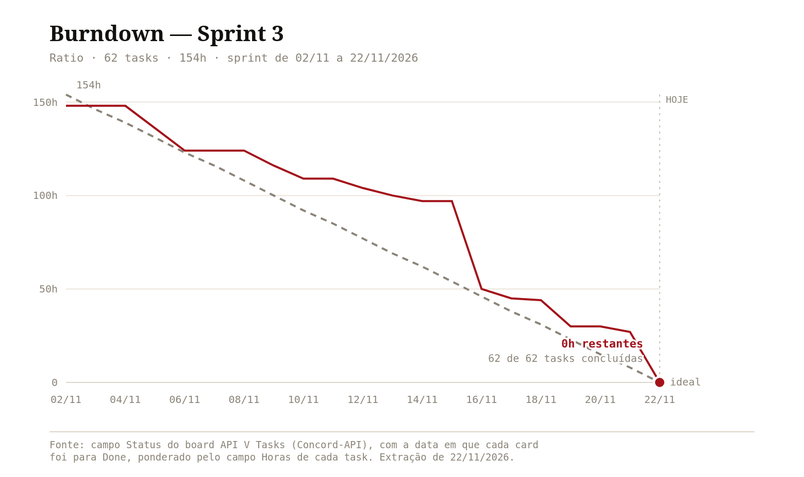

# Sprint Backlog — Sprint 3

**Window:** Nov 2 to Nov 22, 2026

**Board:** [GitHub Project](https://github.com/orgs/Concord-API/projects/5) · snapshot of Nov 22, 2026

**Definitions:** [Definition of Ready](../Docs/Scrum/definition-of-ready.md) · [Definition of Done](../Docs/Scrum/definition-of-done.md)

## Sprint goal

> **The user checks inside Ratio the cases, rulings and precedents behind the topic, and takes the result into their own work: exports the decisions, copies the ready citation and shares the link to the tab.**

Stories the team commits to delivering. If any of them is not completed, the sprint did not meet its goal.

| ID | Priority | Description | SP | Tasks | Hours | Status |
| --- | --- | --- | ---: | ---: | ---: | --- |
| **US-13** | Could | As a **user**, I want the tab I am viewing to be reflected in the URL, so that I can send a colleague the exact link to the part I want to show | 5 | 3 | 6h | Done |
| **US-39** | Should | As a **user**, I want to see the data of each case in the sample inside Ratio, taken from the court's own site, so that I can check the case without leaving the product | 5 | 8 | 21h | Done |
| **US-40** | Should | As a **user**, I want to see the rulings that make up the topic's case law, with court, judging body, date, summary and a link to the court's page, in the same table pattern as the cases, so that I can read how the courts decided and not only count the cases | 8 | 8 | 23h | Done |
| **US-41** | Should | As a **user**, I want to see the qualified precedents related to the topic — súmulas, temas repetitivos, IRDR, IAC and repercussão geral — with type, number, court, thesis and status, so that I know what binds the courts on this topic and not only how they have decided | 8 | 7 | 15h | Done |

## Outside the goal

Stories planned in the sprint that can move to the next one if there is not enough capacity, even though they are priorities.

| ID | Priority | Description | SP | Tasks | Hours | Status |
| --- | --- | --- | ---: | ---: | ---: | --- |
| **US-27** | Should | As a **user**, I want to export to CSV the decisions that support the topic, so that I can work the data outside the tool | 5 | 6 | 9h | Done |
| **US-28** | Should | As a **user**, I want to copy the topic's citation already with the source, the extraction date, the scope and the `n`, so that I can paste it without retyping | 3 | 3 | 5h | Done |

## Sprint summary

| | Total |
| --- | ---: |
| Stories (goal / outside the goal) | 4 / 2 |
| Story points (goal / total) | 26 / 34 |
| Tasks (done / total) | 62 / 62 |
| Hours (done / total) | 154h / 154h |
| Tasks in stories | 35 (79h) |
| Technical Foundation | 2 (10h) |
| Delivery and process | 25 (65h) |

### Hours by assignee

| Assignee | Tasks | Hours | Done |
| --- | ---: | ---: | ---: |
| thiagosabreu | 26 | 60h | 60h |
| JoaoBaranov | 10 | 31h | 31h |
| IsaacOliveiraSouza | 11 | 25h | 25h |
| RichardCordeiro | 8 | 20h | 20h |
| victorgsnogueira | 6 | 17h | 17h |
| joaoandrade17 | 1 | 1h | 1h |

### Hours by layer

| Layer | Hours | Done |
| --- | ---: | ---: |
| DevOps | 49h | 49h |
| ETL | 31h | 31h |
| Backend | 30h | 30h |
| Frontend | 24h | 24h |
| Test | 16h | 16h |
| Docs | 4h | 4h |

## Burndown

Remaining hours per day, from the board's `Status` field and each task's hours. Status on Nov 22, 2026.

## Stories and tasks

### US-13 — As a user, I want the tab I am viewing to be reflected in the URL, so that I can send a colleague the exact link to the part I want to show

_5 SP · Could · Done · 3/3 tasks · 6h_

Issue: [#19](https://github.com/Concord-API/API-5/issues/19)

| # | Task | Layer | Assignee | Est. | Status |
| --- | --- | --- | --- | ---: | --- |
| [13.1](https://github.com/Concord-API/API-5/issues/86) | Validate the tab search param, defaulting to resumo | Frontend | thiagosabreu | 3h | Done |
| [13.2](https://github.com/Concord-API/API-5/issues/87) | Update the URL when the active tab changes | Frontend | thiagosabreu | 2h | Done |
| [13.3](https://github.com/Concord-API/API-5/issues/88) | Make the browser back button return to the previous tab | Frontend | thiagosabreu | 1h | Done |

### US-39 — As a user, I want to see the data of each case in the sample inside Ratio, taken from the court's own site, so that I can check the case without leaving the product

_5 SP · Should · Done · 8/8 tasks · 21h_

Issue: [#329](https://github.com/Concord-API/API-5/issues/329)

| # | Task | Layer | Assignee | Est. | Status |
| --- | --- | --- | --- | ---: | --- |
| [39.1](https://github.com/Concord-API/API-5/issues/343) | Harvest the case data from the TJSP site | ETL | RichardCordeiro | 5h | Done |
| [39.5](https://github.com/Concord-API/API-5/issues/347) | Load the case details and public movements into the warehouse | ETL | thiagosabreu | 4h | Done |
| [39.6](https://github.com/Concord-API/API-5/issues/348) | Expose a case's details and movements by its number | Backend | victorgsnogueira | 3h | Done |
| [39.7](https://github.com/Concord-API/API-5/issues/349) | Remove the court link and the portal hint from the case sample | Frontend | IsaacOliveiraSouza | 1h | Done |
| [39.8](https://github.com/Concord-API/API-5/issues/350) | Build the case view opened from the sample | Frontend | victorgsnogueira | 4h | Done |
| [39.9](https://github.com/Concord-API/API-5/issues/351) | Explain in the case view what does not exist and why | Frontend | victorgsnogueira | 1h | Done |
| [39.10](https://github.com/Concord-API/API-5/issues/352) | Test that no party, lawyer or sealed data reaches the case response | Test | victorgsnogueira | 2h | Done |
| [39.11](https://github.com/Concord-API/API-5/issues/353) | Document the court site sources in the ETL docs | Docs | thiagosabreu | 1h | Done |

### US-40 — As a user, I want to see the rulings that make up the topic's case law, with court, judging body, date, summary and a link to the court's page, in the same table pattern as the cases, so that I can read how the courts decided and not only count the cases

_8 SP · Should · Done · 8/8 tasks · 23h_

Issue: [#330](https://github.com/Concord-API/API-5/issues/330)

| # | Task | Layer | Assignee | Est. | Status |
| --- | --- | --- | --- | ---: | --- |
| [40.1](https://github.com/Concord-API/API-5/issues/354) | Harvest the rulings from the verified source | ETL | IsaacOliveiraSouza | 6h | Done |
| [40.2](https://github.com/Concord-API/API-5/issues/355) | Load the rulings into the warehouse with the summary as published | ETL | IsaacOliveiraSouza | 4h | Done |
| [40.3](https://github.com/Concord-API/API-5/issues/356) | Tie each ruling to the topic by CNJ number or by declared similarity | ETL | victorgsnogueira | 4h | Done |
| [40.4](https://github.com/Concord-API/API-5/issues/357) | Expose the topic's rulings with "N of M", source and extraction date | Backend | JoaoBaranov | 3h | Done |
| [40.5](https://github.com/Concord-API/API-5/issues/358) | Build the rulings table in the Base analítica tab | Frontend | JoaoBaranov | 3h | Done |
| [40.6](https://github.com/Concord-API/API-5/issues/359) | Explain in the block why a court has no rulings | Frontend | JoaoBaranov | 1h | Done |
| [40.7](https://github.com/Concord-API/API-5/issues/360) | Test the rulings ordering and the court without a source | Test | JoaoBaranov | 1h | Done |
| [40.8](https://github.com/Concord-API/API-5/issues/361) | Document the rulings source in the ETL docs | Docs | IsaacOliveiraSouza | 1h | Done |

### US-41 — As a user, I want to see the qualified precedents related to the topic — súmulas, temas repetitivos, IRDR, IAC and repercussão geral — with type, number, court, thesis and status, so that I know what binds the courts on this topic and not only how they have decided

_8 SP · Should · Done · 7/7 tasks · 15h_

Issue: [#331](https://github.com/Concord-API/API-5/issues/331)

| # | Task | Layer | Assignee | Est. | Status |
| --- | --- | --- | --- | ---: | --- |
| [41.2](https://github.com/Concord-API/API-5/issues/363) | Add type, status date, suspension and leading cases to the precedent dimension | Backend | thiagosabreu | 3h | Done |
| [41.3](https://github.com/Concord-API/API-5/issues/364) | Tie each precedent to the topic by similarity over question and thesis | ETL | thiagosabreu | 4h | Done |
| [41.4](https://github.com/Concord-API/API-5/issues/365) | Expose the topic's related precedents | Backend | thiagosabreu | 2h | Done |
| [41.5](https://github.com/Concord-API/API-5/issues/366) | Build the precedents block with cancelled ones marked | Frontend | IsaacOliveiraSouza | 3h | Done |
| [41.6](https://github.com/Concord-API/API-5/issues/367) | Explain in the block why a topic has no related precedent | Frontend | IsaacOliveiraSouza | 1h | Done |
| [41.7](https://github.com/Concord-API/API-5/issues/368) | Test that labour and electoral precedents are not loaded | Test | IsaacOliveiraSouza | 1h | Done |
| [41.8](https://github.com/Concord-API/API-5/issues/369) | Document the precedents source in the ETL docs | Docs | thiagosabreu | 1h | Done |

### US-27 — As a user, I want to export to CSV the decisions that support the topic, so that I can work the data outside the tool

_5 SP · Should · Done · 6/6 tasks · 9h_

Issue: [#327](https://github.com/Concord-API/API-5/issues/327)

| # | Task | Layer | Assignee | Est. | Status |
| --- | --- | --- | --- | ---: | --- |
| [27.1](https://github.com/Concord-API/API-5/issues/334) | Expose the theme's decisions as CSV with the same filter as the sample | Backend | thiagosabreu | 3h | Done |
| [27.2](https://github.com/Concord-API/API-5/issues/335) | Write the source, extraction date and scope at the top of the file | Backend | thiagosabreu | 1h | Done |
| [27.3](https://github.com/Concord-API/API-5/issues/336) | Encode the file for a Portuguese spreadsheet | Backend | thiagosabreu | 1h | Done |
| [27.4](https://github.com/Concord-API/API-5/issues/337) | Cap the exported rows and return the ceiling | Backend | IsaacOliveiraSouza | 1h | Done |
| [27.5](https://github.com/Concord-API/API-5/issues/338) | Add the export button with the ceiling message | Frontend | IsaacOliveiraSouza | 2h | Done |
| [27.6](https://github.com/Concord-API/API-5/issues/339) | Test that the file has the same rows as the screen | Test | IsaacOliveiraSouza | 1h | Done |

### US-28 — As a user, I want to copy the topic's citation already with the source, the extraction date, the scope and the `n`, so that I can paste it without retyping

_3 SP · Should · Done · 3/3 tasks · 5h_

Issue: [#328](https://github.com/Concord-API/API-5/issues/328)

| # | Task | Layer | Assignee | Est. | Status |
| --- | --- | --- | --- | ---: | --- |
| [28.1](https://github.com/Concord-API/API-5/issues/340) | Build the theme citation from sourced numbers only | Backend | RichardCordeiro | 2h | Done |
| [28.2](https://github.com/Concord-API/API-5/issues/341) | Add the copy-citation button with a visible confirmation | Frontend | RichardCordeiro | 2h | Done |
| [28.3](https://github.com/Concord-API/API-5/issues/342) | Test that the citation has no markup, no forced line break and no unsourced block | Test | RichardCordeiro | 1h | Done |

## Technical Foundation

Tasks with no parent story, numbered `0.Y`: what the sprint needs so the stories have somewhere to run (schema, data pipeline, load path, screen skeleton and fixes found along the way).

_2 tasks · 10h · 2 done_

| # | Task | Layer | Assignee | Est. | Status |
| --- | --- | --- | --- | ---: | --- |
| [0.112](https://github.com/Concord-API/API-5/issues/332) | Spike: find a lawful source of court rulings with summary for the courts in scope | Backend | JoaoBaranov | 6h | Done |
| [0.113](https://github.com/Concord-API/API-5/issues/333) | Spike: verify the Pangea/BNP terms of use and endpoint for qualified precedents | ETL | IsaacOliveiraSouza | 4h | Done |

## Delivery and process

Tasks `DVP-xx` (CI, deploy, QA, monitoring, database tests and documentation), also with no parent story.

_25 tasks · 65h · 25 done_

| # | Task | Front | Layer | Assignee | Est. | Status |
| --- | --- | --- | --- | --- | ---: | --- |
| [DVP-42](https://github.com/Concord-API/API-5/issues/309) | Export traces with OpenTelemetry when configured | Monitoramento | Backend | thiagosabreu | 2h | Done |
| [DVP-43](https://github.com/Concord-API/API-5/issues/310) | Instrument Npgsql and drop the health endpoints from traces | Monitoramento | Backend | thiagosabreu | 2h | Done |
| [DVP-44](https://github.com/Concord-API/API-5/issues/311) | Add the span id to the file log | Monitoramento | Backend | thiagosabreu | 1h | Done |
| [DVP-45](https://github.com/Concord-API/API-5/issues/312) | Test the traces contract | Monitoramento | Test | thiagosabreu | 2h | Done |
| [DVP-46](https://github.com/Concord-API/API-5/issues/313) | Add Tempo to the installation: WinSW, configuration and script | Monitoramento | DevOps | thiagosabreu | 3h | Done |
| [DVP-47](https://github.com/Concord-API/API-5/issues/314) | Provision the Tempo data source with trace-to-log correlation | Monitoramento | DevOps | thiagosabreu | 2h | Done |
| [DVP-51](https://github.com/Concord-API/API-5/issues/318) | Publish Grafana under /monitoramento/ through the reverse proxy | Monitoramento | DevOps | thiagosabreu | 4h | Done |
| [DVP-52](https://github.com/Concord-API/API-5/issues/319) | Run Alloy, Prometheus, Loki, Tempo and Grafana on the homologation environment | Monitoramento | DevOps | thiagosabreu | 6h | Done |
| [DVP-53](https://github.com/Concord-API/API-5/issues/320) | Collect homologation Postgres metrics with pg_stat_statements through a monitor-only role | Monitoramento | DevOps | thiagosabreu | 3h | Done |
| [DVP-59](https://github.com/Concord-API/API-5/issues/370) | Run a k6 load test against the API in the acceptance workflow | CI | DevOps | victorgsnogueira | 3h | Done |
| [DVP-60](https://github.com/Concord-API/API-5/issues/371) | Send the k6 results to Prometheus and show them on a Grafana dashboard | Monitoramento | DevOps | thiagosabreu | 5h | Done |
| [DVP-61](https://github.com/Concord-API/API-5/issues/372) | Test an incremental upgrade of a database that already has data | BD | Test | JoaoBaranov | 5h | Done |
| [DVP-62](https://github.com/Concord-API/API-5/issues/373) | Test that a load failing after the truncate leaves the previous data intact | BD | Test | JoaoBaranov | 3h | Done |
| [DVP-63](https://github.com/Concord-API/API-5/issues/374) | Detect drift between the pipeline schema fixture and the backend migrations | BD | DevOps | JoaoBaranov | 4h | Done |
| [DVP-66](https://github.com/Concord-API/API-5/issues/377) | Validate the migration tool against repeated versions | BD | DevOps | JoaoBaranov | 3h | Done |
| [DVP-67](https://github.com/Concord-API/API-5/issues/379) | Fix false schema drift detection for PostgreSQL metadata | BD | DevOps | JoaoBaranov | 2h | Done |
| [DVP-69](https://github.com/Concord-API/API-5/issues/381) | Add the board fields that the Radar fills | QA | DevOps | RichardCordeiro | 1h | Done |
| [DVP-70](https://github.com/Concord-API/API-5/issues/382) | Add the Radar workflow that collects the data every day | QA | DevOps | RichardCordeiro | 4h | Done |
| [DVP-71](https://github.com/Concord-API/API-5/issues/383) | Measure the planning and the execution of each sprint | QA | DevOps | RichardCordeiro | 3h | Done |
| [DVP-72](https://github.com/Concord-API/API-5/issues/384) | Build the QA charts in Insights | QA | DevOps | RichardCordeiro | 2h | Done |
| [DVP-74](https://github.com/Concord-API/API-5/issues/401) | Remove the Process container and move its only task to DevOps | Docs | Docs | joaoandrade17 | 1h | Done |
| [DVP-75](https://github.com/Concord-API/API-5/issues/404) | Cache the search filter options until the next load | Monitoramento | DevOps | thiagosabreu | 1h | Done |
| [DVP-76](https://github.com/Concord-API/API-5/issues/405) | Expand the search synonyms once per search | Monitoramento | DevOps | thiagosabreu | 1h | Done |
| [DVP-77](https://github.com/Concord-API/API-5/issues/406) | Bound the database connection pool and stop answering 500 when it times out | Monitoramento | DevOps | thiagosabreu | 1h | Done |
| [DVP-78](https://github.com/Concord-API/API-5/issues/407) | Extend the API latency histogram beyond 10 s | Monitoramento | DevOps | thiagosabreu | 1h | Done |
