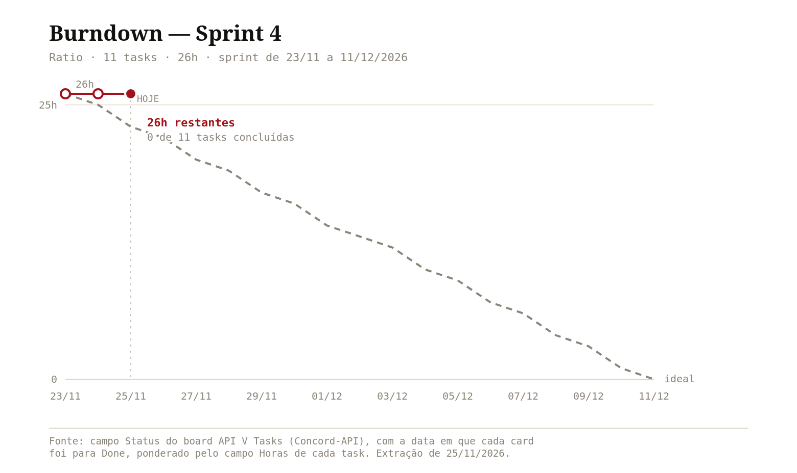

# Sprint Backlog — Sprint 4

**Window:** Nov 23 to Dec 11, 2026

**Board:** [GitHub Project](https://github.com/orgs/Concord-API/projects/5) · snapshot of Nov 25, 2026

**Definitions:** [Definition of Ready](../Docs/Scrum/definition-of-ready.md) · [Definition of Done](../Docs/Scrum/definition-of-done.md)

## Sprint goal

> **Ratio runs on the client's server with the monitoring installed, the path from the search to the topic is validated end to end before and after the fair on Dec 3, and each DevOps front has its documentation in API-5.**

A sprint with no stories: only `DVP-xx` tasks from the DevOps container, to validate how the product runs.

## Sprint summary

| | Total |
| --- | ---: |
| Tasks (done / total) | 0 / 11 |
| Hours (done / total) | 0h / 26h |
| Delivery and process | 11 (26h) |

### Hours by assignee

| Assignee | Tasks | Hours | Done |
| --- | ---: | ---: | ---: |
| joaoandrade17 | 7 | 9h | 0h |
| vp-p | 2 | 7h | 0h |
| RichardCordeiro | 1 | 6h | 0h |
| IsaacOliveiraSouza | 1 | 4h | 0h |

### Hours by layer

| Layer | Hours | Done |
| --- | ---: | ---: |
| Docs | 11h | 0h |
| DevOps | 10h | 0h |
| Test | 5h | 0h |

## Burndown

Remaining hours per day, from the board's `Status` field and each task's hours. Status on Nov 25, 2026.

## Delivery and process

Tasks `DVP-xx` (CI, deploy, QA, monitoring, database tests and documentation), also with no parent story.

_11 tasks · 26h · 0 done_

| # | Task | Front | Layer | Assignee | Est. | Status |
| --- | --- | --- | --- | --- | ---: | --- |
| [DVP-14](https://github.com/Concord-API/API-5/issues/183) | Add the end-to-end smoke test from search to theme detail | Testes | Test | vp-p | 5h | To do |
| [DVP-39](https://github.com/Concord-API/API-5/issues/292) | Document where the API integration tests live and which CI job runs them | Testes | Docs | vp-p | 2h | To do |
| [DVP-65](https://github.com/Concord-API/API-5/issues/376) | Document the database process in the API-5 repository | Docs | Docs | joaoandrade17 | 1h | To do |
| [DVP-68](https://github.com/Concord-API/API-5/issues/380) | Install the monitoring on the server after the first deploy | Deploy | DevOps | IsaacOliveiraSouza | 4h | To do |
| [DVP-79](https://github.com/Concord-API/API-5/issues/409) | Document the CI process in the API-5 repository | Docs | Docs | joaoandrade17 | 1h | To do |
| [DVP-80](https://github.com/Concord-API/API-5/issues/410) | Document the deploy process in the API-5 repository | Docs | Docs | joaoandrade17 | 1h | To do |
| [DVP-81](https://github.com/Concord-API/API-5/issues/411) | Document the QA process in the API-5 repository | Docs | Docs | joaoandrade17 | 1h | To do |
| [DVP-82](https://github.com/Concord-API/API-5/issues/412) | Document the monitoring process in the API-5 repository | Docs | Docs | joaoandrade17 | 1h | To do |
| [DVP-83](https://github.com/Concord-API/API-5/issues/413) | Document the test process in the API-5 repository | Docs | Docs | joaoandrade17 | 1h | To do |
| [DVP-84](https://github.com/Concord-API/API-5/issues/414) | Define the documentation standard and the folder structure of the API-5 repository | Docs | Docs | joaoandrade17 | 3h | To do |
| [DVP-85](https://github.com/Concord-API/API-5/issues/419) | Report the stalled work every weekday in an API-5 issue | QA | DevOps | RichardCordeiro | 6h | To do |
