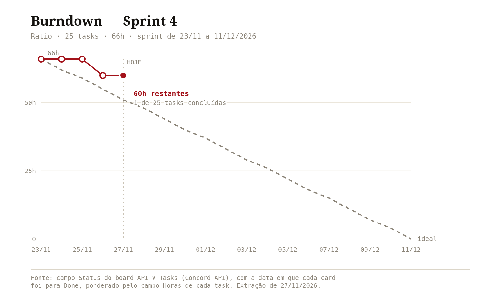

# Sprint Backlog — Sprint 4

**Janela:** 23/11 a 11/12/2026

**Board:** [GitHub Project](https://github.com/orgs/Concord-API/projects/5) · snapshot de 27/11/2026

**Definições:** [Definition of Ready](../Docs/pt_br/Scrum/definition-of-ready.md) · [Definition of Done](../Docs/pt_br/Scrum/definition-of-done.md)

## Meta da sprint

> **O usuário vê quais temas mudaram nos últimos dois anos e como os processos do tema foram decididos antes e depois da tese do STJ; o Ratio roda no servidor do cliente com o monitoramento instalado, o caminho da busca até o tema é validado de ponta a ponta antes e depois da feira de 03/12, e cada frente do DevOps tem a sua documentação no API-5.**

Stories que o time se compromete a entregar. Se alguma não for concluída, a sprint não atingiu a meta.

| ID | Prioridade | Descrição | SP | Tasks | Horas | Status |
| --- | --- | --- | ---: | ---: | ---: | --- |
| **US-42** | Should | Como **usuário**, quero ver quais temas mudaram nos últimos dois anos, com a taxa e a contagem de processos de cada período, para saber quais entendimentos estão virando antes de me apoiar em decisões mais antigas | 8 | 7 | 18h | A fazer |
| **US-43** | Should | Como **usuário**, quero ver no gráfico anual do tema a data em que o STJ julgou o tema repetitivo relacionado, e como os processos do tema foram decididos antes e depois dela, para saber se os tribunais mudaram de rumo depois da tese vinculante | 8 | 7 | 16h | A fazer |

## Resumo da sprint

| | Total |
| --- | ---: |
| Stories (meta / fora da meta) | 2 / 0 |
| Story points (meta / total) | 16 / 16 |
| Tasks (concluídas / total) | 1 / 25 |
| Horas (feitas / total) | 6h / 66h |
| Tasks em stories | 14 (34h) |
| Entrega e processo | 11 (32h) |

### Horas por responsável

| Responsável | Tasks | Horas | Concluído |
| --- | ---: | ---: | ---: |
| sem responsável | 14 | 34h | 0h |
| joaoandrade17 | 7 | 9h | 0h |
| RichardCordeiro | 2 | 7h | 6h |
| vp-p | 2 | 6h | 0h |
| IsaacOliveiraSouza | 2 | 5h | 0h |
| victorgsnogueira | 2 | 3h | 0h |
| JoaoBaranov | 1 | 1h | 0h |
| thiagosabreu | 1 | 1h | 0h |

_As horas de uma task com mais de um responsável são divididas igualmente entre eles._

### Horas por camada

| Camada | Horas | Concluído |
| --- | ---: | ---: |
| Backend | 17h | 0h |
| Docs | 17h | 0h |
| DevOps | 12h | 6h |
| Frontend | 11h | 0h |
| Test | 9h | 0h |

## Burndown

Horas restantes por dia, a partir do campo `Status` do board e das horas de cada task. Situação em 27/11/2026.

## Stories e tasks

### US-42 — Como usuário, quero ver quais temas mudaram nos últimos dois anos, com a taxa e a contagem de processos de cada período, para saber quais entendimentos estão virando antes de me apoiar em decisões mais antigas

_8 SP · Should · A fazer · 0/7 tasks · 18h_

Issue: [#426](https://github.com/Concord-API/API-5/issues/426)

| # | Task | Camada | Responsável | Est. | Status |
| --- | --- | --- | --- | ---: | --- |
| [42.1](https://github.com/Concord-API/API-5/issues/427) | Compute each topic's upheld rate in the earlier and the recent window | Backend | — | 4h | A fazer |
| [42.2](https://github.com/Concord-API/API-5/issues/428) | Keep only the shifts that pass the two-proportion test | Backend | — | 2h | A fazer |
| [42.3](https://github.com/Concord-API/API-5/issues/429) | Expose the shifting topics with both rates, n, direction, source and extraction date | Backend | — | 3h | A fazer |
| [42.4](https://github.com/Concord-API/API-5/issues/430) | Build the shifting topics block on the home page | Frontend | — | 4h | A fazer |
| [42.5](https://github.com/Concord-API/API-5/issues/431) | Show the shift in the result item and in the theme header | Frontend | — | 2h | A fazer |
| [42.6](https://github.com/Concord-API/API-5/issues/432) | Test that a shift under the n floor or not significant never shows | Test | — | 2h | A fazer |
| [42.7](https://github.com/Concord-API/API-5/issues/433) | Document the shift rule in the dimensional model docs | Docs | — | 1h | A fazer |

### US-43 — Como usuário, quero ver no gráfico anual do tema a data em que o STJ julgou o tema repetitivo relacionado, e como os processos do tema foram decididos antes e depois dela, para saber se os tribunais mudaram de rumo depois da tese vinculante

_8 SP · Should · A fazer · 0/7 tasks · 16h_

Issue: [#434](https://github.com/Concord-API/API-5/issues/434)

| # | Task | Camada | Responsável | Est. | Status |
| --- | --- | --- | --- | ---: | --- |
| [43.1](https://github.com/Concord-API/API-5/issues/435) | Pick the related repetitive theme of each topic by the highest declared similarity | Backend | — | 2h | A fazer |
| [43.2](https://github.com/Concord-API/API-5/issues/436) | Compute the topic's upheld rate before and after the precedent's judgment date | Backend | — | 4h | A fazer |
| [43.3](https://github.com/Concord-API/API-5/issues/437) | Expose the before and after with the precedent, its date, both n, source and link method | Backend | — | 2h | A fazer |
| [43.4](https://github.com/Concord-API/API-5/issues/438) | Mark the precedent's judgment date on the yearly chart | Frontend | — | 3h | A fazer |
| [43.5](https://github.com/Concord-API/API-5/issues/439) | Write the before and after sentence below the chart | Frontend | — | 2h | A fazer |
| [43.6](https://github.com/Concord-API/API-5/issues/440) | Test the topic without enough cases on either side of the date | Test | — | 2h | A fazer |
| [43.7](https://github.com/Concord-API/API-5/issues/441) | Document the before and after rule in the dimensional model docs | Docs | — | 1h | A fazer |

## Entrega e processo

Tasks `DVP-xx` (CI, deploy, QA, monitoramento, testes de banco e documentação), também sem story-mãe.

_11 tasks · 32h · 1 concluídas_

| # | Task | Frente | Camada | Responsável | Est. | Status |
| --- | --- | --- | --- | --- | ---: | --- |
| [DVP-14](https://github.com/Concord-API/API-5/issues/183) | Add the end-to-end smoke test from search to theme detail | Testes | Test | vp-p | 5h | A fazer |
| [DVP-65](https://github.com/Concord-API/API-5/issues/376) | Document the database process in the API-5 repository | Docs | Docs | joaoandrade17, JoaoBaranov | 2h | A fazer |
| [DVP-68](https://github.com/Concord-API/API-5/issues/380) | Install the monitoring on the server after the first deploy | Deploy | DevOps | IsaacOliveiraSouza | 4h | A fazer |
| [DVP-79](https://github.com/Concord-API/API-5/issues/409) | Document the CI process in the API-5 repository | Docs | Docs | victorgsnogueira, joaoandrade17 | 2h | A fazer |
| [DVP-80](https://github.com/Concord-API/API-5/issues/410) | Document the deploy process in the API-5 repository | Docs | Docs | IsaacOliveiraSouza, joaoandrade17 | 2h | A fazer |
| [DVP-81](https://github.com/Concord-API/API-5/issues/411) | Document the QA process in the API-5 repository | Docs | Docs | RichardCordeiro, joaoandrade17 | 2h | A fazer |
| [DVP-82](https://github.com/Concord-API/API-5/issues/412) | Document the monitoring process in the API-5 repository | Docs | Docs | thiagosabreu, joaoandrade17 | 2h | A fazer |
| [DVP-83](https://github.com/Concord-API/API-5/issues/413) | Document the test process in the API-5 repository | Docs | Docs | joaoandrade17, vp-p | 2h | A fazer |
| [DVP-84](https://github.com/Concord-API/API-5/issues/414) | Define the documentation standard and the folder structure of the API-5 repository | Docs | Docs | joaoandrade17 | 3h | A fazer |
| [DVP-85](https://github.com/Concord-API/API-5/issues/419) | Report the stalled work every weekday in an API-5 issue | QA | DevOps | RichardCordeiro | 6h | Concluído |
| [DVP-86](https://github.com/Concord-API/API-5/issues/442) | Refresh the pipeline schema fixture and publish the load at the new schema version | BD | DevOps | victorgsnogueira | 2h | A fazer |
